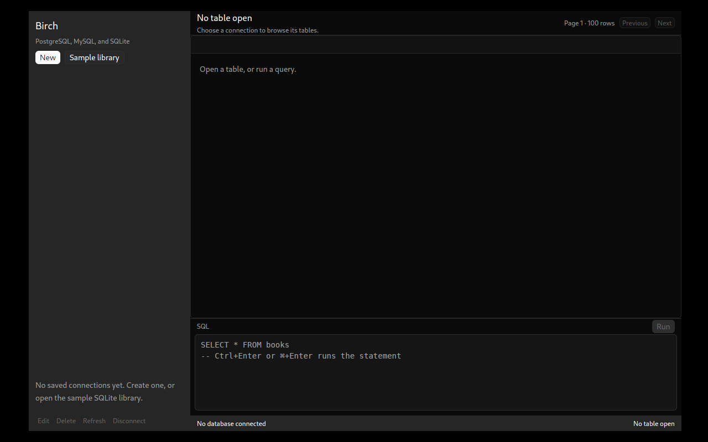

# Sela

[](https://github.com/nesso99/sela/actions/workflows/ci.yml)

Sela is a native desktop database client for PostgreSQL, MySQL, and SQLite. Early TablePlus-style slice: save a connection, browse schemas and tables, open tabs, page or stream results, cancel queries, and inspect structure — built with Rust and [GPUI](https://github.com/zed-industries/zed/tree/main/crates/gpui) via [GPUI Kit](https://github.com/longbridge/gpui-kit) **0.10.0**.



*Replace with a current product screenshot.*

## Quick start

Prebuilt binaries (Linux AppImage/`tar.gz`, macOS arm64 DMG/zip, Windows zip) are attached to [GitHub Releases](https://github.com/nesso99/sela/releases). See [installation](docs/user/installation.md) for Gatekeeper / SmartScreen caveats and Linux Vulkan runtime deps.

To build from source: Rust **1.85+**, a C toolchain, and `pkg-config`.

```bash
cargo build --workspace
cargo run -p sela-app
```

Sample SQLite library: sidebar **Sample library**, or seed your own with `scripts/seed-sqlite.sql`. Local Postgres/MySQL: `docker compose up -d` (user/password/db `sela`/`sela`/`sample`).

## Feature status

| Area | Status |
| --- | --- |
| Connections (PG / MySQL / SQLite), passwords in OS keychain | Done |
| TLS modes + CA/client cert paths (PG / MySQL); config schema v2 | Done (M1-8) |
| Schema / table / view sidebar | Done |
| Virtualized grid, typed cells, bounded result window | Done |
| Run SQL, cancel, streaming + load-more | Done |
| Read-only Structure view | Done |
| Tabs (open / close / switch / restore) | Done |
| Filter bar + column sort (table tabs) | Done |
| Query history (FTS, per-connection scope) | Done (M1-5) |
| Grid selection + copy (TSV/CSV/JSON/INSERT); light/dark/system themes | Done (M1-7) |
| Safe mode (editor) | Done (M2-4) — [safe mode](docs/user/safe-mode.md) |
| Inline edit, connection color / groups | Done (M2) — [safe mode](docs/user/safe-mode.md), [connecting](docs/user/connecting.md) |
| SSH tunnel | Core done (M3-1); connection-dialog UI later — [roadmap](docs/design/roadmap.md) |
| Export CSV/JSON/SQL + CSV import | Core done (M3-3); UI follows [11-export-import](docs/design/ux/11-export-import.md) — [export-import](docs/user/export-import.md) |
| Command palette + quick open | Done (M3-4) — Cmd/Ctrl+P tables, Cmd/Ctrl+Shift+P actions; [keyboard shortcuts](docs/user/keyboard-shortcuts.md) |

## Documentation

| Doc | Path |
| --- | --- |
| Install | [docs/user/installation.md](docs/user/installation.md) |
| Connecting | [docs/user/connecting.md](docs/user/connecting.md) |
| Safe mode | [docs/user/safe-mode.md](docs/user/safe-mode.md) |
| Keyboard shortcuts | [docs/user/keyboard-shortcuts.md](docs/user/keyboard-shortcuts.md) |
| Filtering & sorting | [docs/user/filtering.md](docs/user/filtering.md) |
| Query history | [docs/user/query-history.md](docs/user/query-history.md) |
| Copying grid data | [docs/user/copying.md](docs/user/copying.md) |
| Export / CSV import | [docs/user/export-import.md](docs/user/export-import.md) |
| Themes | [docs/user/themes.md](docs/user/themes.md) |
| FAQ | [docs/user/faq.md](docs/user/faq.md) |
| Architecture | [docs/dev/architecture.md](docs/dev/architecture.md) |
| Building & testing | [docs/dev/building-and-testing.md](docs/dev/building-and-testing.md) |
| Grid benchmarks | [docs/dev/benchmarks.md](docs/dev/benchmarks.md) |
| PRD | [docs/design/PRD.md](docs/design/PRD.md) |
| Specs | [docs/design/SPECS.md](docs/design/SPECS.md) |
| Roadmap | [docs/design/roadmap.md](docs/design/roadmap.md) |
| UX specs | [docs/design/ux/README.md](docs/design/ux/README.md) |
| ADRs | [docs/adr/](docs/adr/) |
| Contributing | [CONTRIBUTING.md](CONTRIBUTING.md) |
| Changelog | [CHANGELOG.md](CHANGELOG.md) |
| Security | [SECURITY.md](SECURITY.md) |

## License

Sela is licensed under **GPL-3.0-or-later**. See [`LICENSE`](LICENSE).
