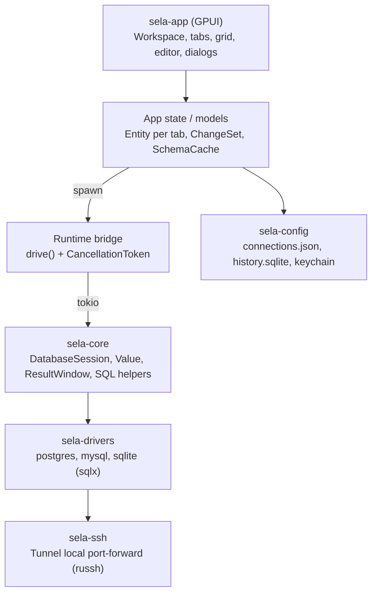

> Source of truth: this file.

# Technical specs — Sela

Architecture, APIs, data model, execution, config, testing, and per-feature specs. Product intent lives in [PRD.md](./PRD.md); milestones in [roadmap.md](./roadmap.md). UX specs for the window, filter/sort, and SQL editor live in [ux/](./ux/README.md). Contribution process: [CONTRIBUTING.md](../../CONTRIBUTING.md). Condensed overview: [architecture.md](../dev/architecture.md).

**License:** GPL-3.0-or-later (see root `LICENSE`).  
**Name:** Sela (Birch retired). Crates: `sela-core`, `sela-drivers`, `sela-config`, `sela-app` (binary `sela`). Keychain service `app.sela.database`. Config under `~/.config/sela/` (macOS Application Support / Windows `%APPDATA%\Sela\`), override `SELA_CONFIG_DIR`.

---

## Architecture



UI never talks to sqlx directly. Library crates stay free of GPUI so CI can test them without a GPU.

### Crates layout

```text
crates/
  sela-core/     # DatabaseSession, Value, ResultWindow, SQL builder, ChangeSet/ChangePlan, structure types
  sela-drivers/  # postgres.rs, mysql.rs, sqlite.rs, stream, decode, runtime, apply_changes; opens sela-ssh
  sela-ssh/      # SSH tunnel (russh), known_hosts; Import-only ~/.ssh/config Host alias → resolved fields
  sela-config/   # connections.json, SecretStore / keyring
  sela-app/      # GPUI binary `sela`: workspace/, grid/, form/, examples/grid_bench
  # planned:
  sela-testkit/  # fixtures, docker helpers, golden SQL
```

---

## Driver / session API

Current trait (`sela-core::DatabaseSession`):

```rust
#[async_trait]
pub trait DatabaseSession: Send + Sync {
    fn dialect(&self) -> Dialect;

    async fn list_schemas(&self) -> Result<Vec<SchemaInfo>, DbError>;
    async fn list_tables(&self, schema: &str) -> Result<Vec<TableInfo>, DbError>;

    async fn query(&self, sql: &str) -> Result<QueryPage, DbError>;
    async fn execute(&self, sql: &str) -> Result<u64, DbError>;
    async fn count_query(&self, sql: &str) -> Result<u64, DbError>;

    async fn estimate_table_rows(&self, schema: &str, table: &str)
        -> Result<Option<u64>, DbError>;
    async fn describe_table(&self, schema: &str, table: &str)
        -> Result<TableStructure, DbError>;
    async fn table_ddl(&self, schema: &str, table: &str) -> Result<String, DbError>;

    async fn stream_query(
        &self,
        sql: &str,
        batch_size: usize,
        row_cap: Option<Arc<AtomicUsize>>,
        finish_at_cap: bool,
        cancel: CancellationToken,
        sink: async_channel::Sender<StreamBatch>,
    ) -> Result<StreamOutcome, DbError>;
}
```

Helpers: `run_user_sql`, `preview_table`, `exact_table_rows`, `is_safe_to_rerun_for_load_more`.

`DatabaseSession::apply_changes(&ChangePlan, CancellationToken)` runs pending grid edits in one transaction (M2-2 / #68). Cancel rolls the transaction back.

**Direction (M2+):** evolve toward a richer `Session` with `Capabilities` and an optional `CancelHandle`, while keeping drivers behind this boundary.

### Async bridge

- Global Tokio runtime (multi-worker) for DB work.
- UI uses `cx.spawn`; inside, `drive(work)` runs on Tokio and awaits a `JoinHandle`, then `this.update` if the request id still matches.
- Each task gets a `CancellationToken`; Stop / Cmd+. / closing a tab cancels the token and triggers server-side cancel when supported.
- Panics in DB tasks map to `DbError::Internal` (app must not crash).
- Request ids are scoped per tab.

### Connection manager (target)

- Small pool for metadata (`max_connections` ~5) plus a dedicated connection per query tab (so cancel / transactions attach correctly) — shared pool today; per-tab connection is a follow-up.
- States: Disconnected → Connecting → Connected → Reconnecting → Failed.
- Connect timeout 12 s; keepalive and reconnect for tabs without an open transaction (planned).
- SSH (M3-1): `sela-ssh` opens the tunnel first; the driver dials `127.0.0.1:<ephemeral>`; closing the session closes the tunnel. Auth: password, private key (+ passphrase), ssh-agent; default for new SSH settings is PrivateKey. Import from `~/.ssh/config` is explicit only: choosing a Host alias copies the resolved HostName/User/Port/IdentityFile into the saved connection (`host`, `port`, `user`, `private_key_path`); connect never re-reads the config. ProxyJump/ProxyCommand → clear unsupported error. known_hosts: match allows; changed key is a hard error (no override); unknown key returns a typed challenge with fingerprint — the caller must confirm before the key is written. Paths (config, known_hosts, home) are injectable for tests. SQLite rejects enabled SSH. SSH passwords/passphrases use the OS keychain (`{id}:ssh-password` / `{id}:ssh-passphrase`), never JSON. Failures are [`DbError::Ssh`].

---

## Data model (`Value`)

```rust
pub enum Value {
    Null,
    Bool(bool),
    Int(i64),
    UInt(u64),
    Float(f64),
    Decimal(Decimal),       // exact NUMERIC/DECIMAL
    Text(Arc<str>),
    Bytes(Vec<u8>),
    Uuid(Uuid),
    Json(Arc<str>),         // raw JSON text; parse lazily
    Date(NaiveDate),
    Time(NaiveTime),
    Timestamp(NaiveDateTime),
    TimestampTz(DateTime<FixedOffset>),
    Interval(Interval),
    Other { type_name: String, text: Arc<str> }, // unsupported or decode-error marker
}
```

Rules:

- Decode errors become `Other` / `DbError::Decode` paths — **never** silent `Null`.
- Grid display uses `truncate_one_line` (~200 Unicode scalars, newlines → `⏎`) with a per-cell cache (`CELL_DISPLAY_MAX_CHARS`).
- Copy / export uses full `Value::display()`.

### `ResultWindow` (M1-2a)

- Keeps at most `ROW_WINDOW_MAX_PAGES` (16) pages of `PAGE_SIZE` (100) rows; raising the cap allows a larger materialized window.
- Pages load on demand as the viewport moves; streaming inserts via `insert_page`.
- Wide Json RSS is bounded by the window, not by retaining 100k owned trees.

See [benchmarks.md](../dev/benchmarks.md).

---

## Errors (`DbError`)

```rust
pub enum DbError {
    Connection { message, sqlstate, vendor_code },
    Tls { message, sqlstate, vendor_code },
    Auth { message, sqlstate, vendor_code },
    Query { message, sqlstate, vendor_code },
    Timeout { message, sqlstate, vendor_code },
    Cancelled { message, sqlstate, vendor_code },
    Decode { message, sqlstate, vendor_code },
    Config { message, sqlstate, vendor_code },
    Internal { message, sqlstate, vendor_code },
}
```

- Drivers map vendor / sqlx failures and preserve SQLSTATE / MySQL errno when available.
- `sqlx::Error::Tls` and Io/Protocol messages that are certificate/rustls failures (`invalid peer certificate`, `UnknownIssuer`, `NotValidForName`, …) map to [`DbError::Tls`], distinct from [`Auth`] / [`Connection`].
- UI shows `Display` text; never log passwords or connection strings that embed passwords.
- Errors must not silently become NULL, empty success, or a wrong success path (see [CONTRIBUTING.md](../../CONTRIBUTING.md) checklist).

Future variants considered earlier (Ssh, Syntax { position }, Constraint, Permission) can be added as needs arise without collapsing classification.

---

## Execution, cancel, streaming, paging

| Concern | Behavior |
| --- | --- |
| Table preview | `LIMIT`/`OFFSET` pages via `pending_pages`; estimate (`pg_class.reltuples` / `information_schema.tables.TABLE_ROWS` / SQLite `None`); Exact count button |
| Filter / sort (M1-3) | `build_table_page` / `build_table_count` in `sela-core`; identifiers quoted; values bound; filter ⇒ Unknown count until Exact; header sort via `ORDER BY` |
| Arbitrary SQL | **Not wrapped** in `SELECT * FROM (…) LIMIT`; stream up to `DEFAULT_SQL_ROW_CAP` (1000) with load-more |
| Load-more | Raises live `AtomicUsize` cap on an open stream; if stream is gone, re-run only when `is_safe_to_rerun_for_load_more` (read-only `SELECT`/`VALUES`, `WITH` without DML, `SHOW`, `EXPLAIN` without `ANALYZE`); else “Result capped at N rows” |
| Streaming | `sqlx` `fetch()` → batches (`STREAM_BATCH_SIZE`) over `async_channel` → `ResultWindow`; columns from first row (describe when 0 rows) |
| Cancel | `CancellationToken`; Stop + Cmd+./Ctrl+.; PG `pg_cancel_backend(pid)` / MySQL `KILL QUERY` from a **second** pool connection; then close the cancelled connection so the next checkout is clean |
| SQLite cancel | Drop the fetch stream only (sqlx has no interrupt) — documented limitation |
| Multi-statement | Sequential run via dialect-aware `split_statements(sql, dialect)` (Postgres dollar quotes; MySQL vs PG/SQLite backslash rules); up to 8 result snapshots per tab |

**Known limitation:** text classifier treats `SELECT my_func()` as safe for load-more re-run even if the function has side effects.

**Follow-ups:** idle timeout for streams paused at the cap; bound/LRU structure cache; real-GPU re-measure.

---

## Config and secrets

Paths:

| OS | Path |
| --- | --- |
| Linux | `$XDG_CONFIG_HOME/sela/connections.json` or `~/.config/sela/connections.json` |
| macOS | `~/Library/Application Support/Sela/connections.json` |
| Windows | `%APPDATA%\Sela\connections.json` |

`SELA_CONFIG_DIR` overrides the directory. File mode `0600` on Unix. Atomic write (temp + rename).

Keychain: service `app.sela.database` via `keyring` v3 with platform features (`apple-native`, `windows-native`, `sync-secret-service` + `crypto-rust`). Account = connection id for the DB password. Fallback: keep the password in process memory and tell the user on the status bar (`MemorySecretStore` / `CachingSecrets`). Passwords never enter `connections.json`. Builds must not use keyring’s mock default store.

### Config schema v2 (M1-8) — done

`schema_version` is **2**. **No migration code** — a v1 file still loads; the next save writes v2. See [ADR 0006](../adr/0006-no-migrations-before-release.md). When `tls` is absent, the legacy boolean `ssl` is read in memory only: `ssl: true` → `require`, `ssl: false` / missing → `disable` (the previous checkbox default). The boolean is never rewritten; the next save emits `tls` (or omits it when still default).

TLS fields on each connection (Postgres / MySQL only; SQLite ignores them in the UI and on connect):

| Field | Values / notes |
| --- | --- |
| `tls.mode` | `disable` (serde / missing-`tls` default) / `prefer` (new Postgres/MySQL connection default) / `require` / `verify-ca` / `verify-full` |
| `tls.ca_path` | Optional CA PEM path (required for verify-ca / verify-full) |
| `tls.client_cert_path` / `tls.client_key_path` | Optional; both set or both empty. Paths only; keys must be unencrypted PEM today |

Mapped to sqlx: Postgres `PgSslMode::{Disable,Prefer,Require,VerifyCa,VerifyFull}`; MySQL `MySqlSslMode::{Disabled,Preferred,Required,VerifyCa,VerifyIdentity}`. `verify-ca` verifies the CA chain and skips hostname checks (sqlx ≥ 0.9 includes [sqlx#3861](https://github.com/launchbadge/sqlx/pull/3861)).

Current on-disk shape (fields beyond TLS land in later milestones):

```json
{
  "schema_version": 2,
  "connections": [{
    "id": "uuid",
    "name": "prod-orders",
    "engine": "postgres",
    "host": "10.0.0.5",
    "port": 5432,
    "username": "app",
    "database": "orders",
    "tls": {
      "mode": "verify-full",
      "ca_path": "/path/to/ca.pem",
      "client_cert_path": "/path/to/client.crt",
      "client_key_path": "/path/to/client.key"
    }
  }]
}
```

Postgres TLS is covered in CI (`db-tls-postgres`): throwaway certs generated in the job; `require` succeeds; `verify-ca` to `127.0.0.1` with a `localhost`-only SAN succeeds (hostname skipped); `verify-full` against `127.0.0.1` fails as `DbError::Tls`; `hostssl`-only `disable` fails as a non-Tls connection error. MySQL live TLS and passphrase-protected client keys remain follow-ups.

History / saved queries (M1-5): `history.sqlite` with FTS5 on `sql`, Unix mode `0600`, global cap 10 000 rows (oldest dropped after each insert). Per-connection `record_history` defaults to true (no schema bump). Catalog / Structure / paging / Count / filter / load-more SQL is not recorded. Rerun confirms unless `is_safe_to_rerun_for_load_more` passes.

Env for integration tests: `SELA_POSTGRES_URL`, `SELA_MYSQL_URL` (optional schema overrides `SELA_POSTGRES_SCHEMA`, `SELA_MYSQL_SCHEMA`). TLS suite: `SELA_PG_TLS_URL`, `SELA_PG_TLS_CA` (see [building-and-testing.md](../dev/building-and-testing.md)).

---

## Testing

| Layer | Content | Where |
| --- | --- | --- |
| Unit | SQL builder, classify / split / load-more safety, `ResultWindow`, config, fake `SecretStore` | Every PR, 3 OS (Windows gated) |
| Integration SQLite | Introspection, types, paging/stream, cancel behavior | Every PR, no service |
| Integration PG/MySQL | Same suite via docker-compose / CI services; cancel + streaming | CI Linux `db-integration`; local `docker compose up` |
| SSH | openssh-server bastion in front of PG (+ MySQL); `scripts/run-ssh-bastion.sh`; skip unless `SELA_SSH_*` | CI Linux `ssh-integration` (proposed) |
| UI | GPUI headless state tests; Xvfb + lavapipe smoke | CI Linux; manual macOS/Windows each release |
| Perf | `grid_bench`, `value_display` bench; flag >10% regressions | Nightly / when grid code changes |
| Licenses | `cargo deny check licenses bans sources` (see `deny.toml`; project is GPL-3.0-or-later) | Every PR + push (`cargo-deny` CI job) |

Rule: tests assert **observable behavior**; every bugfix gets a regression test.

---

## Grid

- **Decision:** keep gpui-component `DataTable` (row + column virtualization). Do not rewrite for virtualization; memory was the risk ([benchmarks.md](../dev/benchmarks.md), [ADR 0001](../adr/0001-keep-datatable.md)).
- Selection / copy / themes: M1-7 (done — grid selection + clipboard formats; `settings.json` theme preference).
- Pending-change overlay: M2.
- Column width: auto-fit from first ~100 rows; remember per table (planned).

---

## SQL editor

- Today: GPUI `Editor`, statement-at-caret / selection / run-all, multi-result strip; autocomplete is M3-2.
- M1-4: code editor with highlight, statement-at-cursor, multi-statement (via `split_statements`). Format (`sqlformat`) is backlog, not M1-4. UX: [ux/03-sql-editor.md](./ux/03-sql-editor.md).
- M3-2: autocomplete from `SchemaCache` + dialect keywords.

---

## Schema introspection

| Engine | Metadata source | Notes |
| --- | --- | --- |
| PostgreSQL | Prefer `pg_catalog` (`pg_class`, `pg_attribute`, `pg_index`, `pg_constraint`, `pg_get_indexdef`, `pg_get_constraintdef`) | Structure view (M1-6) uses catalog paths; estimates via `reltuples` |
| MySQL | `information_schema` + `SHOW CREATE TABLE` | Schema = database; estimate via `TABLE_ROWS` |
| SQLite | `sqlite_schema` / `sqlite_master`, `pragma_table_info`, index/FK pragmas | DDL from `sql` column |

`TableStructure`: columns (name, type, nullable, default, comment), indexes, foreign keys, full DDL string.

---

## Pending edits and safe mode (M2)

Core (M2-1 / M2-2) lives in `sela-core` (`change_set`, `change_plan`) and `DatabaseSession::apply_changes` in drivers. Grid overlay / commit UI is M2-3.

```rust
pub struct ChangeSet { /* table, pk_columns, columns, pending RowChange list */ }
pub enum RowChange {
    Update { pk: Vec<Value>, cells: BTreeMap<String, CellChange> },
    Insert { id: u64, values: BTreeMap<String, Value> },
    Delete { pk: Vec<Value> },
}
pub struct ChangePlan {
    pub dialect: Dialect,
    pub table: TableRef,
    pub statements: Vec<PlannedStatement>, // DELETE, then UPDATE, then INSERT
}
```

- Edit only with a primary key (`ChangeSet::try_new` / `from_structure`); otherwise `ChangeError::NoPrimaryKey`.
- Always bound parameters; reuse `quote_ident` / `qualify` / `bind_placeholder`.
- `UPDATE`/`DELETE` `WHERE` always includes PK columns (`IS NULL` for null PK parts) **and** comparable previous non-PK values (optimistic concurrency, always on — #68). NULL old values use `IS NULL` (no bind). Skips `Value::Other`, Postgres `json` (keeps `jsonb`), MySQL JSON, XML, geometric types, and blobs over 4 KiB; Preview lists `-- unchecked optimistic: …`. UPDATE uses each edited cell’s `old_value`; DELETE uses `RowChange::Delete::expected` (UI supplies the loaded-row snapshot).
- Commit: driver `apply_changes(plan, cancel)` → BEGIN → Delete, Update, Insert → COMMIT; on error or cancel ROLLBACK and keep `ChangeSet` (caller does not clear). Stop / `secondary-.` / pending-bar Cancel via the same `CancellationToken` path as streaming queries (Postgres `pg_cancel_backend` / MySQL `KILL QUERY` from a second pool checkout — skipped if the 5-conn pool is exhausted; SQLite cooperative between statements only). UI cancel copy: `Commit cancelled. No changes were saved.`
- Each UPDATE/DELETE must affect exactly one row; otherwise `DbError::ChangeConflict` (statement index + PK display) and rollback — including when a concurrent non-PK edit makes the optimistic predicate match zero rows. UI conflict copy + Refresh: [08-preview-commit.md](./ux/08-preview-commit.md). INSERT is not checked this way. MySQL uses `CLIENT_FOUND_ROWS` (sqlx default + explicit `.found_rows(true)`) so same-value UPDATE still reports one matched row.
- `ChangePlan::preview_sql` / preview sheet render literals including optimistic predicates and unchecked columns; executable SQL stays bound.
- Golden tests per dialect under `crates/sela-core/tests/change_plan_snapshots/` (OW-01); driver integration covers cancel + conflict (CAN-* / OW-*); see [v0.3-test-plan.md](../qa/v0.3-test-plan.md).

Safe mode per connection: Off / Confirm writes / Read-only (`safe_mode` on `SavedConnection`, M2-4). Classify with `classify_statement_safety` (`sqlparser`) for no-WHERE writes and writes inside CTEs. Apply to editor and history Rerun; `decide_grid_commit_gate` for grid Commit when that UI lands. Production-tagged (Red) connections default to Confirm writes when the color UI (M2-5) lands — see [09-safe-mode.md](./ux/09-safe-mode.md).

---

## Packaging (M4)

- macOS: universal `.app` + `.dmg`, Developer ID + notarize.
- Linux: AppImage and `.deb` (then Flatpak); document Vulkan deps.
- Windows: MSI/NSIS, code-signed; Credential Manager.
- `cargo-packager` (or similar) on tag; checksums + changelog.
- Automatic updates after v1 (GitHub Releases, user confirms).

---

## Per-feature status (M1 slice)

| Feature | Spec pointer | Status |
| --- | --- | --- |
| M1-2a Result model | `ResultWindow`, lazy Json, display cache | Done (#9) |
| M1-2b Cancel / stream / estimates / SQL cap | This file § Execution | Done (#10) |
| M1-1 Tabs | Per-tab state, cancel-on-close, `tabs.json` | Done (#12) |
| M1-6 Structure view | `describe_table` / `TableStructure` | Done (#11) |
| M1-3 Filter / sort | [ux/02-filter-sort-review.md](./ux/02-filter-sort-review.md); `filter.rs` + bound stream/count | Done (#17, #22) |
| M1-4 Editor | [ux/03-sql-editor.md](./ux/03-sql-editor.md) | Implemented (Editor UI; highlight via default monospace, not tree-sitter SQL) |
| M1-5 History | `history.sqlite` FTS; [ux/04-query-history.md](./ux/04-query-history.md) | Done (#25) |
| M1-7 Selection / copy / themes | Grid selection + TSV/CSV/JSON/INSERT; light/dark/system themes; result-strip a11y | Done (#24) |
| M1-8 TLS + config v2 | No migration; schema_version 2; `DbError::Tls`; Postgres TLS CI | Done (#15) |
| M1-9 PG text-cast fallback | `pg_decode` strategies | Done (#13) |

---

## Contributing

See [CONTRIBUTING.md](../../CONTRIBUTING.md) for the fork/branch workflow, local checks, and pull request checklist.
