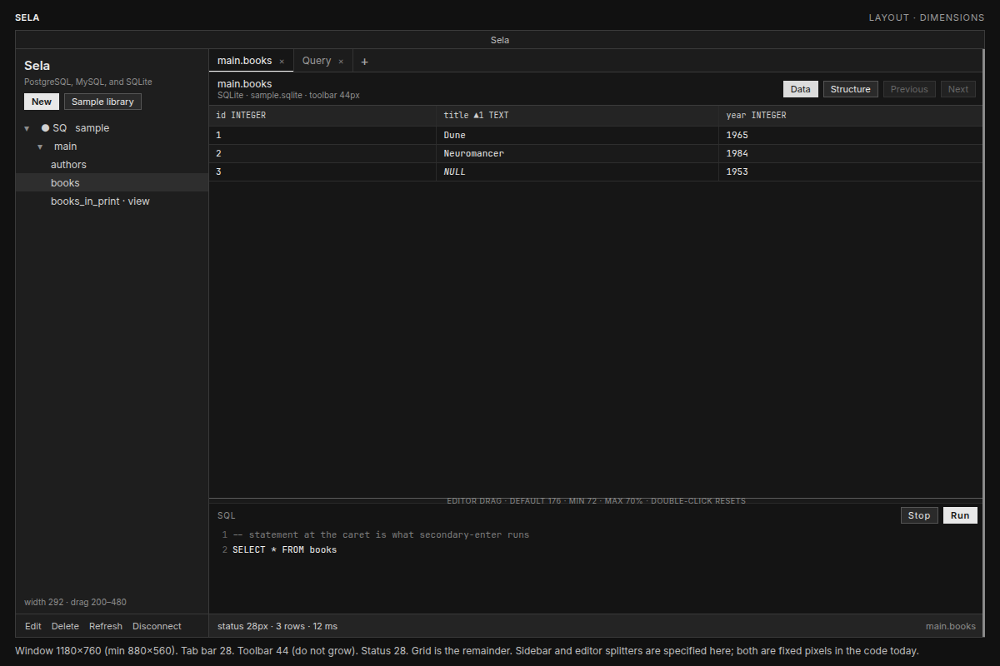
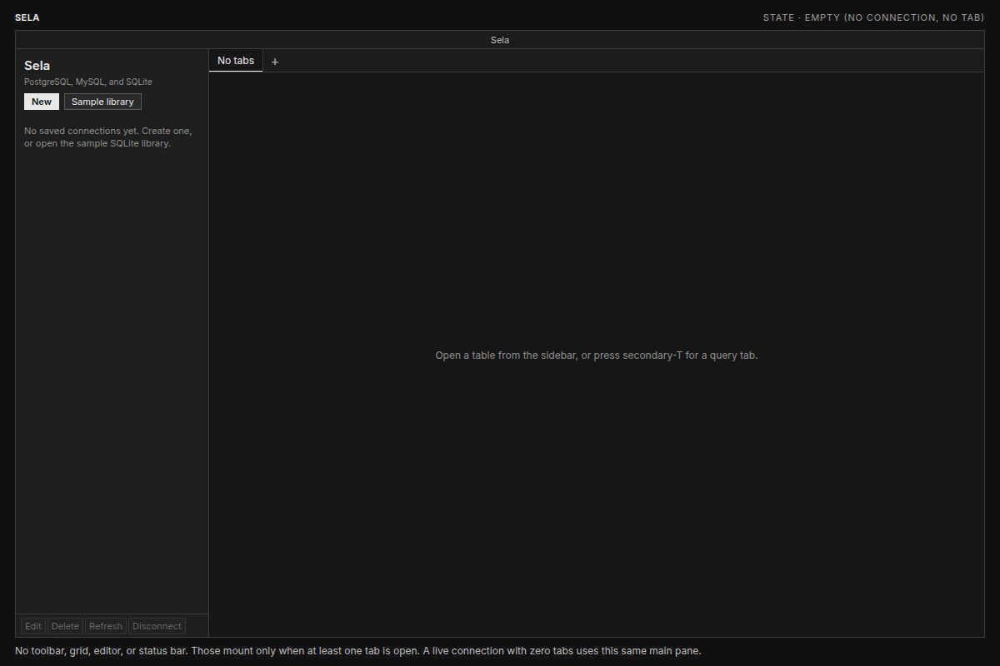
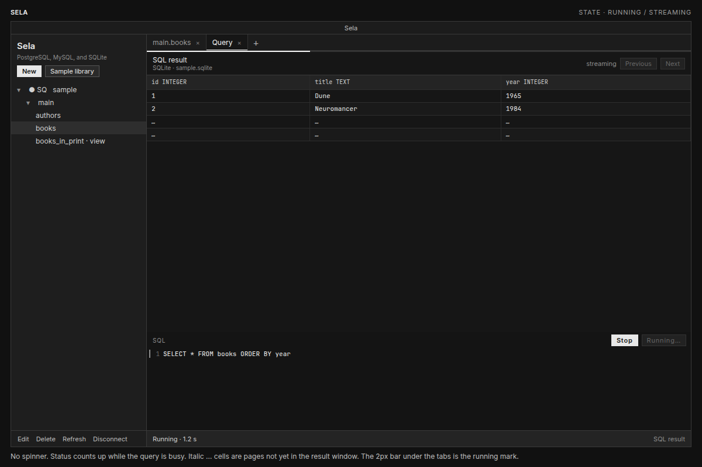
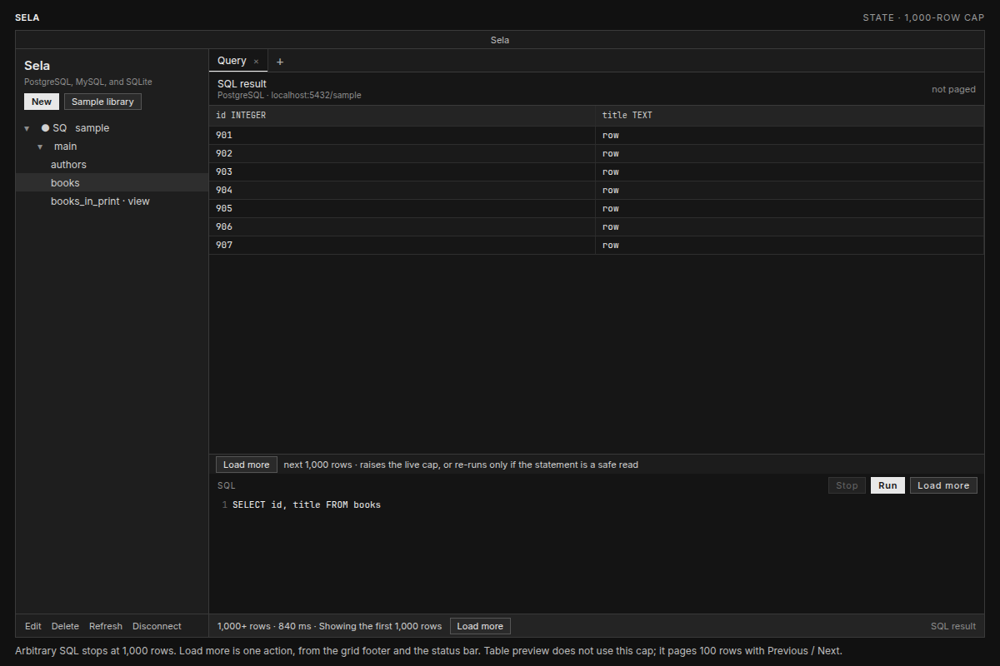
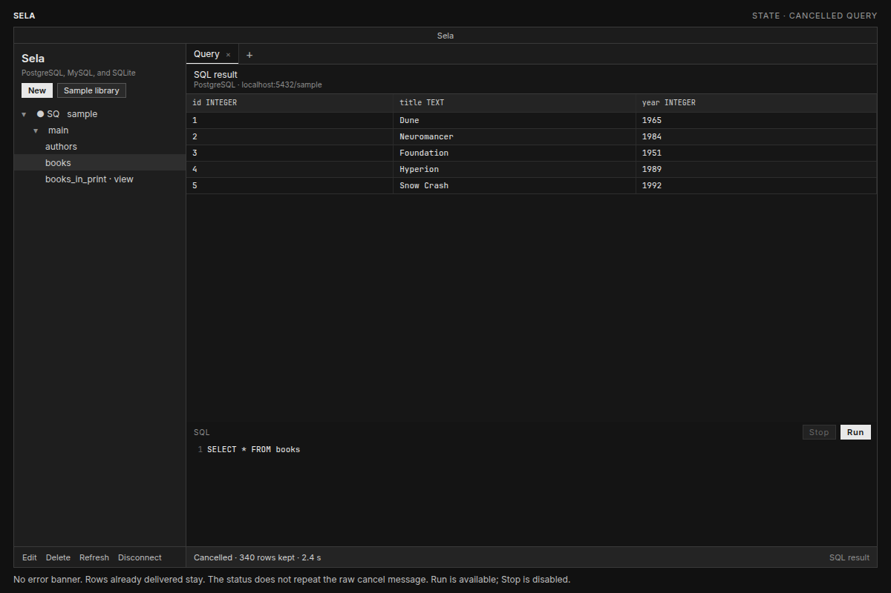
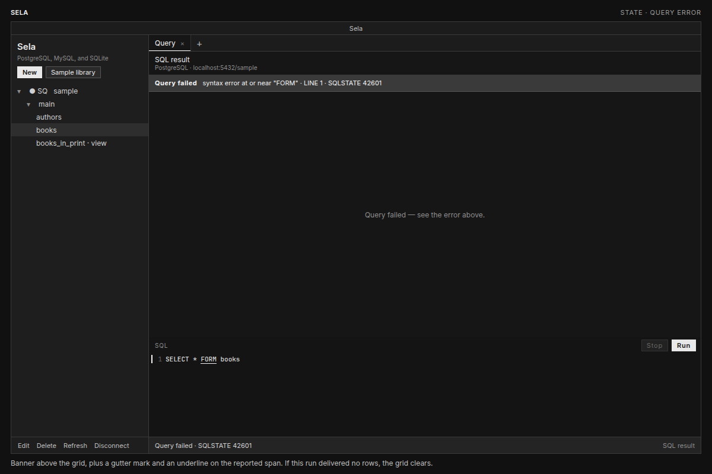
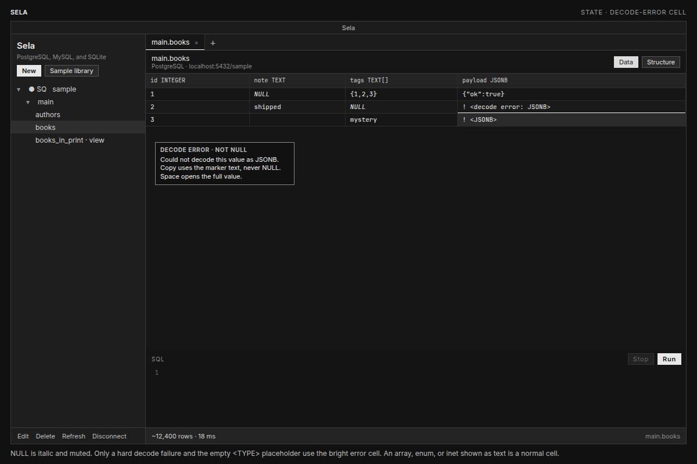

# Main window

The Sela window is one sidebar and one content column. The content column is a tab bar, a toolbar, an optional error banner, the results (grid or Structure), the SQL editor, and a status bar. Nothing in this layout is a card. Regions meet on 1px borders.

This spec matches the window in `crates/sela-app/src/ui/workspace/` and the shortcuts in `crates/sela-app/src/ui/mod.rs`. Filter-bar behavior is specified in [02-filter-sort-review.md](./02-filter-sort-review.md). The editor split, autocomplete, and gutter errors are specified in [03-sql-editor.md](./03-sql-editor.md). Shortcut notation is in [README.md](./README.md). Quit and the close control are in [Quit and window lifecycle](#quit-and-window-lifecycle).

## Regions

Default window size is 1180×760, minimum 880×560 (`ui/mod.rs`). The OS title bar says “Sela” and is not drawn by the workspace.

| Region | Size | Where it is set today | Resize |
| --- | --- | --- | --- |
| Sidebar | 292px default | `sidebar.rs`, `w(px(292.))`, `flex_shrink_0` | Drag the right edge. Min 200, max 480. Double-click returns to 292. |
| Tab bar | 28px | `tabs.rs` `TabBar`, no explicit height | Fixed. |
| Toolbar | 44px | `content.rs` `toolbar`, `h(px(44.))` | Fixed. Do not grow it. A later density pass may take it to 32px. Not part of M1-3. |
| Filter bar | 26px per row, plus a 20px SQL line | Not built | Opens under the toolbar. Height comes out of the grid. |
| Error banner | Up to about 60px, then scroll | `content.rs` `error_banner` | Grows with the message, then scrolls. |
| Grid or Structure | Remainder | `results_area` is `flex_1` | Shrinks when the editor, filter bar, or banner grows. |
| Editor splitter | 1px line, 5px hit target | Not built. Editor is `h(px(176.))` | Drag vertically. |
| SQL editor | 176px default | `content.rs` `sql_editor` | Min 72px (the 28px header plus one line). Max 70% of the column under the tab bar. Double-click returns to 176. |
| Status bar | 28px | `status.rs`, `h(px(28.))` | Fixed. |

At 1180×760 the sidebar is about a quarter of the width. The grid gets whatever height is left after the fixed rows. Do not give the grid a percentage of the whole window: the filter bar and the banner change that height.

Sidebar collapse is `secondary-b`. The column width goes to 0 and the 5px drag handle stays, so the sidebar can be pulled back. Editor collapse is the chevron in the SQL header or `secondary-shift-e`. Collapsed height is 28px. Run and Stop stay on that strip.

Sidebar width and editor height live in memory for the session only. Do not persist them yet. A later change may store them as an optional config field with a serde default, and that change must not include a migration.

Column widths stay as they are: `GridDelegate::column` sizes from the header text, clamped to 140–340px, and `Column` is `resizable(true)`. Remembering widths per table is already marked planned in SPECS. Do not add it here.

## What each region shows

**Sidebar** (`sidebar.rs`). “Sela”, the engine line, New, Sample library, the connection tree, then Edit, Delete, Refresh, Disconnect. A connected row is `●` plus the engine short name. Schemas and tables render only under the active connection. Empty copy is the current sentence: “No saved connections yet. Create one, or open the sample SQLite library.”

Clicking another saved connection while one is active switches: Sela cancels running work on the previous connection’s tabs, closes those tabs, then connects the chosen row. If any of those tabs have non-empty editor SQL (trimmed) or a busy query, Sela asks first: title `Close N tab(s) for {name}?`, body `Unsaved SQL in the editor will be lost.`, buttons **Cancel** (primary / Esc / Enter) and **Close tabs**. Cancel leaves the session, tabs, selection, and running queries unchanged. With no such tabs, the close is silent. **Edit** and **Delete** target the tree selection (the clicked connection, or the connection that owns a selected schema/table), falling back to the active session when nothing is selected. **Refresh** and **Disconnect** act on the live session.

**Disconnect** cancels any running queries on that connection’s tabs, closes those tabs (and persists `tabs.json`), drops the session, and clears the active connection. The same close-tabs confirm applies when typed SQL or a busy query would be lost. The content column returns to the empty “no tabs” state until the user connects again.

**Tab bar** (`tabs.rs`). One tab per table or query. The close control is on the tab. `+` creates a query tab. With no tabs the bar shows a disabled “No tabs” item, which is what the code does today.

**Toolbar** (`content.rs`). Left: `TabView::source_label` (`schema.table`, `SQL result`, or `No table open`) and, under it, the engine and endpoint. Right, only when a table is open: Data, Structure, and Refresh while Structure is showing. On the Data pane: the page label, Previous, Next. Page label logic in `Workspace::render` stays: `Page N of M` when `total_rows` is known, otherwise `Page N · 100 rows`. When the platform is not drawing a close button, a small close control sits at the right end of this bar. It is not a Quit button. See [Quit and window lifecycle](#quit-and-window-lifecycle).

**Grid** (`grid.rs`, gpui-component `DataTable`). Monospace. Header is the column name, then the type name (`format!("{}   {}", meta.name, meta.type_name)`). NULL is italic and `muted_foreground`. A loading cell is italic `…`. Other values use `foreground`. Cells are one line, truncated at `CELL_DISPLAY_MAX_CHARS` (200) by `truncate_one_line`.

**Editor.** Specified in [03-sql-editor.md](./03-sql-editor.md). Until that work lands it remains the monospace `Textarea` at 176px.

**Status bar** (`status.rs`). Left: `TabView.status` (or a workspace keychain session warning when there is no tab status). Right: the source label. Text size is `text_xs`. The exact strings for each state are in [Status text](#status-text). When the OS keychain cannot store a password, the left text includes `The OS keychain is unavailable, so the password is kept for this session only. {message}` (also after a successful connect).

## States

### Empty — no connection, or no tab

`Workspace::render` mounts the toolbar, grid, editor, and status bar only when `tabs` is non-empty. With no tabs the content column is the tab bar plus the centered line:

> Open a table from the sidebar, or press Ctrl+T / ⌘+T for a query tab.

Use that sentence. In shortcut docs it is `secondary-t`. A selected connection with zero tabs uses this same main pane; the sidebar still shows that connection’s tree once it is connected.

If `connections.json` fails to load, `boot_error` is the banner above the empty message. There is still no grid.

A query tab that has not been run is a different state: the grid’s empty message is “Open a table, or run a query.” (`GridDelegate::empty`). That tab does show the toolbar, editor, and status bar.

### Running and streaming

There is no spinner and no overlay. The grid stays usable.

- The Run button label is already `Running…` while `view.busy` is true. Stop is enabled. Previous and Next stay disabled because they check `busy`.
- Status text is `Running · 1.2 s`, updated about four times a second from `view.query_started`. Today the status is set to `Running…` once and does not tick.
- A 2px indeterminate bar sits on the bottom edge of the tab bar. It is the only extra chrome.
- Rows already delivered stay. Cells whose page is not in the `ResultWindow` render as italic muted `…` (`CellView::Loading` in `render_td`). That placeholder is also used when a table page has been evicted, even if no query is busy. It is not an error.
- Before the first row of a new SQL run, `render_empty` should say `Running…` when `GridDelegate.loading` is true. Today it keeps “Open a table, or run a query.” SQL runs already call `result.reset` at the start of `start_sql_stream`, so the old rows are gone. Table preview keeps the previous page until the new page arrives, with status `Running…`. That is fine for Previous/Next. Do not clear a table page just because the next page is in flight.

### 1,000-row cap

Arbitrary SQL streams until `DEFAULT_SQL_ROW_CAP` (1,000). Table preview does not. A table pages `PAGE_SIZE` (100) with Previous and Next and must not show Load more.

When the stream pauses at the cap and `can_load_more` is true:

- Status: `1,000+ rows · 840 ms · Showing the first 1,000 rows`
- A `Load more` button on the right side of the status bar, before the source label.
- A footer row pinned to the bottom of the grid, not a `ResultWindow` row and not counted in the row total: `Load more` plus `next 1,000 rows`. Both controls call `Workspace::load_more`.

`load_more` already raises the live `AtomicUsize` cap when the stream is still open, and re-runs only when `is_safe_to_rerun_for_load_more` says the statement is a safe read ([ADR 0004](../../adr/0004-safe-load-more.md)). While that is happening the status is `Loading more (cap N)…`, which the code already sets.

When the statement must not be re-run (`can_load_more` is false):

- No Load more button in the status bar, the grid footer, or the SQL header.
- Status: `1,000+ rows · 840 ms · Result capped at 1,000 rows. Re-run manually to see more.`
- The footer text is `Capped at 1,000 rows` with no button.

Today Load more exists only in the SQL header (`content.rs`, button `load-more`), and `refresh_status_from_state` appends `view.note`, which repeats the same sentence. One sentence, owned by the status formatter. Do not append `note` on top of it.

### Cancelled query

Cancel is Stop or `secondary-.` (`stop_query` → `apply_cancelled`). No error banner. `view.error` stays empty, which is what the code does.

- The grid keeps every row delivered for this run.
- Status: `Cancelled · 340 rows kept · 2.4 s`
- Do not append the raw `DbError` text when it is the generic cancel message (`query cancelled`). If the server message is different, put it after a middle dot.
- Stop becomes disabled. Run is enabled.
- If the run delivered zero rows, the empty message is `Query cancelled`.

SQLite still only drops the stream (ADR 0003). The status line is the same. Do not add a second explanation in the banner.

### Query error

The banner stays. It is `error_banner` in `content.rs`, between the toolbar and the grid: full `DbError` display text, `danger` background, `text_sm`. Cap it at about three lines (60px) and scroll the rest so a long Postgres message does not eat the grid. When `sqlstate` or `vendor_code` is present, append it: ` · SQLSTATE 42601`.

Status: `Query failed · SQLSTATE 42601`, or `Query failed` when there is no code.

Grid:

- If this run has delivered no rows, clear the grid and set the empty message to `Query failed — see the error above.` A failed re-run must not leave the previous result looking current. `GridDelegate::note_query_failed` (from `apply_outcome` and the SQL stream error path) clears a stale `Running…` empty copy when this request delivered nothing.
- If rows were streamed and then the server failed, keep those rows. Status: `Query failed · 340 rows received · SQLSTATE 42601`. The banner still has the full message.

The banner always shows the full message. The editor gutter and underline are specified in [03-sql-editor.md](./03-sql-editor.md) and appear only when the engine reports a position. An error with no position is the banner and the status line, with no marker in the gutter.

### Decode-error cells

Three different values pass through `Value::Other`. The grid must not paint them the same way.

| Value | How it is built | Cell |
| --- | --- | --- |
| SQL NULL | `Value::Null` | Italic, `muted_foreground`, text `NULL`. This is `render_td` today. |
| Loading | `CellView::Loading` | Italic, `muted_foreground`, text `…`. |
| Hard decode failure | `Value::decode_error`, text `<decode error: TYPE>` | Not italic. `danger` foreground. Leading `!`. Tooltip below. |
| Unsupported, no text | `other()` in `decode.rs` when String and bytes both fail, text `<TYPE>` | Same treatment as a hard failure. Tooltip: `No text form for TYPE. It is not NULL.` |
| Text fallback | `pg_decode.rs` `other_text` / `other()` when a String was read. Arrays, enums, inet, ranges, and any recovered text. | Normal `foreground`, like `Value::Text`. The type name is already in the header. |

`Value::is_null()` is false for every `Other`. `render_td` only special-cases `null` and `loading`, so a decode error is currently drawn as ordinary text. Do not classify by “is `Other`”. M1-9 stores successful fallbacks as `Other` with the real text.

Add `Value::is_decode_error()` for the `decode_error` constructor, and treat the exact placeholder `<{type_name}>` as unsupported. Do not substring-match `<decode error:` in the widget.

Tooltip on hover, anchored to the cell, not a modal:

> Decode error · not NULL  
> Could not decode this value as JSONB.

`Space` with the grid focused opens the inspect popover for any cell, not only errors. The popover shows the column name, the type name, and the full `Value::display()` (not the 200-character cache). For a decode error the title is `Decode error · not NULL`. Click outside or `Escape` closes it. Maximum width 420px, monospace, scroll if the value is long. Truncated normal cells use the same popover so there is one inspect path.

Copy uses `GridDelegate::cell_text`, which already calls `Value::display()`. A decode error copies `<decode error: TYPE>`, never `NULL`.

`Enter` on a focused cell opens the same popover until M2. US-05 assigns `Enter` to edit. When editing lands, `Enter` edits and `Space` remains inspect.

## Focus order

Tab order, top to bottom. Shift+Tab reverses. The status text and the source label are not stops.

1. Sidebar: New, Sample library.
2. Sidebar tree.
3. Sidebar: Edit, Delete, Refresh, Disconnect.
4. Tabs, then the new-tab button. Tab close buttons stay `tab_stop(false)`, as they are now.
5. Toolbar: Data, Structure, Refresh, Filter (when the spec in 02 adds it), Previous, Next.
6. Filter fields, when the bar is open.
7. The grid, as one stop. Arrows move the focused cell once focus is inside it.
8. The editor.
9. Run, Stop, and Load more in the editor header.
10. `Count` or `Load more` in the status bar, when that button is visible.

A modal (connection form, delete confirm, quit confirm) traps focus until it closes. `secondary-q` still reaches the quit handler from a dialog other than the quit confirm. An open menu, the autocomplete popup, or the inspect popover keeps Tab, arrows, Enter, and Escape inside itself.

## Keyboard shortcuts

Full tables and reserved chords are in [README.md](./README.md). The window-level set:

| Action | Shortcut | Notes |
| --- | --- | --- |
| New query tab | `secondary-t` | Bound |
| Close tab | `secondary-w` | Bound. Does not close the window. |
| Tab 1–9 | `secondary-1` … `secondary-9` | Bound. `ActivateTab` is 1-based. |
| Previous / next tab | `secondary-alt-left` / `secondary-alt-right` | Only when focus is outside a text field. |
| Toggle sidebar | `secondary-b` | |
| Data / Structure | `secondary-shift-[` / `secondary-shift-]` | Bound. No effect unless the tab is a table. |
| Cancel | `secondary-.` | Bound. |
| Toggle editor | `secondary-shift-e` | |
| Inspect cell | `Space` | Grid focused. |
| Quit | `secondary-q` | Bound. Global, including the editor and dialogs. |

Filter and editor chords are in the other specs. They must be context-scoped so they do not fire from this list’s focus. `secondary-q` is the exception: it is not scoped.

## Quit and window lifecycle

The window always has a close control. Use server-side decorations where the platform draws them. On Linux and Wayland, when the server does not draw decorations, show a small client-side close button at the right end of the 44px toolbar. GPUI draws no native menu bar on Linux, so that button is the close control on those sessions. It is not a Quit button. Do not put Quit on the toolbar.

`secondary-q` quits. That is Command+Q on macOS and Control+Q on Linux and Windows. The binding is global: it works from the SQL editor and from dialogs. On Windows, Alt+F4 is the OS close and uses the same quit path. Register it once, with `bind_secondary`, not as a second `cmd-q` / `ctrl-q` pair.

On macOS the app menu item is `Quit Sela`, last, after a separator. On Linux and Windows the File menu item is `Quit`, last, after a separator, with a Ctrl+Q hint. GPUI does not draw a native menu bar on Linux, so that item is not visible there.

Closing the last window quits on Linux and Windows. On macOS the app stays running after the last window closes, and Command+Q quits. That is gpui-pre 0.3.12 `QuitMode::Default` (`Explicit` on macOS, `LastWindowClosed` elsewhere). `ui/mod.rs` does not call `set_quit_mode`. Keep that default. The shortcut, the menu item, Alt+F4, and the close control go through one quit handler. Closing the window on macOS is not that handler.

Confirm only while a query is running. Count is included: `spawn_work` sets `view.busy` for Count the same way it does for a query. If any tab is busy, confirm. Title `Quit Sela?`. Body `A query is still running. Quitting will cancel it.` Buttons are Cancel, then Quit. Cancel is the default (primary-styled) button. Initial keyboard focus may sit on the dialog rather than on the Cancel button; Enter or Escape still dismisses the dialog without quitting. Quit is not primary-styled. A second `secondary-q` while this dialog is open does not quit.

On quit, cancel in-flight queries and close pools, then flush query history: WAL checkpoint and close `history.sqlite`. That cleanup runs from `Context::on_app_quit` and is capped by gpui-pre’s `SHUTDOWN_TIMEOUT` (200 ms) inside `App::shutdown`. After the timeout GPUI exits anyway.

## Status text

`refresh_status_from_state` is the single formatter. It should not concatenate `view.note` after it has already spelled the same fact.

| Situation | Left side of the status bar |
| --- | --- |
| Table, engine estimate | `~12,400 rows · 18 ms` and a `Count` button |
| Table, no estimate, or any active filter | `unknown rows · 100 on this page · 18 ms` and a `Count` button |
| Count in flight | `Counting… · 1.2 s`. Stop and `secondary-.` cancel it. No confirm dialog. |
| Count finished | `1,284 rows · 40 ms` and no button |
| SQL, complete, under the cap | `340 rows · 18 ms` |
| SQL, capped, Load more allowed | `1,000+ rows · 840 ms · Showing the first 1,000 rows` and `Load more` |
| SQL, capped, Load more refused | `1,000+ rows · 840 ms · Result capped at 1,000 rows. Re-run manually to see more.` |
| Running | `Running · 1.2 s` |
| Cancelled | `Cancelled · 340 rows kept · 2.4 s` |
| Query failed | `Query failed · SQLSTATE 42601` |
| Statement with no rows (`Executed`) | `3 rows affected · 4 ms` |

`Count` is specified in [02-filter-sort-review.md](./02-filter-sort-review.md). The button moves from the SQL header to this bar.

## Implementation notes for engineering

- Sidebar width is a field on `Workspace`, default 292, not written to disk. The drag handle is the existing `border_r_1`, with a 5px hit target. Double-click sets it back to 292. `secondary-b` toggles 0 vs the last width.
- Editor height is a field on `TabView` (each tab remembers its split until quit), not written to disk. Default 176, matching `sql_editor`’s `h(px(176.))`. The splitter is the top border of that column. Collapsed is a bool that forces height 28 and hides the `Textarea`.
- `render_empty` branches on `self.loading` and on a small empty-reason enum (`Idle`, `Running`, `Failed`, `Cancelled`) instead of overloading `empty_message` from every call site. `show_message` remains the path for `N rows affected`.
- Failed query empty state: `GridDelegate::note_query_failed` — if the grid’s row count for this request is 0, call `show_message("Query failed — see the error above.")`. If rows were delivered, leave them and only clear `loading`.
- `apply_cancelled`: set the status string in the table above. Do not include `err.to_string()` unless it differs from the generic cancel text.
- Decode-error styling belongs in `GridDelegate::render_td` after a method on `Value`. Do not paint every `Value::Other` with `danger`.
- The running elapsed label needs a short GPUI timer while `busy` is true. Stop the timer in the same places that set `busy = false` (the request-id checks in `query.rs`). A stale timer must not update a tab whose request id has moved on.
- Banner: keep `error_banner`. Add `max_h` around 60px and vertical scroll. Append SQLSTATE from `DbError` instead of only `Display`, which is the message alone (`error.rs`).
- Load more footer: a sibling under the `DataTable` inside `results_area`, visible only when `GridSource::Sql` and `truncated`. It is not a row in `ResultWindow`.
- Do not turn on `TableState::sortable(true)`. Header sort is specified in the filter spec and is server-side.
- Quit goes through one handler (`Workspace::request_quit`), as in [Quit and window lifecycle](#quit-and-window-lifecycle). Cancel queries synchronously, then `cx.quit()`; pool close and history flush run from `on_app_quit` within `SHUTDOWN_TIMEOUT` (200 ms).

## Decisions

1. **Do not persist sidebar width or editor height yet.** Keep both in memory for the session. A later optional config field may store them with a serde default, together with the history panel height. That change has no migration. See [04-query-history.md](./04-query-history.md).
2. **Keep both error surfaces.** The banner always shows the full message. The gutter marker and underline are drawn only when the engine reports a position.
3. **M1-9 is done** (#13, `pg_decode.rs`). Text fallbacks are normal cells, as in the decode-error section. Do not edit `roadmap.md` for that status here. Engineering updates the roadmap, PRD, and SPECS status rows in the M1-3 pull request.
4. **Quit cleanup uses GPUI’s `SHUTDOWN_TIMEOUT` (200 ms)** via `on_app_quit`, not a separate ~2 s wait before `cx.quit()`.

## Open questions

None open for quit. See [Quit and window lifecycle](#quit-and-window-lifecycle) for the shipped behavior.
