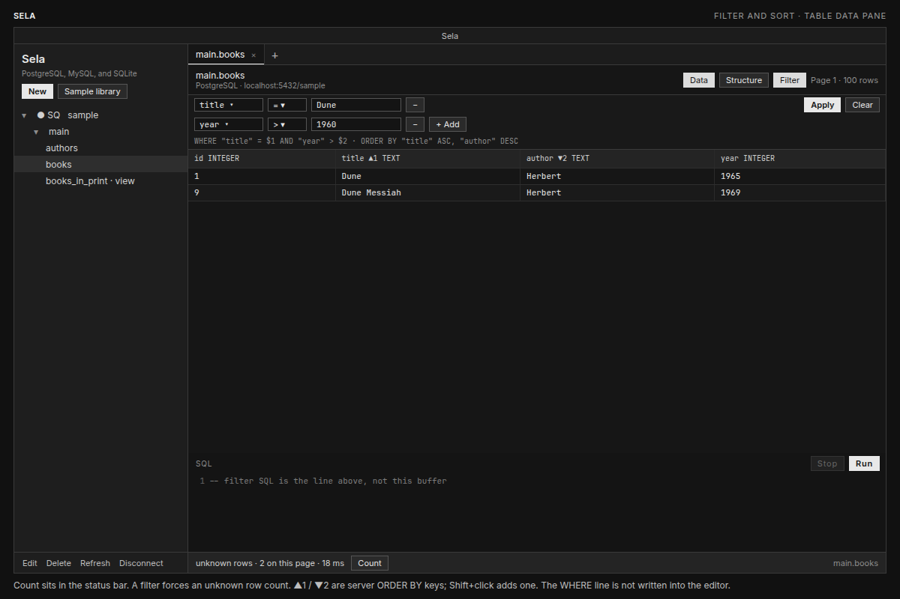

# Filter and sort — review of the M1-3 plan

US-04 asks for a filter bar (column, operator, value, AND), header-click sort, and visible generated SQL. M1-3 is AND-only: no OR and no groups. Header sort applies to table Data only. None of that UI exists. The grid, the status line, and the Exact count button do exist, and they will mis-report a filtered table if M1-3 is dropped on top of them unchanged.

This is a review of those seams. It is not a new filter design. The bar is still one row per predicate: column, operator, value. Shortcuts use the notation in [README.md](./README.md). The status bar’s other strings are in [01-main-window.md](./01-main-window.md).



## What is built

| Piece | Behavior today | File |
| --- | --- | --- |
| Grid sort | Off. `TableState::new(…).sortable(false)` | `tab_view.rs` |
| Header text | `"{name}   {type}"`, no sort mark | `grid.rs` `GridDelegate::column` |
| Table load | `preview_table` → `select_all` + `wrap_page`. No WHERE, no ORDER BY. | `session.rs`, `sql.rs` |
| Row count | Estimate from `estimate_table_rows`, or `Unknown` when the engine returns `None` (SQLite). | `preview_table` |
| Status for Unknown + paged | `"{page_len} rows (page)"` | `query.rs` `refresh_status_from_state` |
| Exact count | Button `exact-count` in the SQL header, label `Exact count`. Shown for a table when the kind is `Estimated` or `Unknown`. | `content.rs` `sql_editor` |
| Count query | `request_exact_count` accepts only `GridSource::Table` and calls `exact_table_rows`, which is `COUNT(*)` of `SELECT * FROM schema.table`. No WHERE. | `query.rs`, `session.rs` |
| Count failure | Sets `view.error`, so `error_banner` paints, and status `Count failed`. | `request_exact_count` |
| Page label | `Page N of M` whenever `total_rows` is `Some` | `workspace/mod.rs` `render` |
| Run | `run_editor` copies the textarea into `GridSource::Sql` and leaves the table. | `query.rs` |
| Parameters | `DatabaseSession::query`, `stream_query`, and `count_query` take `&str` only. | `session.rs` |

US-04’s operator list is one list for every column: `=`, `!=`, `LIKE`, `IN`, `IS NULL`, `>`, `<`. Column types on the wire are engine strings (`ColumnMeta.type_name` from `column_meta` in `decode.rs`): Postgres `INT4` / `TEXT` / `BOOL` / `JSONB`, MySQL `INT` / `VARCHAR`, SQLite `INTEGER` / `TEXT`.

## Fixes

### 1. Do not turn on client sort

`sortable(true)` would sort the rows inside the `DataTable`. A table page is 100 rows, and a SQL stream is at most the rows in the `ResultWindow`. Sorting that window is the wrong order.

Leave `sortable(false)`. Header clicks rebuild `ORDER BY` and call `load_source_for` for page 0. Details are under [Sort indicator and multi-sort](#9-sort-indicator-and-multi-sort).

### 2. A filter makes the count unknown

`preview_table` stores `pg_class.reltuples` or MySQL `TABLE_ROWS` on the tab. That number is the whole table. After a WHERE it is a lie, and the toolbar will say `Page 1 of M` because `render` trusts `total_rows`.

When any predicate is applied:

- Set `row_count_kind` to `Unknown`.
- Set `total_rows` to `None`.
- Keep `paged` true and keep Previous / Next. `can_go_next` already enables Next when the page is full and the total is unknown.

Status text, from `refresh_status_from_state`:

`unknown rows · 100 on this page · 18 ms`

Not `100 rows (page)`, and not `~12,400 rows`. The same sentence is used for an unfiltered SQLite table, which is already `Unknown` and today reads like a count of the page.

Tooltip on that text: `Filtered results are not estimated. Count runs COUNT(*) for this filter.` For an unfiltered unknown table: `No estimate for this table. Count runs COUNT(*).`

### 3. Move Count onto the status bar and point it at the filtered statement

The button labeled `Exact count` sits in the SQL header, next to Run and Stop (`content.rs`). That header is the editor’s chrome. The count is a fact about the grid.

- One button, in `status_bar` (`status.rs`), label `Count`.
- Show it when the source is a table and the kind is `Estimated` or `Unknown`, and the tab is not busy.
- Hide it when the kind is `Exact` or `AtLeast` (a SQL cap uses Load more, not Count).
- Remove the `exact-count` button from `sql_editor` so Run, Stop, and Load more are the only controls there.

`request_exact_count` must count the statement the grid is showing. `exact_table_rows` ignores the filter and would display the unfiltered total as if it were exact.

Build the count with the existing `wrap_count` around the filtered `SELECT` (no LIMIT). On success set `row_count_kind` to `Exact`, set `total_rows`, and let the formatter drop the button.

There is no confirm dialog. Production tagging does not exist yet, and Count is a read.

Count is cancellable. It uses the tab’s `CancellationToken`, the same one as Stop and `secondary-.`. `spawn_work` already sets `busy`, which enables Stop. While it runs, the status ticks about four times a second: `Counting… · 1.2 s`. The button is disabled for the duration. Cancel leaves the grid and the previous `RowCountKind` in place and sets the status to `Count cancelled`. Do not show the query-cancelled line, and do not clear rows.

On failure, do not set `view.error`. A count failure is not a failed data query, and the banner would sit on top of a good page. Status: `Count failed · {message}`. Leave the grid and the previous kind alone.

### 4. Do not write the filter into the SQL editor

Table tabs open with an empty `TabView.sql` (`attach_view`). Writing the generated SELECT into that textarea means the next Run (`run_editor`) replaces `GridSource::Table` with `GridSource::Sql`, drops paging, and applies the 1,000-row cap.

Keep the filter on `GridSource::Table`. Show the predicate on one muted monospace line under the rows, 20px tall:

`WHERE "title" = $1 AND "year" > $2 · ORDER BY "title" ASC, "author" DESC`

Truncate with `…`. Hover shows the full line. Click copies that fragment, not the `wrap_page` query. The editor buffer is untouched.

### 5. Bind the values

Identifiers go through `quote_ident`. Values do not get concatenated into the SQL string, including text that looks like a number or a quote.

`query` / `stream_query` / `count_query` cannot take parameters yet. M1-3 adds a bound execution path (placeholders plus a value list) and uses it for the filtered preview and the count. Postgres placeholders are `$1`, `$2`, …. MySQL and SQLite use `?`.

Until that path exists, do not ship the bar. A quoted-literal fallback will be wrong on embedded quotes and on types.

The line shown to the user may display `$1` / `?`. It is a preview of the statement, not a string that is executed as text.

### 6. Operators depend on the column type

Classify `ColumnMeta.type_name` once, in `sela-core`, as a `ColumnKind`. The UI switches on the kind, not on the raw engine string. Match case-insensitively, and check the longer names first (`TIMESTAMPTZ` before `TIME`, `DATETIME` before `DATE`, `BIGINT UNSIGNED` before `INT`).

| Kind | `type_name` contains | Operators |
| --- | --- | --- |
| Bool | `BOOL` | `=`, `!=`, `IS NULL`, `IS NOT NULL` |
| Int | `INT`, `SERIAL`, `OID`, `YEAR` | `=`, `!=`, `>`, `>=`, `<`, `<=`, `IN`, `IS NULL`, `IS NOT NULL` |
| Float | `FLOAT`, `DOUBLE`, `REAL` | same as Int |
| Decimal | `NUMERIC`, `DECIMAL`, `MONEY`, `NUMBER` | same as Int |
| Date | `DATE`, and not `DATETIME` / `TIMESTAMP` | `=`, `!=`, `>`, `>=`, `<`, `<=`, `IS NULL`, `IS NOT NULL` |
| Time | `TIME`, and not `TIMESTAMP` / `DATETIME` | same as Date |
| Timestamp | `TIMESTAMP`, `TIMESTAMPTZ`, `DATETIME` | same as Date |
| Interval | `INTERVAL` | `=`, `!=`, `>`, `<`, `IS NULL`, `IS NOT NULL` |
| Text | `TEXT`, `CHAR`, `VARCHAR`, `CITEXT`, `CLOB`, `NAME`, `XML`, `STRING` | `=`, `!=`, `LIKE`, `NOT LIKE`, `IN`, `IS NULL`, `IS NOT NULL` |
| Uuid | `UUID` | `=`, `!=`, `IN`, `IS NULL`, `IS NOT NULL` |
| Json | `JSON` | `=`, `IS NULL`, `IS NOT NULL` |
| Bytes | `BYTEA`, `BLOB`, `BINARY` | `IS NULL`, `IS NOT NULL` |
| Other | anything else | `=`, `!=`, `IS NULL`, `IS NOT NULL` |

`LIKE` is not offered for numbers, dates, bools, json, or bytes. US-04’s single list would generate `year LIKE …` and `flag LIKE …`.

`IS NOT NULL` is missing from US-04. Include it for every kind.

Bool does not use a text field. The value control is a two-item menu, `true` and `false`.

Json `=` requires the value to parse as JSON. Otherwise the row is invalid (see below). There is no `LIKE` on json.

Changing the column resets the operator if the current operator is not legal for the new kind, and clears a value that cannot be parsed for the new kind.

### 7. NULL operators do not take a value

`IS NULL` and `IS NOT NULL` hide the value control. Tab skips it. They bind no parameter.

Never emit `col = NULL` or `col != NULL`. If the operator is `=` or `!=` and the column is not text, the literal text `NULL` is invalid and the row says `Use IS NULL`. On a text column, the characters N-U-L-L are a real string.

### 8. Apply and clear are explicit

The bar does not query on each keystroke.

- `Apply` runs the draft. It is the primary button when the draft differs from the applied filter.
- `Enter` in any filter field applies. It does not insert a newline.
- `Clear` drops the draft and the applied filter, sets `page_offset` to 0, and reloads `select_all` so the estimate comes back.
- `secondary-enter` must not also call `run_editor` while a filter field is focused. Today `RunQuery` is a global binding in `ui/mod.rs`. Scope `RunQuery` to the editor. From the filter bar, that chord applies, same as Enter.
- Applying or changing sort sets `page_offset` to 0, then `load_source_for`.

The bar is only on a table tab’s Data pane (`GridSource::Table` and `TablePane::Data`). Hide it on Structure and on SQL results. Switching to Structure does not drop the applied filter.

Add a `Filter` button to the existing toolbar, same `xsmall` size as Data. It toggles the bar. When a filter is applied and the bar is hidden, the button stays in the selected style.

### 9. Sort indicator and multi-sort

Plain click on a header:

- If this column is the only sort key: ASC → DESC → remove.
- Otherwise: replace the whole list with this column ASC.

Shift-click:

- Not in the list: append ASC.
- ASC: flip to DESC.
- DESC: remove that key only. Leave the others.

At most 3 keys. A fourth Shift-click does not change the list. Status, until the next successful change: `At most 3 sort columns`.

The header mark is drawn by `GridDelegate::column`, between the name and the type, so it does not collide with the type name:

`title ▲1    TEXT`  
`author ▼2    TEXT`

`▲` is ASC, `▼` is DESC, the digit is the key’s position starting at 1. No mark means unsorted. The existing width math uses the header string, so the mark is included.

ORDER BY uses `quote_ident` on the column name and the direction keyword. It is applied before `wrap_page`, so the page is ordered by the engine, not by the visible 100 rows.

SQL result grids do not get header sort in M1-3. Wrapping user SQL in another ORDER BY changes the statement and fights `ORDER BY` the user already wrote. Those grids stay `sortable(false)`.

### 10. Adding and removing rows from the keyboard

Opening the bar focuses the column field of the first row. If nothing is applied, there is one empty row. If a filter is applied, the rows show that filter.

Tab order inside a row: column, operator, value (when the operator has one), remove. Then the next row. After the last row: Add, Apply, Clear.

| Key | Result |
| --- | --- |
| `secondary-f` | Toggle the bar when the editor is not focused. When it opens, focus the first column field. |
| `Tab` / `Shift-Tab` | Move through the fields above. |
| `Enter` | Apply. |
| `secondary-shift-enter` | Insert a row after the focused row and focus its column field. |
| `secondary-backspace` | Remove the focused row. If it is the only row, clear its fields and leave the row in place. |
| `Escape` | Close the column or operator menu if one is open. Otherwise move focus to the grid. If the draft is empty and nothing is applied, hide the bar too. |
| Up / Down | Move inside an open menu. They do not move between rows while a menu is open. |

`secondary-f` while the editor is focused is find, not the filter. See [03-sql-editor.md](./03-sql-editor.md).

Removing a row does not reload until Apply or Clear. The Apply button shows that the draft is dirty.

## Edge cases

Apply validates every row. If any row is invalid, nothing is sent, the previous page stays, and that row carries the message on its right side. Do not skip a bad row and run the others.

| Case | Result |
| --- | --- |
| Text `=` or `!=` with an empty value | Valid. Binds `''`. While the field is empty, its placeholder is `empty matches '' · IS NULL for nulls`. The placeholder is not the submitted value. Nulls use `IS NULL` / `IS NOT NULL`, not an empty box. |
| `LIKE` or `NOT LIKE` with an empty value | Invalid. `Enter a pattern`. Do not rewrite it to `%`. |
| `IN` with an empty value, or an empty item between commas | Invalid. `IN needs a value` or `Item 2 is empty`. |
| Number, date, time, timestamp, interval, uuid left empty | Invalid. `Enter a value`. |
| Integer that does not parse as `i64`, or a float that is not finite | `Not an integer` / `Not a number`. |
| Decimal that `rust_decimal` cannot parse | `Not a decimal`. |
| Date not `YYYY-MM-DD`, time not `HH:MM:SS`, timestamp not an ISO form the existing `Value` parsers accept | `Not a date (YYYY-MM-DD)` and the matching messages for time and timestamp. |
| UUID that does not parse | `Not a UUID`. |
| JSON `=` that does not parse | `Not valid JSON`. |
| `IN` item that fails the column’s parser | `Item 2 is not an integer` (or the matching type). |
| More than 100 `IN` items | `At most 100 values`. |
| `LIKE` on a kind that does not offer it | The operator is not in the menu, so it cannot be chosen. |
| Bytes, other than IS NULL / IS NOT NULL | Those are the only operators in the menu. |
| Predicate on a view | Same as a table. Views are already in the tree. |

`LIKE` does not add `%` for the user. `%` and `_` are wildcards because the engine treats them that way. Say that in the value field’s tooltip. The empty-text hint above is the only placeholder, and only for `=` / `!=` on text.

Client-side parse errors never become a `DbError` banner.

## Generated statement shape

For `main.books`, Postgres, the two rows in the wireframe, plus the sort marks:

```sql
SELECT * FROM "main"."books"
WHERE "title" = $1 AND "year" > $2
ORDER BY "title" ASC, "author" DESC
```

The grid runs `wrap_page` of that statement with `PAGE_SIZE` and the current offset. Count runs `wrap_count` of that statement with no limit. Both use the same bound values.

An empty applied filter omits WHERE and ORDER BY and is the `select_all` path `preview_table` already uses, including the estimate.

## Implementation notes for engineering

- Put `ColumnKind` and the operator table in `sela-core`, with unit tests on Postgres, MySQL, and SQLite type strings (`INT4`, `INTEGER`, `VARCHAR`, `TIMESTAMPTZ`, `JSONB`, `BYTEA`). The UI must not match type names itself.
- Put the SQL builder next to `select_all` / `quote_ident`. Tests should lock the placeholder style per `Dialect` and reject a value that was interpolated.
- Extend the session API with a bound query (SQL plus values) used by the filtered preview and by Count. Do not format values with `Display` and embed them.
- Filter and sort state live on `TabView`, beside `source`, not inside `GridDelegate` and not in the textarea. Reloading a page keeps them.
- `GridDelegate::column` reads the sort list to build the header string. Clicks do not go through `DataTable`’s sorter. If `Column` in gpui-component 0.10 has a click callback that does not reorder rows, use it. If the only click path is `sortable(true)`, do not enable it; track Shift yourself and handle the click without letting the table sort.
- `refresh_status_from_state` gains the `unknown rows · N on this page` branch and stops appending `note` when the formatter already includes that sentence.
- `request_exact_count` takes the filtered statement. The `GridSource::Table` guard stays (Count is not offered for SQL). The error arm must not assign `view.error`. Wire Count through the same cancel token as other tab work. Tick `Counting… · {elapsed}` in the status bar. Stop and `secondary-.` cancel it without a confirm dialog and without touching the grid.
- `render`’s page label is already correct once `total_rows` is cleared. Add a test or a UI-state assertion if one exists for the label; otherwise a `sela-core` test is the wrong layer, and a short comment next to the label is enough only if there is no harness. Prefer a focused test on the status formatter if that formatter is extracted out of the GPUI impl.
- Scope the `RunQuery` binding to the editor context so Enter-family keys in the filter bar cannot call `run_editor`.
- The filter bar is a column of kit controls: a select for the column, a select for the operator, a single-line input for the value, `xsmall` buttons for remove, add, Apply, and Clear. Row height 26px. Do not build a card around it.

## Decisions

1. **M1-3 filters are AND-only.** OR and groups come later. The bar has no combiner control.
2. **Header sort is for table Data only.** SQL result grids stay `sortable(false)`. Do not wrap user SQL in `ORDER BY` in M1-3.
3. **`=` with an empty text value matches a real `''`.** Use `IS NULL` for nulls. The empty value field shows the hint `empty matches '' · IS NULL for nulls`. `LIKE` with an empty pattern stays invalid.
4. **Count has no confirmation.** There is no production tagging yet. Count must be cancellable (Stop and `secondary-.`) and must show elapsed time in the status bar (`Counting… · 1.2 s`).
