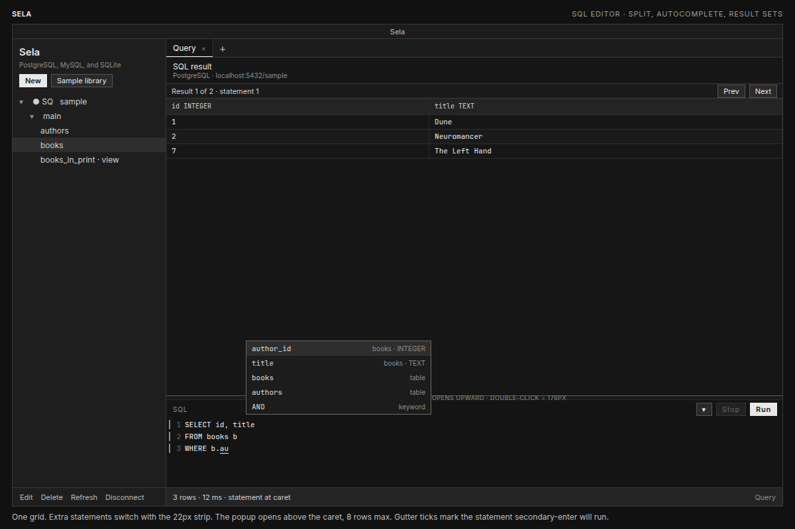

# SQL editor

The editor is the bottom of the content column. M1-4 replaces the single-statement textarea behavior with statement-at-caret, multi-statement runs, a gutter, and format. Autocomplete is M3-2 (US-08). Both are specified here so the chords and the split are chosen once. Shortcut notation is in [README.md](./README.md). The running, cancelled, capped, and error states of the window are in [01-main-window.md](./01-main-window.md).

## What is built

| Piece | Today | File |
| --- | --- | --- |
| Widget | `Textarea` / `TextareaState`, 6 rows, monospace | `tab_view.rs`, `content.rs` `sql_editor` |
| Height | Fixed `h(px(176.))`, not draggable, not collapsible | `content.rs` |
| Run | The whole buffer. `normalize_sql` rejects zero statements and rejects more than one. | `query.rs` `run_editor`, `sql.rs` `normalize_sql` |
| Empty buffer | Status `Write a SQL statement, then run it.` | `run_editor` |
| Several statements | Error string `run one statement at a time` (`SqlError::Multiple`) | `normalize_sql` |
| Unclosed quote | Also `SqlError::Multiple`. `split_statements` returns `Multiple` when a quote is still open. | `sql.rs` |
| Cancel | Stop and `secondary-.`. Rows already delivered stay. | `stop_query`, `apply_cancelled` |
| Running label | Button becomes `Running…`. Status is set to `Running…` once. | `content.rs`, `query.rs` |
| Results | One `DataTable` per tab | `TabView.grid` |
| Error position | `DbError` has a message, SQLSTATE, and vendor code. No byte offset. SPECS mentions a future syntax variant with a position. | `error.rs` |

`split_statements` already splits on semicolons outside quotes and comments and keeps the statement text. It does not return byte ranges. M1-4 needs the ranges so the gutter and the caret can agree.

## Split

The editor stays under the grid. The divider is horizontal (the column is split vertically). It replaces the fixed 176px height.

| | |
| --- | --- |
| Default | 176px, the current `sql_editor` height |
| Minimum | 72px: the 28px SQL header plus one text line |
| Maximum | 70% of the main column below the tab bar |
| Double-click | Returns to 176px |
| Collapse | Chevron in the SQL header, or `secondary-shift-e`. Height 28px. Run and Stop stay. The buffer is kept. |
| Drag | Vertical. Each tab stores its own height on `TabView`. |

The filter bar and the error banner take height from the grid, not from the editor. Opening the filter does not jump the caret.

The 28px header remains: the label `SQL`, the collapse chevron, Stop, Run. Load more moves to the grid footer and the status bar ([01-main-window.md](./01-main-window.md)). Exact count leaves this header ([02-filter-sort-review.md](./02-filter-sort-review.md)).

## Run and cancel

`normalize_sql` stays the helper for “this string is exactly one statement”. The editor stops using it as the only way to run.

| Focus and selection | Shortcut | What runs |
| --- | --- | --- |
| Editor, no selection | `secondary-enter` | The statement that contains the caret |
| Editor, non-empty selection | `secondary-enter` | The selected text only, split with `split_statements`. Do not expand to the surrounding statement. |
| Editor | `secondary-shift-enter` | Every statement in the buffer, top to bottom |
| Filter bar | `secondary-enter` or `Enter` | Apply the filter. Do not run SQL. |
| Anywhere else | `secondary-enter` | Nothing |

Statement at the caret: extend `split_statements` to return each statement’s byte range in the buffer. The caret belongs to a statement when it sits inside that range, or in the whitespace and comments between the previous statement and this one. A caret in the leading comments belongs to the first statement.

The gutter draws a 2px muted bar on every line of the statement that `secondary-enter` will run. A selection replaces that highlight with the selection’s own lines.

Several statements run one after another, not as a batch the server parses itself. Stop at the first error. Statements that already finished stay as result sets. `secondary-.` cancels the in-flight statement and does not start the next. That is the same `CancellationToken` path as Stop.

`secondary-enter` is bound on the editor focus context, not on the window. The global binding in `ui/mod.rs` is why Run fires while the user is elsewhere.

Empty buffer: keep the current status, `Write a SQL statement, then run it.`

Unclosed quote: `split_statements` should return a distinct `SqlError::UnclosedQuote` instead of `Multiple`. The gutter marks the opening quote. The banner says `Unclosed quote`. Do not say `run one statement at a time`.

## Running indicator

No spinner over the grid.

- Run’s label stays `Running…` while `view.busy`. Stop stays enabled.
- Status ticks: `Running · 1.2 s`, about four times a second, from `query_started`.
- The gutter’s statement mark switches to the running statement’s lines for the duration.
- A new SQL run clears the grid immediately, which `start_sql_stream` already does via `result.reset`. Before the first row, the empty message is `Running…` when `GridDelegate.loading` is true.
- Table Previous/Next may keep the old page on screen. That path is not the editor.

Cancel and the 1,000-row cap keep the behavior in the main-window spec.

## Autocomplete

Milestone M3-2. Do not block M1-4 on it. The popup rules are fixed now so M1-4 does not take the chords.

**Trigger.** Open after one identifier character, and immediately after `.`. Do not open inside a comment or a string. Do not open or move the selection while an IME composition is active. Enter during composition commits the composition and does not accept a completion.

There is no manual chord. `secondary-space` is Spotlight on macOS. `ctrl-space` switches input sources on macOS. Automatic open plus Escape is the whole trigger.

**Contents.** Dialect keywords, schema names, table names, and column names from the connection’s catalog cache (the same catalog the sidebar tree uses). After `alias.` or `table.`, list that relation’s columns first.

**Ranking.**

1. Case-insensitive prefix on the typed fragment.
2. Columns of tables named in the current statement, above other columns.
3. Other substring matches.
4. Keywords, below identifiers, unless the fragment itself is a keyword prefix.

**Rows.** Monospace name, and on the right a muted label: the type name, `table`, `schema`, or `keyword`. No large icons. Maximum 8 rows, 22px each, so the popup is at most 176px tall and then scrolls. Width fits the labels up to 360px.

**Placement.** Prefer above the caret. The editor sits at the bottom of the window, so a popup that opens downward is clipped. Flip below only when there is no room above.

**Keys.** Up and Down move. Enter accepts and inserts. Tab does not accept; it moves focus. Escape closes the popup and leaves the text. Click outside closes it. Arrows do nothing to the popup when it is closed.

## Errors

Three places, all fed from the same failure:

1. **Gutter.** A 2px `danger` bar on the line, full line height. This is separate from the muted bar that marks the statement to run.
2. **Underline.** A 1px `danger` underline on the reported span.
3. **Banner and status.** The existing `error_banner` above the grid, capped around 60px, plus the status line from the main-window spec (`Query failed · SQLSTATE 42601`).

`DbError` has no position field. Use one when a later API adds it. Until then:

- Postgres messages often include `LINE n` and a caret line. Parse that. Underline the token the caret points at. If only the line is known, underline the whole line.
- MySQL and SQLite often have no offset. Mark the first line of the statement that just ran, and put the full text in the banner. Do not invent a column.
- A failure from `split_statements` (empty, unclosed quote) is local: gutter plus banner, no round trip.

The banner stays. The gutter is where the position is visible. Neither replaces the other.

## Multiple result sets

One grid per tab. Do not stack grids.

A 22px strip between the grid and the splitter: `Result 2 of 3 · statement 2`, with Prev and Next. The strip is a tab stop. Do not bind Alt+arrows for it; window managers and word navigation already use those keys. Tab switching stays on `secondary-alt-left` / `secondary-alt-right` when focus is outside a text field.

Each finished statement keeps its own `ResultWindow`. Cap stored sets at 8. Beyond that, drop the oldest and set the status note `Showing the latest 8 results`. A statement that returns no row set (`Executed`) is still a result: the grid shows the existing `show_message` text (`3 rows affected · 4 ms`).

A failure stops the sequence. Earlier results remain switchable. The strip selects the failed statement, the banner shows the error, and the gutter marks that statement.

Memory stays bounded: 8 windows, each already capped by `ResultWindow` and the SQL row cap. Do not materialize every result without the cap.

## Find and format

`secondary-f` in the editor opens a one-line find bar in the SQL header, not the filter bar. Type, Enter jumps to the next match, `secondary-g` / `secondary-shift-g` are next and previous, Escape closes find. No replace in M1-4. Matches use the editor’s current selection. This exists so filter and find do not share one global chord.

`secondary-shift-f` in the editor formats the selection if there is one, otherwise the whole buffer, using `sqlformat` as SPECS already names for M1-4. It does not run the statement. Format is undoable with the editor’s own undo (`secondary-z`).

## Highlight

M1-4. Stay inside the theme: comments in `muted_foreground`, strings in `foreground`, keywords slightly brighter than identifiers. No multi-color syntax theme. If gpui-component 0.10 has a code editor, use it in place of `Textarea`. If it does not, keep the monospace textarea for M1-4 and draw the gutter and the underline as an overlay. Autocomplete does not require the code editor; it is a popup anchored to the caret in M3-2.

## Keyboard

| Action | Shortcut | Milestone |
| --- | --- | --- |
| Run caret statement or selection | `secondary-enter` | M1-4 |
| Run all statements | `secondary-shift-enter` | M1-4 |
| Cancel | `secondary-.` or Stop | done |
| Find | `secondary-f` | M1-4 |
| Find next / previous | `secondary-g` / `secondary-shift-g` | M1-4 |
| Format | `secondary-shift-f` | M1-4 |
| Collapse editor | `secondary-shift-e` | M1-4 |
| Accept completion | `Enter` while the popup is open | M3-2 |
| Dismiss popup or find | `Escape` | M1-4 / M3-2 |

`secondary-shift-enter` adds a filter row when the filter bar is focused. The two bindings use different focus contexts.

## Implementation notes for engineering

- Change `split_statements` to return ranges (start and end byte offsets into the original string) and add `SqlError::UnclosedQuote`. Keep `normalize_sql` as “exactly one statement” for callers that still want that. Update its tests in `sql.rs`.
- Store the editor height and the collapsed flag on `TabView`. Default height 176.
- Replace the `RunQuery` window binding with an editor-context binding. `Workspace::run_editor` reads the caret and the selection from the editor state instead of always taking `value()`.
- Run statements sequentially on the existing per-tab request id. A new run bumps the request id so a late batch from statement 1 cannot paint into statement 2. Cancel cancels the token and does not schedule the rest.
- Keep a `Vec` of at most 8 result snapshots on the tab. Showing one calls the same grid update `apply_outcome` uses. Do not allocate a second `DataTable`.
- Gutter and underline read an optional position. Parse Postgres `LINE n` only in one function with tests taken from real driver messages. If the parse fails, mark the first line of the statement that ran.
- IME: while a composition is active, the autocomplete popup stays closed and Enter is not treated as “accept completion”.
- Do not enable `TableState::sortable(true)` on SQL results as a stand-in for ORDER BY.

## Open questions

1. Autocomplete stays in M3-2 and out of the M1-4 pull request. Confirm.
2. Run-all stops at the first error. Confirm that later statements should not continue.
3. Eight stored result sets is the cap. Confirm, or pick another bound.
4. SPECS puts `sqlformat` in M1-4. This spec assigns `secondary-shift-f` for it. Confirm format ships in that milestone.
