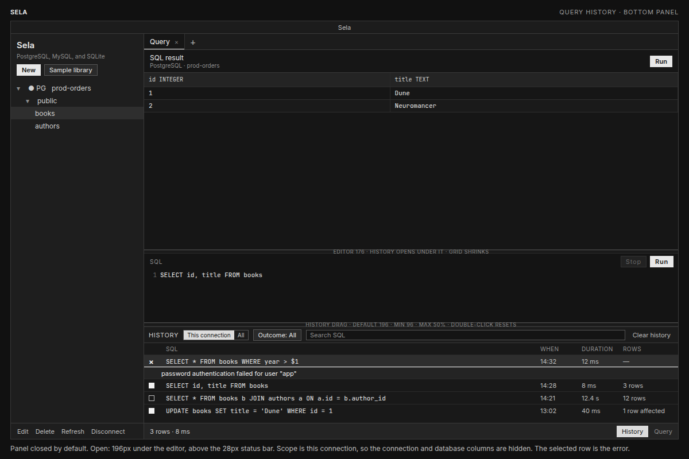
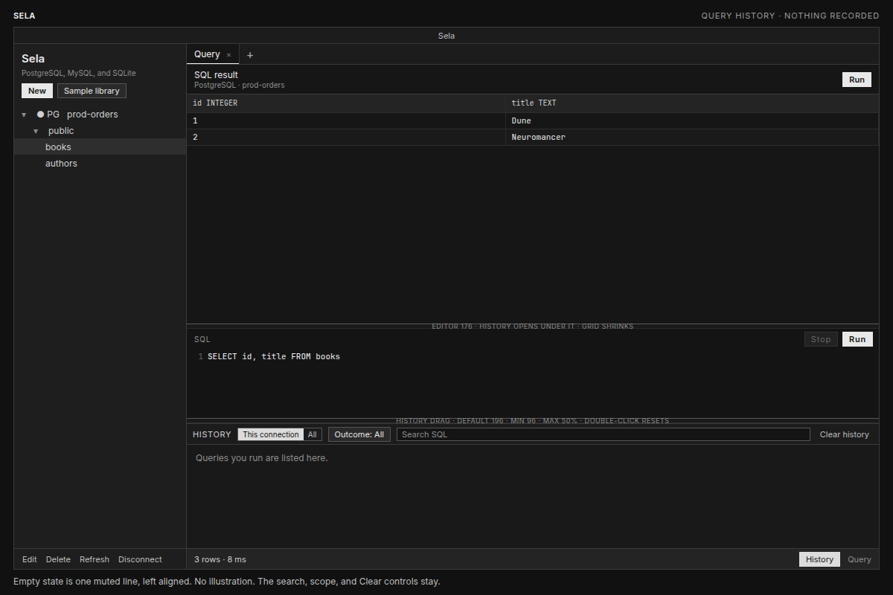

# Query history

M1-5. US-10: the user finds a past query, and can reopen it in a new tab. Nothing in the app records history today. There is no `history.sqlite`, no history panel, and no history types. The status line already has the facts a row needs: outcome, row count, duration, and the error text. [SPECS.md](../SPECS.md) places the store at `history.sqlite` with FTS5, a default cap of about 10,000 entries, and an optional switch to turn recording off per connection.

Shortcut notation is in [README-batch2.md](./README-batch2.md). `secondary` is Command on macOS and Control on Linux and Windows.

## Where it lives

The history UI is a bottom panel in the content column. It sits under the SQL editor and above the status bar. It is closed by default.

The sidebar stays the schema tree. A history row has to show a SQL preview at the width of the content column. The sidebar is 292px (`sidebar.rs`) and is the wrong place for that line. A third column on the right would fight the 1180px window. The panel takes its height from the grid (`flex_1`). It does not change the toolbar (44px), the editor band (176px), or the status bar (28px).

| Piece | Size | Notes |
| --- | --- | --- |
| Panel closed | 0 | No leftover bar |
| Panel open | 196px default | Min 96. Max 50% of the content column |
| Splitter | 5px hit area, drawn as a 1px line | Drag the top edge. Double-click resets to 196 |
| Header | 28px | Title, scope, outcome, search, Clear history |
| Row | 26px | Same height as the dense grid row in [06-theme-tokens.md](./06-theme-tokens.md) |
| Error detail | 22px | Only when the selected row failed |

The open/closed state and the height live in memory for the session. Do not write them into `connections.json`. Persistence is the same open question as the sidebar width in the batch 1 main-window spec.

The status bar gains one ghost button, `History`, on the right, before the source label. `xsmall`, inside the existing 28px. It uses the selected button style while the panel is open. `secondary-shift-h` toggles the panel from anywhere except a modal. `secondary-h` is Hide on macOS and stays free. `secondary-y` is redo in text fields on Windows and Linux and stays free.

Opening the panel moves focus to the search field. Closing it returns focus to the editor if the editor had it, otherwise to the grid.

## What gets recorded

Record a row when a statement the user started from the SQL editor finishes. Finished means success, error, or cancel.

One editor run today is one statement, so it is one row. When M1-4 runs several statements, write one row per statement that the engine actually started, in order. A statement that never started, because an earlier one failed, is not a row.

Do not record:

- An empty or whitespace-only buffer.
- Catalog, Structure, paging, exact-count, or filter SQL that Sela generates. Opening a table is not a history event.
- A load-more continuation of a result that is already on screen.
- Anything that is still running. The status bar owns the running state. The row appears when the run ends.

The SQL stored is the statement text, not the whole buffer once statements are split. Keep the text the user typed, including literals. Do not try to redact string literals. Do not attach the password, the keychain account, or a connection URI.

Each row stores:

| Field | Source |
| --- | --- |
| `id` | New id for the row |
| `connection_id` | `SavedConnection.id` |
| `connection_name` | Name at the time of the run |
| `database` | Postgres/MySQL database name, or the SQLite file path |
| `sql` | The statement |
| `started_at` | UTC |
| `duration_ms` | The same elapsed time the status line used |
| `rows_label` | The count text the status line would show. See below |
| `outcome` | `success`, `error`, or `cancelled` |
| `error_message` | The `DbError` message for `error`. Empty otherwise |

`rows_label` examples, matching the status line: `3 rows`, `~1,000 rows`, `1,000+ rows`, `2 rows affected`, `0 rows affected`. An error row has no count (`—` on screen). A cancelled row keeps the rows received (`12 rows`) and the outcome is what says it was cancelled.

If the connection is later renamed, the panel shows the current name when the id still exists. If the connection was deleted, show the stored name.

## Entry row

Newest first. The list does not sort any other way.

| Column | When | Content |
| --- | --- | --- |
| Outcome | Always | A 8px mark. Success uses `status.success.text`, error uses `status.error.text`, cancelled is a hollow mark in `text.muted`. Colors are in [06-theme-tokens.md](./06-theme-tokens.md). The wireframe is grayscale: a filled mark, a heavy cross, and a dash. |
| SQL | Always | One line, monospace, ellipsis. 12px. |
| Connection | Scope is All | Connection name. Hidden when the scope is this connection, so the SQL column can use the width. |
| Database | Scope is All | Database name, or the file name for SQLite. |
| When | Always | Local time. Today: `HH:MM` (24-hour). Yesterday: `Yesterday`. Older: `YYYY-MM-DD`. |
| Duration | Always | Under 10 seconds: `{ms} ms`, the same shape as the status line. From 10 seconds: `{s} s` with one decimal. |
| Rows | Always | `rows_label`, or `—` on error. |

The selected row is a 26px selection wash, the same treatment as a selected grid row. When that row's outcome is `error`, a 22px line under the header shows `error_message` in `status.error.text`, one line, ellipsis. The list itself stays one line per query.

A row has a menu on right-click and on a `…` button that is visible on the focused row: Open in new tab, Insert into editor, Copy, Rerun, Delete. The keyboard actions below do the same work. Hover-only icons are not the way to reach them.

## Search and filter

The header holds one search field, placeholder `Search SQL`. It filters the statement text through FTS5. It does not match the connection name or the database. Those have their own controls, so a search for a table name does not also hide rows because of a connection name.

The outcome control is one menu, default `All`, items `All`, `Success`, `Error`, `Cancelled`. It is a `WHERE` on `outcome`, not a second text query.

Typing updates the list from a background read. A slow reply that belongs to an older query is ignored. The same request-id rule as query execution applies. The panel does not show a spinner over the list. The previous rows stay until the new page arrives.

The list is virtualized. The cap is 10,000 rows. Do not build 10,000 elements.

## Scope

Two segments in the header: `This connection` and `All`.

`This connection` is the connection of the active tab. That is the default when the active tab has a connection. With no connection, the segment is disabled and the panel shows `All`.

Switching tabs retargets `This connection` to the new tab's connection. `All` does not retarget.

The choice lasts for the session. It is not written to `connections.json`.

Recording is on by default. The only off switch is `Record query history` on the connection dialog ([05-connection-dialog.md](./05-connection-dialog.md)). It is not tied to a production tag. While it is off, editor runs on that connection do not insert rows. Rows already stored stay until the user deletes them or uses Clear history. The panel says so when the scope is that connection: `History is off for {name}.` A `Turn on` button on that empty state flips the flag and saves the connection record. It does not open a session.

The flag is `record_history` on `SavedConnection`, `#[serde(default = "default_true")]`. It is not inside the TLS object, and it does not need a `schema_version` bump. See [ADR 0006](../../adr/0006-no-migrations-before-release.md).

## Actions

| Action | What it does |
| --- | --- |
| Open in a new tab | Default. `Enter` or double-click. A new query tab on the row's connection, SQL in the editor, not run. If that connection was deleted, the item is disabled. |
| Insert into the editor | `secondary-enter`. Inserts at the caret, or replaces the selection, in the active tab's editor. Table tabs have an editor today. Does not run. Does not change the tab's connection. |
| Copy | `secondary-c` with the list focused. The full statement, not the ellipsized preview. With the search field focused, copy keeps the field's own clipboard behavior. |
| Rerun | `secondary-shift-enter`. See below. |
| Delete | `secondary-backspace` on the list. One row. No confirm. |
| Clear history | The header button, labeled `Clear history`. No shortcut. Confirms with the existing alert pattern. Scope `This connection`: title `Clear history for {name}?`, description `Queries stored for this connection are removed. The database is left untouched.`, OK button `Clear history` (danger). Scope `All`: title `Clear all query history?`, same OK button. |

Rerun opens a new query tab on the row's connection and uses the normal run path. It runs immediately only when `is_safe_to_rerun_for_load_more` returns true. That is the same classifier load-more uses (`sela-core`). Anything else opens a confirm dialog before the run:

| Piece | Value |
| --- | --- |
| Title | `Rerun this statement?` |
| Body | The full statement, monospace, scrolling after about 8 lines |
| Cancel | Default button. Focused. `Enter` and `Escape` both cancel. |
| Rerun | The other button. Click or `Tab` then `Enter`. It is not the default. |

The dialog does not replace safe mode. Safe mode is still M2. The classifier's known limit stays: `SELECT my_func()` counts as safe. Do not add a second classifier for this dialog.

Open and Insert do not auto-run. Rerun is the action that runs.

## Empty, filtered, and error states

Copy is one line, left aligned, `text.muted`, 13px. No illustration and no centered card.

| State | Text |
| --- | --- |
| Nothing stored for this scope | `Queries you run are listed here.` |
| History off for this connection | `History is off for {name}.` plus `Turn on` |
| Search or outcome matches nothing | `No queries match.` The search text stays. |
| The history file cannot be opened or written | `Could not open query history: {message}` |

A failed history write does not fail the query. The user's statement still runs, and the grid still shows its result. The first failure in a session also sets the status bar text to `Query history is not being saved.` Later failures in that session do not repeat the sentence.

A file that cannot be read is renamed to `history.sqlite.bad` (replace an older `.bad` file) and a new empty store is created. The panel shows `History was reset because the file could not be read.` once.

## Retention

The file is `{config_dir}/history.sqlite`, next to `connections.json`. Unix mode `0600`. The directory is the one `SELA_CONFIG_DIR` already overrides.

The cap is one global limit of 10,000 rows for the whole file. A busy connection can push out another connection's older rows. After each insert, in the same transaction, delete the oldest rows past the cap. There is no per-connection cap and no time-based expiry.

FTS5 indexes `sql` only. Scope and outcome are ordinary columns.

Deleting a connection does not delete its rows. Clear history and Delete are how rows go away. Deleting the connection still deletes the keychain item, as it does today. The file is unencrypted. Unix mode `0600` is the protection. [faq.md](../../user/faq.md) tells the user that the file stores SQL text, literals included.

## Keyboard

Bindings use a history focus context. The full group is in [README-batch2.md](./README-batch2.md).

| Action | Shortcut |
| --- | --- |
| Toggle the panel | `secondary-shift-h` |
| Focus search | `secondary-f` while the panel is open |
| Move the selection | `Up` / `Down`. This works while the search field is focused. |
| Open in a new tab | `Enter` |
| Insert into the editor | `secondary-enter` |
| Copy | `secondary-c` on the list |
| Rerun | `secondary-shift-enter`. Confirms first unless the statement passes `is_safe_to_rerun_for_load_more`. |
| Delete the row | `secondary-backspace` on the list |
| Close | `Escape` clears a non-empty search first, then closes the panel |

`Up` and `Down` in the search field move the history selection. They do not move the caret. `Enter` in the search field opens the selected row. It does not submit a form.

## Implementation notes for engineering

- The store belongs in `sela-config`, beside `connections.json`. The UI reads a snapshot. Writes and FTS queries run on the existing Tokio runtime, not on the UI thread. Drop stale snapshots the same way stale query results are dropped.
- Schema sketch, not a contract: a table with the columns in [What gets recorded](#what-gets-recorded), an FTS5 table on `sql`, and an index on `(connection_id, started_at)`. Keep the insert and the cap delete in one transaction.
- `rows_label` is a display string copied from the status formatter so the panel and the status line cannot drift. Do not store a second count and format it again.
- `record_history` defaults to true for a missing field. SQLite and both network engines honor it. Turning it off is a `store.save` of the connection list only.
- Open in a new tab uses the existing new-query-tab path and sets the editor text. It does not call the run action.
- Rerun uses that path and then the normal run action when `is_safe_to_rerun_for_load_more` is true. Otherwise it shows the confirm dialog first. Cancel is the default button. It does not grow a private execution path or a second safety classifier.
- Virtualize the list. gpui-component `List` is the first choice. A hand-rolled 10,000-row flex is not.
- Do not log statement text at info. It can contain literals the user would not want in a log file.
- Panel height and the `History` status button must not change the 28px status bar or the 176px editor. The grid is what shrinks.

## Decisions

1. History is recorded by default. A per-connection `Record query history` checkbox is the only off switch. A production tag does not change the default.
2. Rerun runs directly only when the statement passes `is_safe_to_rerun_for_load_more`. Every other statement gets a confirm dialog that shows the SQL. Cancel is the default button. Rerun stays available.
3. An unencrypted `history.sqlite` with mode `0600` is acceptable. Clear history is the way to remove it. The user-facing note is in [faq.md](../../user/faq.md).
4. One global cap of 10,000 rows. The oldest rows in the file are the ones removed.

## Still open

Should the open/closed state and the panel height persist with the theme setting, or stay in memory for the session? The spec keeps them in memory until that is decided. Same question as the sidebar width in the main-window spec.
