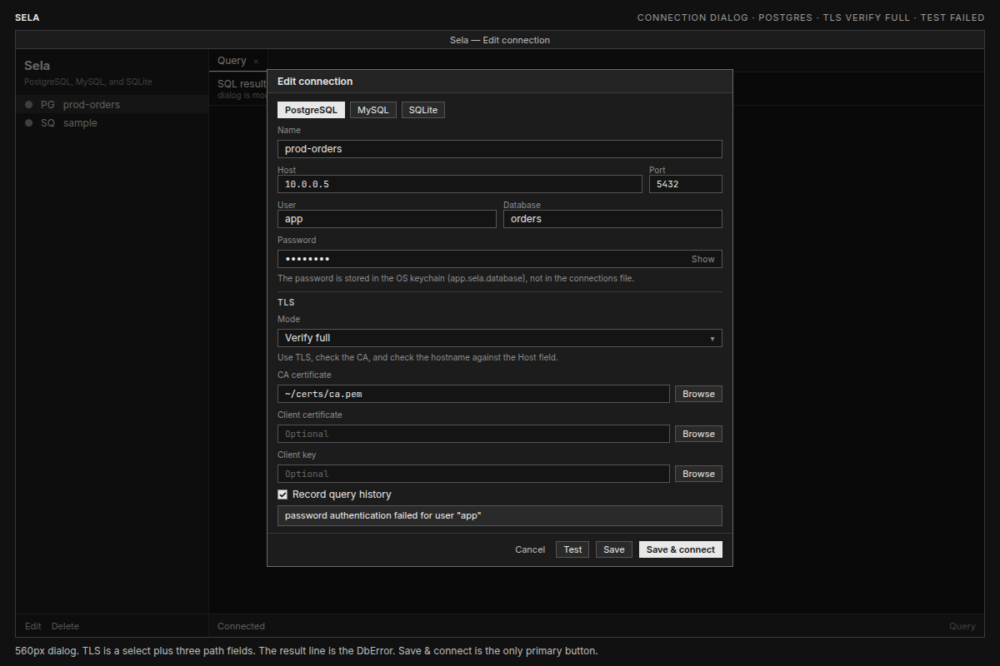
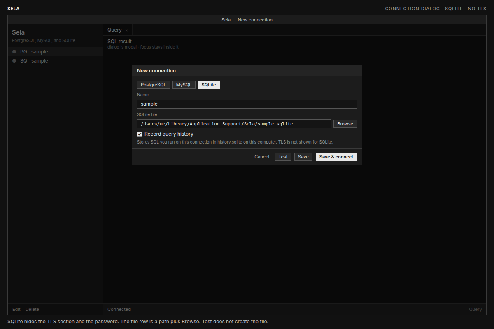

# Connection dialog

The dialog that creates and edits a saved connection. It already ships as a 460px modal from `open_form` in `crates/sela-app/src/ui/workspace/state.rs`, rendered by `ConnectionForm` in `ui/form.rs`. The sections below keep that dialog and extend it. TLS modes are M1-8. Test connection is an acceptance check on US-01 and has no UI today. Query-history recording is the switch from [04-query-history.md](./04-query-history.md).

Shortcut notation is in [README-batch2.md](./README-batch2.md). `secondary` is Command on macOS and Control on Linux and Windows. The dialog traps focus until it closes, which the main-window spec already requires.

What the form does today, so the spec does not invent it as new:

- Engine buttons PostgreSQL, MySQL, SQLite. The selected engine is the primary button. The others are ghost.
- Name, then host, port, user, database. SQLite shows a file path instead and clears the network fields on submit.
- M1-8 (#15, on `main`) stores `TlsSettings` and, for network engines, shows SSL mode buttons plus CA, client certificate, and client key path fields. `TlsMode::default` is `disable`. A file with no `tls` object loads as disable. Legacy `ssl: true` with no `tls` object loads as require. SQLite ignores TLS.
- Password is a masked `Input` with `mask_toggle`, network engines only. It never enters `connections.json`. The keychain service is `app.sela.database`.
- One primary button, `Save connection`. It writes the keychain, writes JSON, and always reconnects (`save_draft` clears the session and calls `connect_id`).
- `SavedConnection::validate` already checks the client-cert pair and a missing CA for verify-ca / verify-full. Those strings stay. File-not-found checks below are new dialog checks.



## Chrome

| Piece | Value |
| --- | --- |
| Title | `New connection` or `Edit connection` |
| Width | 560px. Today it is 460px. The certificate paths need the extra width. |
| Max height | The window height minus 48px. The window minimum is 560px tall, so the body scrolls. |
| Body | Single column. Labels above fields, `text_xs`, `text.muted`, as today. |
| Button row | Pinned to the bottom of the dialog. It does not scroll away. |
| Buttons | `Cancel` (ghost), `Test` (plain), `Save` (plain), `Save & connect` (primary). One primary. |

Host and port share a row: host takes the remaining width, port is 88px. User and database share a row. Stacking every field, which is what the form does now, pushes TLS past a 760px window. The scroll still exists for the 560px minimum.

There is no card around the TLS block. A 1px top border and an 11px `TLS` label separate it from the password.

## Field order

### PostgreSQL and MySQL

1. Engine
2. Name
3. Host, Port
4. User, Database
5. Password
6. Password helper, then any keychain warning, then the validation error
7. TLS mode
8. The one-line explanation of the selected mode
9. CA certificate
10. Client certificate
11. Client key
12. Record query history
13. Test result
14. Cancel, Test, Save, Save & connect

### SQLite

1. Engine
2. Name
3. SQLite file, with Browse
4. Record query history
5. Test result
6. Cancel, Test, Save, Save & connect

The TLS block is not in the tree for SQLite. It is not a disabled checkbox. Password is not shown. Submit keeps today's clearing of host, user, database, and port, and it writes TLS as absent.

Changing engine keeps the behavior in `set_engine`: the port is replaced only when it is empty, `0`, or still the previous engine's default (5432 or 3306). Name, password, paths, and the history checkbox are kept.

Placeholders stay: name `Local library`, host `127.0.0.1`, port `5432` or `3306`, user `sela`, database `sample`, SQLite file `/path/to/database.sqlite`.



## Password

The field is `InputContentType::Password` with the existing reveal toggle. The reveal button is in the field. The password is never shown in the sidebar, the status bar, the history file, or `connections.json`.

| Situation | Field | On save |
| --- | --- | --- |
| New connection | Empty. Placeholder `Password`. | Empty writes nothing and deletes any keychain item for that id (`PasswordPersistence::Empty`). |
| Edit, keychain read succeeded | Prefilled and masked. Reveal shows the secret. | A new value replaces the keychain item. Empty deletes it. |
| Edit, keychain read failed | Empty. The existing warning stays: `The saved password could not be read: {err}`. | Empty does **not** call delete. The stored item is left alone because the form never loaded it. |
| Keychain write failed | The dialog still closes on save. | The existing memory-only path. The status bar (the left status text, not only `TabView.note`) shows `The OS keychain is unavailable, so the password is kept for this session only. {message}`. |

The helper under the field replaces the current sentence. The current sentence says an empty password is kept for the session. `CachingSecrets::set` deletes the item when the secret is empty.

> The password is stored in the OS keychain (app.sela.database), not in the connections file. Leave the field empty to save the connection without a password.

When the read failed, add a second line in `text.muted`: `The saved password could not be loaded, so an empty field will not remove it.`

A non-empty password that could not be written uses the memory-only status sentence above. That sentence is not the helper.

Test uses the password in the field. On edit, if the field is empty and a read earlier succeeded, the user cleared it, so Test uses an empty password. If the read failed, Test uses no password rather than a value the form does not have, and the result line says `No password is loaded. Type it to test, or save without testing.` Test does not write the keychain.

## TLS

Shown for PostgreSQL and MySQL. Hidden for SQLite.

The control is a select, not a row of cards. The menu row is the mode name plus the explanation. The explanation of the selected mode is repeated under the select in `text.muted`, one line.

A new Postgres or MySQL connection opens with the mode set to `prefer`. That is a dialog default only. `TlsMode`'s serde default stays `disable`, so a saved file with no `tls` value still loads as disable. Legacy `ssl: true` and no `tls` object still loads as `require`, which is what #15 does. Do not change `TlsMode::default` to Prefer. A new SQLite connection has no TLS section.

When the selected mode is Prefer, the line under the explanation is:

> prefer may fall back to unencrypted; use require or verify-full for remote servers

That hint is hidden for the other modes. The docker sample still works on Prefer, because Prefer falls back when the server has no TLS. Remote servers should use Require or Verify full.

| Mode | Explanation | Postgres `PgSslMode` | MySQL `MySqlSslMode` |
| --- | --- | --- | --- |
| Disable | Do not use TLS. | `Disable` | `Disabled` |
| Prefer | Use TLS if the server offers it. Otherwise connect without TLS. | `Prefer` | `Preferred` |
| Require | Use TLS. Do not check the server certificate. | `Require` | `Required` |
| Verify CA | Use TLS and check the certificate against the CA file. Do not check the hostname. | `VerifyCa` | `VerifyCa` |
| Verify full | Use TLS, check the CA, and check the hostname against the Host field. | `VerifyFull` | `VerifyIdentity` |

Postgres `Allow` is not a mode in this dialog. MySQL has no separate `Allow`. Verify full on MySQL is `VerifyIdentity`, not a fifth name in the UI. The stored value is the left-hand column (`disable`, `prefer`, `require`, `verify-ca`, `verify-full`), which is the shape in the SPECS config example.

The hostname that Verify full checks is the Host field. `127.0.0.1` and `localhost` are different names to a certificate.

### Certificate fields

Three rows. Each row is a label, a single-line path field, and a ghost `Browse` button.

| Field | JSON | Browse title |
| --- | --- | --- |
| CA certificate | `ca_path` | `Choose CA certificate` |
| Client certificate | `client_cert_path` | `Choose client certificate` |
| Client key | `client_key_path` | `Choose client key` |

Browse opens the platform file dialog and writes the chosen path into the field. It does not submit the form. The user can also type or paste a path. A path may start with `~`. The existence check expands `~`. The JSON stores the text the user sees, which is what the SPECS example does (`~/certs/ca.pem`).

The dialog filters to certificate and key files (`.pem`, `.crt`, `.cer`, `.key`) and All files. There is no file-picker widget on the form today. gpui-kit 0.10's `Input` stays the path field. Browse is a button beside it.

Which fields accept input:

| Mode | CA | Client certificate | Client key |
| --- | --- | --- | --- |
| Disable | Disabled | Disabled | Disabled |
| Prefer | Enabled, optional | Enabled, optional | Enabled, optional |
| Require | Enabled, optional | Enabled, optional | Enabled, optional |
| Verify CA | Enabled, required | Enabled, optional | Enabled, optional |
| Verify full | Enabled, required | Enabled, optional | Enabled, optional |

Disabled fields stay visible and keep their text, so switching to Disable and back does not wipe a path. They are not focusable while disabled. Disable does not send the paths to the driver. The paths are still saved, so the next time the user picks Verify CA the fields are filled.

Client certificate and client key are a pair. The mode never requires them. If one field is non-empty, the other must be non-empty too. There is no client-key passphrase field. rustls needs an unencrypted PEM. A passphrase-protected key is backlog ([roadmap.md](../roadmap.md)); if it is built later, the passphrase goes to the OS keychain and never into JSON. The key file on disk is what the driver reads.

The driver reads the files at connect time. The file bytes are not copied into `connections.json`.

### What is stored

The object is `TlsSettings` as shipped in #15. Field names are `ca_path`, `client_cert_path`, and `client_key_path`. Empty strings are omitted on save (`skip_serializing_if`). A file that still has `ssl` and no `tls` is read with the mapping above. Saving writes `tls` and stops writing `ssl`.

```json
"tls": {
  "mode": "verify-full",
  "ca_path": "~/certs/ca.pem",
  "client_cert_path": null,
  "client_key_path": null
}
```

`record_history` sits on the connection, beside `tls`, not inside it. See the history spec.

## Test connection

Test dials the form's current values, including an unsaved password and the TLS fields. It does not write `connections.json`, does not write the keychain, and does not replace the workspace session. It opens its own connection and drops it. It must not check a connection out of the live pool. A failed test must not poison that pool.

The timeout is the existing `CONNECT_TIMEOUT` of 12 seconds in `sela-drivers`. The failure text is the `DbError` message. The timeout message that function already returns is `timed out after 12s while opening the connection`.

Closing the dialog cancels an in-flight test.

| State | Test button | Result line | Save and Save & connect |
| --- | --- | --- | --- |
| Idle | Label `Test`, enabled | Hidden | Enabled |
| Testing | Label `Testing…`, disabled | `Testing…` in `text.muted` | Disabled |
| Success | Label `Test`, enabled | `Connected in {ms} ms.` in `status.success.text` | Enabled |
| Failure | Label `Test`, enabled | The `DbError` message in `status.error.text`, up to three lines | Enabled |

There is no overlay and no second dialog. The result line is the only indicator. A later edit to host, port, user, database, password, file path, or any TLS field returns the line to idle.

Validation runs before the test starts. A validation error uses the error line the form already has (`text_sm`, danger) and leaves the test state idle.

SQLite Test calls the same `connect` path. That path opens the file with `create_if_missing: false`. Test does not create a database file.

## Save and connect

Both save buttons use the same validation.

| Button | Writes the connection and the password | Then |
| --- | --- | --- |
| Save | Yes | Closes the dialog. Does not drop the live session and does not call `connect_id`. |
| Save & connect | Yes | Closes the dialog, then connects. This is today's `Save connection`, including the reconnect. |
| Cancel | No | `Escape`. Drops the in-memory edits. |

`Save & connect` is the primary button for both new and edit. The label does not change to "reconnect".

Save leaves a live session on the options it was opened with. The sidebar shows the saved name immediately. The open pool keeps the old host, password, and TLS until the user connects again. Save & connect is how those options become the live session.

After a successful save, keychain feedback follows the password section. `Password saved in the OS keychain.` is status text when the write landed in the keychain. Empty password produces no password sentence.

`Record query history` is a checkbox under TLS, or under the file field for SQLite. Default checked. Helper, one line, `text.muted`: `Stores SQL you run on this connection in history.sqlite on this computer.`

## Validation

Show one error, the first failure in field order. Keep the existing strings.

| Check | Message |
| --- | --- |
| Empty name | `Give the connection a name.` |
| Empty SQLite path | `Choose a SQLite file path.` |
| SQLite path is a directory | `Choose a SQLite file, not a folder.` |
| SQLite path does not exist | `SQLite file was not found.` |
| Empty host | `Host is required.` |
| Port not an integer from 1 to 65535 | `Port must be a number from 1 to 65535.` |
| Port parses as 0 | `Port must be between 1 and 65535.` |
| Empty user | `User is required.` |
| Empty database | `Database name is required.` |
| Verify CA or Verify full with an empty CA | `CA certificate path is required for verify-ca and verify-full.` |
| CA path set, or required, and missing or a directory | `CA certificate was not found.` |
| Client certificate missing or a directory | `Client certificate was not found.` |
| Client key missing or a directory | `Client key was not found.` |
| Only one of the client pair is set | `Client certificate and client key paths must both be set, or both empty.` |

TLS checks run only when the engine is Postgres or MySQL and the mode is not the reason to skip them. In Disable, skip the file checks. In Prefer and Require, check a path only when it is non-empty, and check the client pair when either side is non-empty. The `~` expansion applies before the existence check.

Do not warn about the key file's permission bits.

## Keyboard

| Action | Shortcut |
| --- | --- |
| Save and connect | `secondary-enter` from any field |
| Cancel | `Escape`, unless the platform file dialog is open |
| Next / previous field | `Tab` / `Shift-Tab` |
| Choose a file | `Space` or `Enter` on Browse |

Test has no shortcut. `secondary-enter` is the primary button, not Test.

`secondary-enter` does not insert a newline. Every field in this dialog is a single line. The dialog's focus context does not include the window-level run binding, so `secondary-enter` cannot start a query on the tab behind the dialog.

Focus order is the field order above, then Cancel, Test, Save, Save & connect. The test result is not focusable. Disabled TLS fields are skipped.

## Implementation notes for engineering

- Widen `open_dialog` from `px(460.)` to `px(560.)`. Keep `window.open_dialog`. Pin the button row and let the field list scroll.
- #15 already replaced the Require SSL checkbox with mode buttons and path fields. Keep that data path. This dialog turns the mode buttons into the select described above, adds Browse, Test, Save, and the Prefer hint. A new network connection sets the select to Prefer in the form. Leave `TlsMode::default` as Disable.
- Map modes with the table in the TLS section. Postgres uses `PgSslMode`. MySQL verify-full uses `MySqlSslMode::VerifyIdentity`.
- Postgres setters on `PgConnectOptions` are `ssl_mode`, `ssl_root_cert`, `ssl_client_cert`, and `ssl_client_key`. MySQL setters on `MySqlConnectOptions` are `ssl_mode`, `ssl_ca`, `ssl_client_cert`, and `ssl_client_key`. Confirm those names against sqlx 0.8 before wiring them. Pass paths only when the mode uses them. Expand `~` in the driver, and also before the dialog's existence check.
- `connect` is the function Test and Save & connect both use, so SQLite keeps `create_if_missing: false` and the 12 second timeout. Test should call it and drop the `DatabaseSession`. It should not assign `Workspace.session`.
- Save is a new path next to `save_draft`. It writes secrets and `store.save` and does not set `session = None` and does not call `connect_id`. Save & connect keeps the current `save_draft` sequence.
- A failed keychain read must not take the empty-secret branch of `CachingSecrets::set`. That branch deletes the item. Thread a "password was loaded" flag through the draft.
- The memory-only warning has to be visible. Today it is stored on `TabView.note`, and the status bar renders `view.status` only. Put that sentence in the status text.
- Field names are `ca_path`, `client_cert_path`, and `client_key_path` on `TlsSettings` (#15).
- The history checkbox writes `record_history`. It does not open the history panel.
- Do not add a client-key passphrase control. rustls needs an unencrypted PEM. The follow-up is on the M1 backlog in [roadmap.md](../roadmap.md).

## Decisions

1. New Postgres and MySQL connections default the mode select to Prefer. Saved configs with no `tls` value keep loading as disable. `TlsMode::default` stays Disable. The Prefer hint is the sentence in the TLS section.
2. The dialog keeps both Save and Save & connect. Save does not reconnect. Save & connect does.
3. No client-key passphrase in this dialog. It is backlog. The key file is an unencrypted PEM.
4. The JSON names are `ca_path`, `client_cert_path`, and `client_key_path`.

## Still open

Verify full checks the Host field. A separate certificate-hostname override, for when Host is an IP, is not in this dialog.
