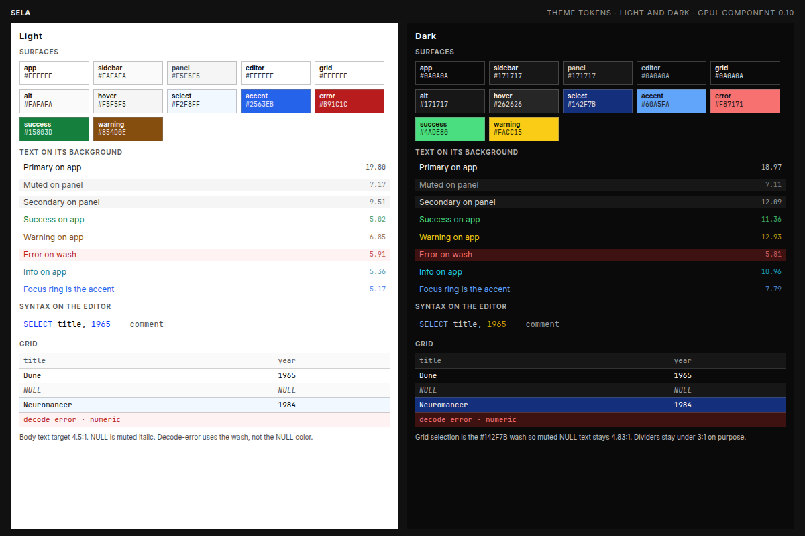

# Theme tokens

M1-7, the theme half. Selection and copy are specified with US-14 and implemented alongside this palette. Until M1-7 lands, the app stays on the kit dark default for the first frame when `settings.json` is missing.

The palette is the gpui-component 0.10.0 default (`src/theme/default-theme.json`, the shadcn neutral theme), with the overrides in [Overrides](#overrides). Wireframes in this folder stay grayscale. This file and the swatch are the only color.



Ratios are WCAG 2.x relative luminance, sRGB. A translucent token is composited over the background named in the table, and the ratio uses that result. Body text, including grid cells, status text, and the error banner, targets **4.5:1**. UI text and non-text boundaries that show a control's edge (focus ring, input border) target **3:1**. Hairline dividers are decorative and are allowed to sit under 3:1.

`secondary` is not used in this file. Shortcut notation for the theme toggle is in [Keyboard](#keyboard).

## How a token is applied

`Theme::change` reloads `Theme.light_theme` or `Theme.dark_theme` and replaces `theme.colors`. A color written onto `theme.colors` in the same closure as `theme.mode` is discarded. `Theme::apply_config` installs a `ThemeConfig` and applies it in one step.

Ship two `ThemeConfig` values, light and dark, each containing the override keys below plus `font_size`, `mono_font.size`, `radius`, `radius.lg`, `window.radius`, and that mode's `highlight` block. Store them on `light_theme` and `dark_theme`. Switch modes with `Theme::change` or `apply_config`. The next launch reads `{config_dir}/settings.json`:

```json
{ "theme": "dark" }
```

`theme` is `light`, `dark`, or `system`. A missing or unreadable file means `dark`, which is what the binary does today. This file is not `connections.json` and it is not config schema v2. When `theme` is `system`, startup and later OS appearance changes call `Theme::sync_system_appearance`. When it is `light` or `dark`, call `Theme::change` with that mode and ignore later OS changes. `font_size` is an optional sibling of `theme`, specified in [Font size](#font-size). The binary does not read it yet.

The status bar grows one `xsmall` ghost menu, after the History button and before the source label. The bar stays 28px. The label is the current choice: `Light`, `Dark`, or `System`. The menu items are those three. `System` follows the OS appearance. If a platform build cannot report window appearance, the menu is Light and Dark only. The check is in the implementation notes. Dark is still the default. Font size adds a second menu immediately before this one. The bar still stays 28px.

Tokens that have no `ThemeColor` field live in a small `SelaPalette` the UI picks from `theme.mode`. They are listed as gaps. Do not overload `danger` or `success` for those roles: in the kit those fields are button fills, and the light fill/foreground pairs fail 4.5:1 (`neutral-50` on green-500 is 2.18:1, on yellow-500 is 1.84:1, on cyan-500 is 2.33:1, on red-500 is 3.61:1).

## Color

Hex values are the ones to implement. "Keep" means the gpui-component 0.10.0 default for that mode. "Override" means the default fails the target or is missing on the dark theme.

### Surfaces

| Token | Light | Dark | JSON key | Rust field | Notes |
| --- | --- | --- | --- | --- | --- |
| bg.app | `#FFFFFF` | `#0A0A0A` | `background` | `background` | Keep. The window fill. |
| bg.sidebar | `#FAFAFA` | `#171717` | `sidebar.background` | `sidebar` | Light keep. Dark override (the kit uses `#0A0A0A`, which is the same as the canvas). |
| bg.panel | `#F5F5F5` | `#171717` | `tab_bar.background` | `tab_bar` | Keep. Tab strip, editor header, history header. |
| bg.status | `#F8F8F8` | `#171717` | `status_bar.background` | `status_bar` | Keep. The status bar is painted with `muted` today. Use this field. |
| bg.editor | `#FFFFFF` | `#0A0A0A` | `highlight` `editor.background` | `highlight_theme` | Keep. |
| bg.grid | `#FFFFFF` | `#0A0A0A` | `table.background` | `table` | Keep. |
| bg.grid.alt | `#FAFAFA` | `#171717` | `table.even.background` | `table_even` | Light keep. Dark is omitted from the kit file. Set it. |
| bg.hover | `#F5F5F5` | `#262626` | `table.hover.background` | `table_hover` | Light keep. Dark is omitted. Set it. Also set `list.hover.background` to the same dark value. |
| bg.grid.header | `#FAFAFA` | `#171717` | `table.head.background` | `table_head` | Light keep. Dark is omitted. Set it. |
| bg.selection.grid | `#F2F8FF` | `#142F7B` | `table.active.background` | `table_active` | Light keep `#BFDBFE` at 20% (`#bfdbfe33`), which composites to `#F2F8FF`. Dark set `#1D4ED8` at 55% (`#1d4ed88c`), which composites to `#142F7B`. |
| bg.selection.editor | `#55A0FC` | `#1D4ED8` | `selection.background` | `selection` | Keep. Editor text selection only. |

Paint the sidebar with `sidebar`, not `muted`. Paint the status bar with `status_bar`, not `muted`. `muted` stays the fill for a pressed or grouped control (`#F5F5F5` / `#262626`).

The 1px sidebar edge uses `sidebar.border` (`#E5E5E5` / `#262626`, keep).

### Text

| Token | Light | Dark | On | Ratio | JSON key | Rust field |
| --- | --- | --- | --- | --- | --- | --- |
| text.primary | `#0A0A0A` | `#FAFAFA` | bg.app | 19.80 / 18.97 | `foreground` | `foreground` |
| text.sidebar | `#171717` | `#F5F5F5` | bg.sidebar | 17.18 / 16.44 | `sidebar.foreground` | `sidebar_foreground` |
| text.secondary | `#404040` | `#D4D4D4` | bg.panel | 9.51 / 12.09 | `tab.foreground` | `tab_foreground` |
| text.muted | `#525252` | `#A3A3A3` | bg.app | 7.81 / 7.85 | `muted.foreground` | `muted_foreground` |
| text.muted | `#525252` | `#A3A3A3` | bg.panel | 7.17 / 7.11 | `muted.foreground` | `muted_foreground` |
| text.muted | `#525252` | `#A3A3A3` | bg.status | 7.36 / 7.11 | `muted.foreground` | `muted_foreground` |
| text.muted | `#525252` | `#A3A3A3` | bg.grid.alt | 7.49 / 7.11 | `muted.foreground` | `muted_foreground` |
| text.header | `#525252` | `#A3A3A3` | bg.grid.header | 7.49 / 7.11 | `table.head.foreground` | `table_head_foreground` |
| text.disabled | `#A3A3A3` | `#525252` | bg.app | 2.52 / 2.53 | — | — |
| text.null | `#525252` | `#A3A3A3` | bg.grid | 7.81 / 7.85 | `muted.foreground` | `muted_foreground` |

Sidebar rows use text.sidebar (`sidebar.foreground`): `#171717` on `#FAFAFA` is 17.18:1, and `#F5F5F5` on `#171717` is 16.44:1. The canvas uses text.primary.

text.secondary is the inactive tab. The active tab uses text.primary on bg.app.

text.muted is the override. The kit's light value is `#737373`, which is 4.74:1 on white and **4.35:1 on bg.panel** and **4.46:1 on bg.status**. Both miss 4.5:1. `#525252` clears them. The dark kit value `#A3A3A3` already clears, so dark stays.

text.header on dark is an override. The kit's dark `table.head.foreground` is `#525252`, which is **2.53:1** on `#0A0A0A`. Use the muted color.

text.null is text.muted, italic, which is what `GridDelegate::render_td` does for NULL today. A selected NULL uses the same color on bg.selection.grid: 7.31:1 light, 4.83:1 dark. The opaque editor selection (`#55A0FC` / `#1D4ED8`) is not the grid selection. Muted text on that opaque light blue is 2.91:1, which is why the grid uses the wash.

text.disabled is below 4.5:1 on purpose. WCAG treats disabled text as exempt. There is no theme field. Read it from `SelaPalette`. Do not reuse text.muted for a disabled control, or the disabled state and the helper text become the same color.

### Accent, focus, status

| Token | Light | Dark | On | Ratio | Where it maps |
| --- | --- | --- | --- | --- | --- |
| accent | `#2563EB` | `#60A5FA` | bg.app | 5.17 / 7.79 | `base.blue` (`blue`). Keep. |
| focus.ring | `#2563EB` | `#60A5FA` | bg.app | 5.17 / 7.79 | `ring`. Override. The kit ring is `#A3A3A3` (2.52:1 on white) and `#737373` (4.18:1 on `#0A0A0A`). |
| border.control | `#767676` | `#737373` | bg.app | 4.54 / 4.18 | `input.border` (`input`). Override. The kit border `#E5E5E5` / `#2F2F2F` is about 1.3:1, under the 3:1 target for an input's edge. |
| border.divider | `#E5E5E5` | `#262626` | bg.app | 1.26 / 1.31 | `border`, `table.row.border`. Keep. Decorative. |
| status.success.text | `#15803D` | `#4ADE80` | bg.app | 5.02 / 11.36 | No field. `SelaPalette`. Also 4.60:1 on bg.panel in light. |
| status.warning.text | `#854D0E` | `#FACC15` | bg.app | 6.85 / 12.93 | No field. Also 6.28:1 on bg.panel in light. |
| status.error.text | `#B91C1C` | `#F87171` | bg.app | 6.47 / 7.16 | No field. |
| status.info.text | `#0E7490` | `#22D3EE` | bg.app | 5.36 / 10.96 | No field. Also 4.91:1 on bg.panel in light. |
| status.error.wash | `#FEF2F2` | `#3F1212` | — | — | No field. Banner and decode-error background. |
| cell.decode.text | `#B91C1C` | `#F87171` | status.error.wash | 5.91 / 5.81 | No field. Same hues as status.error.text. |
| cell.decode.bg | `#FEF2F2` | `#3F1212` | — | — | No field. |

The primary button stays the kit pair: `#FAFAFA` on `#171717` in light, `#171717` on `#FAFAFA` in dark, 17.18:1 either way (`primary.background` / `primary.foreground`). Do not recolor it to accent.

The query error banner in `content.rs` is `danger` with `danger_foreground` today. Point it at status.error.wash and status.error.text. The kit's light danger button pair does not clear 4.5:1 at the banner's size.

History outcome marks, the Test result line, and a future inline error use the status text colors. They do not use the kit's `success`, `warning`, `danger`, or `info` fills.

A decode-error cell (already specified in the main-window spec as distinct from NULL) uses cell.decode.bg and cell.decode.text. NULL stays italic text.null on the grid background, with no wash.

### Syntax

Basics for the SQL editor. The kit's `highlight.syntax` block is the store (`Theme.highlight_theme`). Unlisted syntax keys stay on the kit default.

| Token | Light | Dark | On bg.editor | Ratio | Highlight key |
| --- | --- | --- | --- | --- | --- |
| syntax.plain | `#000000` | `#CACCCA` | editor | 21.00 / 12.26 | `editor.foreground` |
| syntax.keyword | `#0433FF` | `#87B1F6` | editor | 7.19 / 9.10 | `syntax.keyword` |
| syntax.string | `#036A07` | `#A3E09F` | editor | 6.84 / 12.93 | `syntax.string` |
| syntax.number | `#0433FF` | `#CC9E00` | editor | 7.19 / 7.97 | `syntax.number` |
| syntax.comment | `#525252` | `#9D9D9D` | editor | 7.81 / 7.30 | `syntax.comment` and `syntax.comment.doc` |
| editor.line_number | `#525252` | `#8F8F8F` | editor | 7.81 / 6.12 | `editor.line_number` |

Light comment and light line number are overrides. The kit comment `#007FFF` is 3.83:1 on white. The kit line number `#929292` is 3.11:1. Comments stay `#525252` (7.81:1), the same gray as muted text. Dark values in this table are the kit's and already clear 4.5:1.

Keyword, string, number, comment, and plain are the set M1-7 has to get right. Identifier text uses syntax.plain. A fuller highlight theme can land with the editor work. It must not put a new color under 4.5:1 on bg.editor.

## Overrides

Keys to set on top of the kit default. Everything else stays.

Light:

| Key | Value |
| --- | --- |
| `muted.foreground` | `#525252` |
| `table.head.foreground` | `#525252` |
| `ring` | `#2563EB` |
| `input.border` | `#767676` |
| `editor.line_number` | `#525252` |
| `syntax.comment.color` | `#525252` |
| `syntax.comment.doc.color` | `#525252` |
| `font_size` | `13` |
| `mono_font.size` | `12` |
| `radius` | `4` |
| `radius.lg` | `6` |
| `window.radius` | `0` |

Dark:

| Key | Value |
| --- | --- |
| `sidebar.background` | `#171717` |
| `muted.foreground` | `#A3A3A3` |
| `table.even.background` | `#171717` |
| `table.hover.background` | `#262626` |
| `table.head.background` | `#171717` |
| `table.head.foreground` | `#A3A3A3` |
| `table.active.background` | `#1d4ed88c` |
| `list.hover.background` | `#262626` |
| `list.even.background` | `#171717` |
| `ring` | `#60A5FA` |
| `input.border` | `#737373` |
| `font_size` | `13` |
| `mono_font.size` | `12` |
| `radius` | `4` |
| `radius.lg` | `6` |
| `window.radius` | `0` |

`list.even.background` in the dark kit is `#171717` at 40% alpha, which composites to about `#0F0F0F` and does not read as a stripe. Set the solid.

## Type

Do not bundle Inter or JetBrains Mono. Those faces are in the wireframe HTML so the drawings match on a machine that has them. The app uses the kit fonts.

| Role | Family | Size | Line height | Weight |
| --- | --- | --- | --- | --- |
| UI | `.SystemUIFont` (`font_family`) | 13px (`font_size`) | 16px | 400 |
| UI small (status, helpers, field labels, grid headers) | UI | 11px floor, 12px if `text_xs` already resolves there | 14px | 400 |
| Active tab, primary button, dialog title | UI | 13px | 16px | 600 |
| Grid cells and SQL editor | `mono_font_family` | 12px (`mono_font_size`) | 26px row / 18px editor line | 400 |

These sizes are the default step. [Font size](#font-size) scales the type. It does not scale the chrome heights in the next sections.

`mono_font_family` stays the kit default: Menlo on macOS, Consolas on Windows, DejaVu Sans Mono on Linux, with the kit's installed-font fallback. Do not set a family the machine may not have. GPUI panics on the first line laid out in a missing family.

Weight 700 is not used in the chrome.

`text_xs` is whatever the kit resolves. If that is already at least 11px, leave it. Do not also scale it down because `font_size` moved from 16 to 13. 11px is the floor for status, helper, and header text.

## Spacing

The scale is 4px. Use these pixels. The kit's `gap_1`, `gap_2`, `px_3`, and `p_4` utilities are the right tool when they match the row. When they do not, use `px`.

| Token | px | Used for |
| --- | --- | --- |
| space.1 | 4 | Icon-to-label gaps, tree indent step is 14px and stays 14 (`tree.rs`) |
| space.2 | 8 | Control gaps in a toolbar group (`gap_2`) |
| space.3 | 12 | Toolbar, status, and sidebar horizontal padding (`px_3`) |
| space.4 | 16 | Dialog body padding when `p_4` is 16 |
| space.6 | 24 | The gap between the dialog and the window edge |

Do not introduce an 8px-base scale. The window is already on 4px steps.

## Chrome sizes

These match the code, except the grid row and the tab strip, which the code does not set.

| Token | px | Where |
| --- | --- | --- |
| sidebar.width | 292 | `sidebar.rs`, `w(px(292.))`. Fixed. Drag range stays the batch 1 spec (200–480) when that splitter is built. |
| toolbar.height | 44 | `content.rs`, `h(px(44.))` |
| editor.band | 176 | `content.rs`, `h(px(176.))`, including the 28px editor header |
| editor.header | 28 | `content.rs` |
| status.height | 28 | `status.rs`, `h(px(28.))` |
| tab.height | 28 | Not set in code. The strip is 28px. Do not grow it. |
| grid.row | 26 | `Size::XSmall` (`table_row_height` is 26). The `DataTable` is `Size::Medium` today (32). Set XSmall. |
| grid.header | 26 | Same size. The kit uses the row height for the header unless `header_row_height` is set. Leave it unset. |
| sidebar.row | 26 | Match the grid. Indent stays `pl(px(8. + depth * 14.))`. |
| dialog.width | 560 | Connection dialog. Today 460. |
| window | 1180 × 760, minimum 880 × 560 | `ui/mod.rs` |

The batch 1 wireframes draw grid rows at 22px. That number is schematic. The kit's smallest table size is 26. Do not pass a custom row height to get to 22.

History rows are 26, the history header is 28, and the history panel defaults to 196. Those are in the history spec. They use this scale and these colors.

## Radius and borders

| Token | px | Maps to |
| --- | --- | --- |
| radius.none | 0 | Grid cells, tabs, sidebar, status bar, splitters |
| radius | 4 | `Theme.radius`. Buttons and inputs. The kit default is 6. |
| radius.lg | 6 | `Theme.radius_lg`. The connection dialog. The kit default is 8. |
| radius.window | 0 | `Theme.window_radius`. Keep. |
| border.width | 1 | Every divider. `border_b_1` and the sidebar's `border_r_1`. |
| focus.width | 2 | The kit focus ring, outside the control, color `ring`. `focus_ring` stays true. |

No shadow on the grid, the sidebar, or the history panel. `Theme.shadow` can stay at the kit default for menus and the dialog. Do not add a shadow to a region that meets its neighbor on a 1px border.

## Mapping and gaps

Fields the app already reads, and the token they should keep reading:

| Call site today | Token |
| --- | --- |
| `background`, `foreground` | bg.app, text.primary |
| `muted` on the sidebar and the status bar | Stop. Use `sidebar` and `status_bar`. |
| `muted_foreground` | text.muted and text.null |
| `border` | border.divider |
| `danger`, `danger_foreground` on the error banner | Stop. Use the `SelaPalette` wash and status.error.text. |
| `mono_font_family` | The mono role above |
| `secondary_foreground`, `tokens.secondary_hover`, `tokens.secondary_active` | Tab close button. Leave those kit fields alone. |

Gaps, with no `ThemeColor` field in gpui-component 0.10.0:

| Need | Why it is not a kit field |
| --- | --- |
| status.success.text, status.warning.text, status.error.text, status.info.text | `success`, `warning`, `danger`, and `info` are fills. Their `*_foreground` colors are for text on that fill, and the light pairs fail 4.5:1. |
| status.error.wash, cell.decode.bg | No subtle-danger field. |
| text.disabled | No disabled-foreground field. `muted_foreground` has to stay at the AA muted color. |
| syntax.* and editor.line_number | They live on `highlight_theme`, not on `ThemeColor`. Set them through the highlight block. |
| A per-mode `SelaPalette` | `Theme::change` will not carry these across a mode switch unless the app owns them. |

## Font size

Backlog #39. One step for the whole window, not a separate editor zoom. The step is the UI pixel size. Mono is derived from it. The value is stored in `settings.json` next to `theme` and applied to both the light and the dark `ThemeConfig`, so a mode switch does not reset it.

```json
{ "theme": "dark", "font_size": 13 }
```

`font_size` is an integer. Missing, or not an integer, means 13. A value outside 11–18 is clamped. The file still holds no secrets.

| UI `font_size` | Mono | `text_xs` | UI line | Editor line | Grid, sidebar, history, and filter row |
| --- | --- | --- | --- | --- | --- |
| 11 | 11 | 11 | 14 | 18 | 26 |
| 13 (default) | 12 | the kit value, never under 11 | 16 | 18 | 26 |
| 18 | 17 | 16 | 22 | 26 | 37 |

Formulas, integer pixels, half rounds away from zero the way `round` usually does:

- Mono = `max(11, ui - 1)`.
- At UI 13, leave `text_xs` as the kit resolves it, and do not shrink it. Otherwise `text_xs` = `max(11, ui - 2)`. The 11px floor from the type section stays.
- UI line = `max(14, round(ui * 16 / 13))`.
- Editor line = `max(18, round(18 * mono / 12))`.
- Row = `max(26, round(26 * mono / 12))`. This is the grid row, the grid header, the sidebar row, the history row, and the filter row.

At the default step, keep `DataTable` on `Size::XSmall` (26). Do not pass a custom row height to get under 26. Above 13, set the row height from the formula.

These stay fixed at every step. Text inside them may grow until the largest step, which is why the maximum is 18 and not larger:

| Token | px | Why it stays |
| --- | --- | --- |
| toolbar.height | 44 | One line still fits at UI 18 (line 22). |
| status.height | 28 | `text_xs` at the top step is 16. |
| tab.height | 28 | The strip does not grow. |
| editor.header, history header | 28 | The header chrome. |
| Client title bar | 34 | gpui-component `TitleBar`. Does not scale. |
| editor.band | 176 | The splitter default, not a font metric. Fewer lines fit when the line height grows. |
| sidebar.width, dialog.width, window size | unchanged | Layout, not type. The sidebar footer button row wraps at large UI steps so **Disconnect** is not clipped. |
| space.1–space.6, radius, border, focus | unchanged | The 4px scale. |

The control is a status-bar menu, `xsmall` ghost, immediately before the theme menu. The label is the current UI size (`13`). The items are `11` through `18`, with a check on the current size, then `Reset`. The bar stays 28px. There is still no settings window. `secondary-,` stays reserved.

| Action | Shortcut | Bound today |
| --- | --- | --- |
| Larger | `secondary-=` and `secondary-+` (`secondary-shift-=`) | no |
| Smaller | `secondary--` | no |
| Reset to 13 | `secondary-0` | no |

None of those chords is in the reserved table in [README.md](./README.md). `secondary-1` through `secondary-9` stay tab switches. `secondary-0` is reset, not a tab. The chords are global, including inside a text field: they change the font and do not insert the character. Register each once, with `bind_secondary`. They do not dismiss a dialog.

## Edit and connection marks

No `ThemeColor` field. Read them from `SelaPalette` for the active mode, same as the status text colors. Hex is the value to use. A connection swatch stores a name; the paint looks up the pair.

| Token | Light | Dark | Use |
| --- | --- | --- | --- |
| row.insert.bg | `#F0FDF4` | `#052E16` | Inserted and duplicated rows. `text.primary` on these is above 4.5:1. |
| cell.dirty.mark | `#854D0E` | `#FACC15` | The 6px triangle. Same hues as status.warning.text. |
| conn.none | — | — | Draw nothing. |
| conn.blue | `#2563EB` | `#60A5FA` | Same hues as accent. |
| conn.green | `#15803D` | `#4ADE80` | Same hues as status.success.text. |
| conn.amber | `#A16207` | `#EAB308` | Dark enough to see on `#FAFAFA`, light enough to see on `#171717`. |
| conn.red | `#B91C1C` | `#F87171` | Production mark. Same hues as status.error.text. |
| conn.purple | `#7E22CE` | `#C084FC` | |
| conn.teal | `#0F766E` | `#2DD4BF` | |

The triangle, the gutter glyph, and strikethrough are specified in [07-grid-editing.md](./07-grid-editing.md). The swatch placement is in [01-main-window.md](./01-main-window.md#connection-color-and-groups). Do not reuse `danger` or `success` fills for these.

## Keyboard

| Action | Shortcut | Bound today |
| --- | --- | --- |
| Choose Light, Dark, or System | The status menu | yes (M1-7) |
| Font size | [Font size](#font-size) | no |

The theme menu has no shortcut. `secondary-,` stays reserved for a future settings window. The status menu is the M1-7 control.

## Implementation notes for engineering

- Build the two `ThemeConfig`s from the kit defaults plus [Overrides](#overrides). Put font size, mono size, radius, and the highlight block on both, or a mode switch restores the kit value on the side that omitted it.
- Apply with `Theme::apply_config` or by replacing `light_theme` / `dark_theme` and then calling `Theme::change`. Do not set `colors` in the same edit that sets `mode`.
- `ui/mod.rs` stays on dark for the first frame when `settings.json` is missing or `theme` is `dark`.
- System is available when the open window can report appearance. In gpui-kit 0.10, `Window::appearance()` returns `WindowAppearance` (`Light`, `Dark`, `VibrantLight`, `VibrantDark`). `ThemeMode` implements `From<WindowAppearance>`: vibrant variants map to Dark and Light. `Theme::sync_system_appearance(Some(window), cx)` reads `window.appearance()`, and uses `cx.window_appearance()` only when no window is passed. The kit comment says to prefer `window.appearance()` on Linux. Call `window.appearance()` once while bringing the window up. If that value is a `WindowAppearance`, show System. If a target build has no appearance API, omit System and ship Light and Dark. Do not add System on a platform where the call is missing.
- When the setting is `system`, call `Theme::sync_system_appearance` at startup and on an OS appearance change. When it is `light` or `dark`, call `Theme::change` and do not follow later OS changes.
- `SelaPalette` is a `const` for each mode. Select it from `cx.theme().mode`. Do not encode those colors as extra keys in the theme JSON unless the loader is confirmed to keep unknown keys. The 0.10 schema drops what it does not know.
- Grid: `DataTable::new(...).stripe(true).bordered(true)` gains the XSmall size. Stripe uses `table_even`. Selection uses `table_active`.
- NULL stays `muted_foreground` and italic. Decode-error stops sharing that style. The main-window spec already requires the two to look different. This file is the color.
- The error banner's contrast is part of this milestone. Leaving it on `danger` / `danger_foreground` keeps a 3.61:1 light pair.
- Check the ratios in [Color](#color) when a token changes. The swatch HTML under `images/theme-swatches.html` is the picture of these hex values. Regenerating the PNG is a documentation step, not a test.

## Decisions

1. The status menu offers Light, Dark, and System when `Window::appearance()` is available. System follows the OS through `Theme::sync_system_appearance`. If that API is missing on a platform, the menu is Light and Dark only. Dark is the default.
2. Light-theme SQL comments stay `#525252`.
3. Dark chrome (`#171717` on a `#0A0A0A` canvas) with a 13px UI font is the density. Do not keep the kit at 16px and only shrink the grid and the editor. `theme.rs` already ships these values.
4. Font size is one UI step, 11–18, default 13. Mono is `max(11, ui - 1)`. Chrome heights in this file stay fixed. The step is written to both theme configs. Separate UI and editor sizes are not in this setting.

## Open questions

None.
