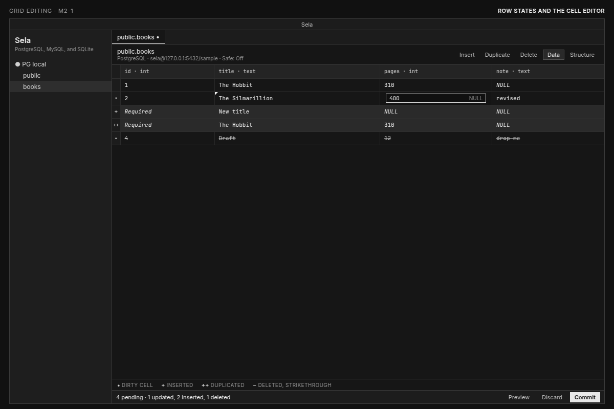

# Grid editing

M2-1, the grid half of US-05. The pending set is the `ChangeSet` in [SPECS.md](../SPECS.md). Preview, the transaction, and discard are in [08-preview-commit.md](./08-preview-commit.md). Safe mode can refuse edits; that gate is in [09-safe-mode.md](./09-safe-mode.md). Shortcut notation is in [README.md](./README.md).

Editing is an overlay on the table Data grid. It does not write to the database until Commit. SQL result tabs, the Structure pane, and views are not editable.

## Where editing is allowed

| Surface | Editing |
| --- | --- |
| Table Data, one primary key | Yes. |
| Table Data, no primary key, exactly one unique NOT NULL constraint | Yes. That constraint is the row key. |
| Table Data, no primary key and no such constraint | Read-only. See [Read-only](#read-only). |
| Table Data, no primary key and two or more unique NOT NULL constraints | Read-only. Sela does not guess which constraint is the key. |
| View | Read-only. |
| Structure pane | No overlay. |
| SQL result tab | Read-only. `Enter` does not open an editor. |

The key is composite when the primary key (or the single unique constraint) has several columns. Every key column is part of the later `WHERE`. Generated and identity columns are not editable: `serial`, `IDENTITY`, `GENERATED`, `AUTO_INCREMENT`, and a SQLite `INTEGER PRIMARY KEY` rowid alias. They stay on screen. The tooltip is `Filled on commit.`

A decode-error cell and a `ColumnKind::Bytes` cell are not editable even on an editable table. `Enter` leaves them alone. Status: `This cell is read-only.` Blob status adds `Use SQL to change it.` `ColumnKind::Other` (arrays and other text fallbacks) is read-only the same way. `Space` still opens inspect, as in [01-main-window.md](./01-main-window.md).

## Entering edit mode

The grid must already have a focused cell (arrow keys, once focus is inside the grid).

| Action | Result |
| --- | --- |
| `Enter` | Open the editor for that cell. |
| Double-click | Same. |
| `Space` | Inspect. This does not edit. |
| Typing a character | No. There is no type-over. `Enter` or double-click first. |

`Enter` no longer opens inspect. That reassignment is the one [01-main-window.md](./01-main-window.md) already reserves for M2.

The editor replaces the cell. It is not a modal, except the JSON and multiline popover below. Focus moves into the editor. The window-level run binding does not fire from it.

## Editors by type

`ColumnKind` picks the control. The value stored in the `ChangeSet` is a `Value`, not the raw string.

| Kind | Control |
| --- | --- |
| Bool | Menu: `true`, `false`, `NULL`. Not a text field. |
| Int, Float, Decimal | One line, monospace. Decimal keeps the digits the user typed. Do not parse it through `f64`. |
| Text, Uuid, Date, Time, Timestamp, Interval | One line, monospace, in the same display text the grid already uses. |
| Json | Popover, not the inline line. |
| Bytes, Other, decode error | No editor. |

Text that contains a newline, or `Shift-Enter` in a text editor, opens the same popover as JSON. The popover is the inspect popover's box: anchored to the cell, max width 420px, monospace, scroll when the value is long. `Enter` inside the popover inserts a newline. `secondary-enter` accepts it. `Escape` closes it and drops what was typed in the popover.

Invalid text does not enter the `ChangeSet`. The editor stays open. One line under the cell, `text_xs`, `status.error.text`: `Enter a valid {type}, or set NULL.` Float `NaN` and infinities follow the copy rule: Postgres accepts them, MySQL and SQLite refuse them with a status line that names the column.

## NULL and empty

NULL and `''` stay different, which is the same rule as filter `=` in [02-filter-sort-review.md](./02-filter-sort-review.md).

The inline editor shows a real NULL as an empty field with the placeholder `NULL` in italic `text.null`. It does not show the letters N-U-L-L as the value. A ghost `NULL` button sits at the right edge of the editor. Activating it stores `Value::Null` and closes the editor.

| Field | What an empty field commits |
| --- | --- |
| Text | `''`. Not NULL. |
| Int, Float, Decimal, Date, Time, Timestamp, Interval, Uuid, Json | Nothing. The error line above. The user sets NULL with the button or, for bool, the menu. |
| Bool | The menu has a `NULL` row. There is no empty commit. |

Clearing a text cell that was NULL stores `''` and marks the cell dirty. Setting NULL on a `''` cell does the same in the other direction.

## Cell keys

These keys are for the open editor. They do not commit to the database. The changeset keys are in [08-preview-commit.md](./08-preview-commit.md).

| Key | Inline editor | Popover |
| --- | --- | --- |
| `Enter` | Accept the cell into the `ChangeSet` and close the editor. | Insert a newline. |
| `secondary-enter` | Same as `Enter`. Does not run SQL. | Accept the popover. |
| `Tab` / `Shift-Tab` | Accept and open the next or previous editable cell on the row, then the next row. | Same, after accept. |
| `Escape` | Drop what was typed in this opening. The `ChangeSet` is unchanged. | Same for the popover. |
| `secondary-z` | Undo typing inside the field. | Same. |
| `secondary-shift-z` | Left to the field. On macOS that is redo. It does not discard. | Same. |

`Escape` does not discard the pending set. Discard is `secondary-shift-z` when the editor is closed. US-05 names Esc as discard; the split is recorded under [Open questions](#open-questions). The default in this spec is the split above, so Esc can keep closing inspect, menus, and the quit dialog.

Accepting a value equal to the server value removes that cell from the row's change. The triangle goes away. If the row has no remaining changes, the row mark goes away too.

## Row states

The grid gains a 16px gutter on the left, sticky, not a data column. It is not copied and it is not in `cell_text`. Header cell of the gutter is empty.

Color comes from [06-theme-tokens.md](./06-theme-tokens.md#edit-and-connection-marks). Every state also has a glyph or strikethrough, and a tooltip, so the state is not color alone.

| State | Gutter | Cells | Tooltip on the gutter |
| --- | --- | --- | --- |
| Inserted | `+` | `row.insert.bg`. No per-cell triangle. | `New row` |
| Duplicated | `++` | Same wash as inserted. | `Duplicated row` |
| Dirty (update of a server row) | `•` | Unchanged text color. Each changed cell has a 6px triangle in the top-left corner, inset 2px, color `cell.dirty.mark`. | `Edited row` |
| Deleted | `−` in `status.error.text` | Strikethrough, `text.primary`. No wash. Triangles hidden. | `Deleted row` |

The triangle's tooltip is `Edited · was {original display}`. NULL is shown there as `NULL`, not as a blank.

A deleted row stays on screen until Commit or Discard. It is not editable. `Enter` on it sets status `This row is marked for delete. Choose Delete again to restore it.`

Marking a dirty row deleted hides the triangles and shows the deleted treatment. The underlying cell edits are kept. Undelete (`secondary-backspace` on that row) shows them again. Commit of a deleted row sends a `DELETE` only, using the original key.

Deleting an inserted or duplicated row removes it from the `ChangeSet`. It was never on the server, so there is no strikethrough and no `DELETE`.

Selection uses `bg.selection.grid` as it does today. The gutter glyph and the triangle stay visible on top of the selection.

Stripe rows keep `table_even` under an update. The insert wash replaces the stripe for inserted and duplicated rows only.

## Read-only

One line, 26px, under the pending bar if that bar is open, otherwise under the filter bar or the toolbar. Background `bg.panel`. Text `status.info.text`. Not the error banner and not `danger`. The error banner still owns real failures.

The Data pane shows the first reason that applies:

| Reason | Line |
| --- | --- |
| Safe mode is Read-only | `Read-only · safe mode on this connection.` |
| View | `Read-only · views are read-only.` |
| No usable key | `Read-only · no primary key or unique NOT NULL column.` |
| Several unique keys and no primary key | `Read-only · more than one unique key and no primary key.` |

`Enter`, double-click, Insert, Duplicate, and Delete do nothing. Status repeats the same sentence. `Space` still inspects. Filter and sort still run.

A SQL result tab has no strip. `Enter` sets status `SQL results are read-only. Open the table to edit.`

## Row actions

On the Data toolbar, before the page label, three ghost `xsmall` buttons: `Insert`, `Duplicate`, `Delete`. Disabled when the table is read-only, with the read-only sentence as the tooltip. The grid context menu gains the same three items under the copy items.

| Action | When the grid is focused and no editor is open | Where the row goes |
| --- | --- | --- |
| Insert | `secondary-i`, or `Insert` | A blank overlay row after the loaded page. Gutter `+`. Every cell unset. |
| Duplicate | `secondary-d`, or `Duplicate` | An overlay row directly under the focused row. Gutter `++`. Non-generated values are copied. Primary-key cells are unset. Generated cells stay `Filled on commit.` |
| Delete | `secondary-backspace` | Marks the focused server row deleted, or drops an overlay row. |
| Restore | `secondary-backspace` on a deleted row | Clears the delete mark. |

Duplicate and Delete with no focused row set status `Select a row first.` Insert does not need one.

Unset primary-key cells on a new row use the placeholder `Required` (italic, `text.null`) when the column is not generated. Commit stays disabled until each of those cells has a value or an explicit NULL. Status while it is disabled: `Set a primary key for the new row.` Generated key columns do not block Commit.

Overlay rows are not `ResultWindow` rows. They do not count toward the page size or the row cap. Paging and filter changes keep the `ChangeSet`. A filter that hides a dirty server row does not drop the edit. Preview still lists it.

Copy skips the gutter. Copy of a dirty cell copies the pending display value. Copy of a deleted row still copies the cells. Unloaded pages are not editable; the existing unloaded-cell copy refusal stays.

## Keyboard

Grid focus context, editor closed. Full chords are also in [README.md](./README.md).

| Action | Shortcut |
| --- | --- |
| Edit the focused cell | `Enter` or double-click |
| Inspect | `Space` |
| Insert a row | `secondary-i` |
| Duplicate the focused row | `secondary-d` |
| Delete or restore the focused row | `secondary-backspace` |
| Commit / discard / preview | [08-preview-commit.md](./08-preview-commit.md) |

`secondary-i` and `secondary-d` are not bound in the SQL editor. `secondary-backspace` in an open cell editor deletes to the start of the line (the same split the filter bar uses). It does not mark the row deleted.

## Implementation notes for engineering

- The overlay lives beside `ResultWindow`, keyed by the stable row identity the page already has, plus a client id for inserted rows. Do not write pending values back into the result pages.
- `Enter` to edit is the grid context. The cell editor's context does not include `RunQuery`.
- The gutter is a 16px sticky column painted with the delegate, excluded from copy and from horizontal scroll of the data columns. If `DataTable` cannot pin it, paint the glyph in the first cell's leading padding and still exclude it from `cell_text`.
- Generated-column detection uses the structure default and type name. The exact `INSERT` omission list belongs to M2-2. This file only decides which cells look unset and which ones block Commit.
- A table with a primary key uses that key even if unique constraints also exist.

## Decisions

1. A single unique NOT NULL constraint is a key when there is no primary key. Two of them, and no primary key, stays read-only. US-05 says "no PK"; the SPECS `RowKey` is the wider rule, with the ambiguous case refused.
2. `Escape` cancels the open cell editor or popover only. It does not discard the `ChangeSet`.
3. Inserted and duplicated rows are marked on the row (wash and gutter). Per-cell triangles are only for edits to a row that already exists on the server.
4. Deleting an inserted row drops it. Deleting a server row keeps it visible and strikethrough until Commit or Discard.
5. NULL is an explicit control. An empty text field is `''`.

## Open questions

1. Confirm decision 1. The alternative is primary key only, which matches the US-05 wording and would make unique-only tables read-only.
2. Confirm decision 2. The alternative is US-05 read literally: `Escape` with the editor closed discards the whole pending set. That fights inspect, menus, and the quit dialog, which already use `Escape` to dismiss.
3. Duplicate leaves primary-key cells unset so an identity column can fill them. Confirm that a non-generated key the user must retype is the right default, rather than copying the key and letting the database reject the duplicate.
