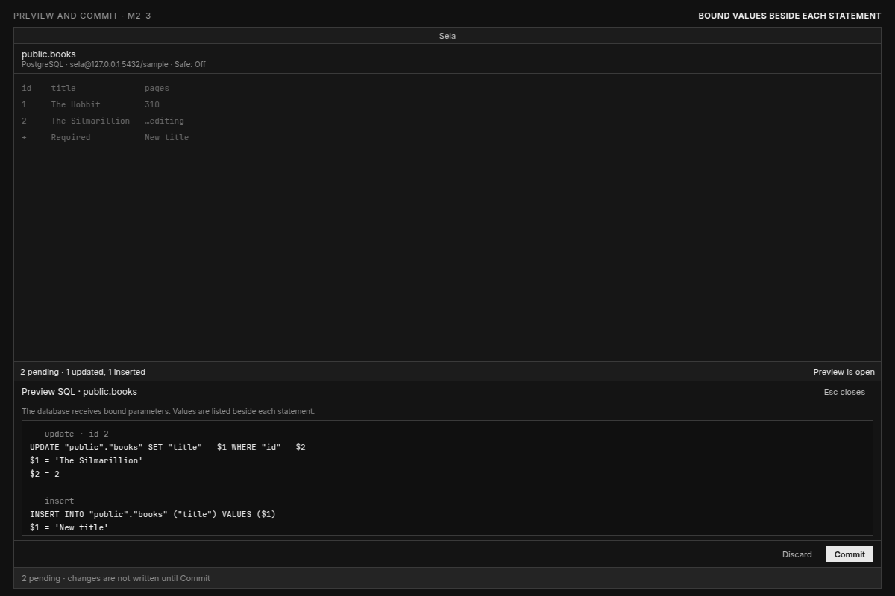

# Preview, commit, and discard

M2-3, US-06. The grid overlay and the `ChangeSet` are in [07-grid-editing.md](./07-grid-editing.md). Safe-mode confirms that wrap Commit are in [09-safe-mode.md](./09-safe-mode.md). The transaction shape is the one in [SPECS.md](../SPECS.md): one transaction, deletes, then updates, then inserts. Dialect SQL and the golden tests are M2-2. This file is the window around that SQL.

v0.3 extends this file for issue [#68](https://github.com/nesso99/sela/issues/68): optimistic WHERE (always on) and cancel while Commit runs. Maps to QA [v0.3-test-plan.md](../../qa/v0.3-test-plan.md) **OW-01…OW-04**, **CAN-01…CAN-04**, **M-CAN-01**.



## Pending bar

A 26px bar, shown only when the active table tab has at least one pending change. It sits under the filter bar (or under the toolbar when the filter bar is closed) and above the read-only strip and the error banner. The height comes out of the grid. It is not a card.

| Side | Contents |
| --- | --- |
| Left | `3 pending · 2 updated, 1 inserted`. Omit a count that is zero. Overlay rows count as inserted. |
| Right | `Preview`, `Discard`, `Commit`. Ghost, ghost, primary. `xsmall`. One primary. |

`Commit` is disabled when a required primary-key cell on a new row is still unset ([07-grid-editing.md](./07-grid-editing.md)), when safe mode is Read-only, or while the tab is `busy`. The tooltip says which. `Discard` and `Preview` stay enabled while changes exist. `Discard` is also disabled while `busy`.

The status bar does not repeat the count. On commit failure it replaces the tab status with the failure line below. After a successful commit the bar closes and the status line stays `Committed · N statements · … ms` (see [Commit](#commit)); the ordinary row-count line does not overwrite it.

`secondary-s`, `secondary-shift-v`, and `secondary-shift-z` are bound here. **`secondary-shift-p` moves to the command palette (action mode) in v0.3** ([12-command-palette.md](./12-command-palette.md)). Preview’s chord is **`secondary-shift-v`**.

## Preview sheet

`Preview` or `secondary-shift-v` opens a sheet from the bottom of the content column, above the status bar, height 240px. The grid shrinks. It is not a second window. `Escape` closes the sheet and does not discard.

Title: `Preview SQL · {schema.table}`. A `text_xs` line under it: `The database receives bound parameters. Values are listed beside each statement.`

The body is monospace, scrollable, one block per statement, in commit order (deletes, then updates, then inserts). Each block is the statement with placeholders and the bound values under it:

```text
UPDATE "public"."books" SET "title" = $1 WHERE "id" = $2
$1 = 'The Hobbit'
$2 = 3
```

NULL is an unquoted `NULL`. Strings are quoted and escaped for display only. The sheet never concatenates those literals into the SQL that runs. Placeholders follow the dialect (`$1` on Postgres, `?` on MySQL and SQLite). A comment line names the row: `-- update · id 3`.

Untouched cells on an insert are omitted so the database default applies. An explicit NULL is included. A new row with nothing set is still listed (M2-2 picks `DEFAULT VALUES` or the dialect equivalent). Generated columns are omitted.

The footer repeats `Discard` (ghost) and `Commit` (primary). They do the same thing as the bar. Closing the sheet leaves the `ChangeSet` in place.

`secondary-shift-v` is bound when the table Data pane or the pending bar is focused, including when this sheet is open (it leaves the sheet open). It does nothing in the SQL editor, the filter fields, and the connection dialog.

## Optimistic WHERE (#68)

**Always on. No setting.** Every grid `UPDATE` / `DELETE` ANDs the previous values of **non-primary-key** columns into the `WHERE`, in addition to the PK predicates (**OW-01**). NULL old values use `IS NULL`. Values stay bound. Preview SQL lists those predicates (**OW-04**).

Zero rows affected (concurrent edit of a non-PK column, or a deleted row) is `ChangeConflict`: the whole transaction rolls back; pending edits are kept (**OW-02**). Same-value updates and NULL old values must not false-positive (**OW-03**); MySQL keeps `FOUND_ROWS`.

## Commit

`Commit` or `secondary-s` runs the pending statements in one transaction: `BEGIN`, deletes, updates, inserts, `COMMIT`. Identifiers are quoted. Values are bound. The `WHERE` is the primary-key columns **plus** the optimistic non-PK predicates above.

`secondary-s` while the cell editor is open accepts the cell first, then commits, except when that accept fails validation: the editor stays open and nothing is sent. `secondary-s` in the SQL editor does nothing. It is not a document save.

When safe mode is Confirm writes, Commit opens the confirm in [09-safe-mode.md](./09-safe-mode.md) instead of sending. When it is Off, grid Commit sends immediately. Grid statements always have a key `WHERE`, so the no-WHERE warning does not apply to them.

### While Commit runs (**CAN-01**, **M-CAN-01**)

| Piece | Behavior |
| --- | --- |
| Pending bar / status | `Committing {N} changes…` |
| Commit button | Disabled; label `Committing…` |
| Cancel | Enabled on the pending bar (ghost `Cancel`) and via Stop / `secondary-.`. Wires `CancellationToken` into `apply_changes`. |
| Grid | Stays as the user left it. No spinner overlay. Mutations, paging, filter, sort stay blocked while busy (existing rule). |

### Outcomes

| Outcome | UI |
| --- | --- |
| Success | Close the sheet, drop the `ChangeSet`, reload the page, status `Committed · 3 statements · 40 ms`. Reload failure: `Committed · the page failed to reload.` Pending set still dropped. |
| Cancel (**CAN-02**, **CAN-03**) | Transaction rolled back. No partial writes. `ChangeSet` kept (edits stay dirty). Status / banner: `Commit cancelled. No changes were saved.` A later Commit can succeed. |
| Conflict (0 rows / optimistic miss) | Transaction rolled back. Pending edits kept until the user acts. Banner + status: `Row changed since it was loaded. No changes were saved. Refresh and try again.` A **Refresh** button on the banner drops that tab’s `ChangeSet` and reloads the page from the server so the grid matches reality. Discard remains available if they want to clear without reloading. |
| Other commit failure | Existing path: banner with `DbError`, `Commit failed. Changes kept.`, no reload. |

`secondary-s` is registered once, with the platform key, on the table-Data and pending-bar contexts. Not on the SQL editor.

## Discard

`Discard` or `secondary-shift-z` (editor closed) opens a confirm. Same button rules as [Quit and window lifecycle](./01-main-window.md#quit-and-window-lifecycle): Cancel is the primary button, `Enter` and `Escape` cancel, the other button is not primary. Do not use the danger style from Clear history.

| Piece | Value |
| --- | --- |
| Title | `Discard pending changes?` |
| Body | `{N} edits on {schema.table} will be dropped. The database is not changed.` |
| Cancel | Primary. `Enter` and `Escape`. |
| Discard | Not primary. Click, or `Tab` then `Enter`. |

Confirming drops the `ChangeSet`, closes the sheet, and repaints the page from `ResultWindow`. Nothing is sent to the database.

`secondary-shift-z` inside a text field, including the cell editor and the SQL editor, is left to the field. On macOS that is redo. On Windows and Linux, redo stays `secondary-y`. Either way it does not discard.

## Commit failure

Any error rolls the transaction back. The `ChangeSet` stays. Dirty marks, overlay rows, and the pending bar stay. The grid is not reloaded from the server.

The existing error banner shows the `DbError` text, with SQLSTATE when there is one, capped and scrolling as in [01-main-window.md](./01-main-window.md). The pending bar adds one clause, `status.error.text`: `Commit failed. Changes kept.` Status: `Commit failed · statement 2 of 4 · changes kept`. When the driver does not say which statement, omit the statement clause.

A key that matched zero rows (PK miss or optimistic non-PK miss) is a failure of the whole transaction, not a partial apply. Use the conflict copy in [Outcomes](#outcomes) (`Row changed since it was loaded…`), not only the older `No row matched {schema.table} for this key.` line. The older line may remain as detail in the banner body when the driver names the table.

## Closing with pending edits

Pending edits are not typed SQL. The close-tab and quit confirms still use the quit button rules.

| Action | Title | Body |
| --- | --- | --- |
| `secondary-w` on a tab with pending edits | `Close {schema.table}?` | `{N} pending changes will be discarded. The database is not changed.` |
| Quit, pending edits, nothing busy | `Quit Sela?` | `{N} pending changes will be discarded.` |
| Quit, pending edits, and a busy query | `Quit Sela?` | Both sentences: the running-query sentence from [01-main-window.md](./01-main-window.md#quit-and-window-lifecycle), then the pending-changes sentence. |

Buttons are Cancel (primary, `Enter`, `Escape`) and `Close tab` or `Quit` (not primary). Cancel leaves the tab, the `ChangeSet`, and any running query alone.

Switching connections and Disconnect already confirm when a tab has typed SQL or a busy query ([01-main-window.md](./01-main-window.md)). Pending grid edits join that same confirm. Add the pending sentence to the body. Cancel still keeps the session.

A tab with pending edits shows a trailing `•` on the tab label, the same bullet as the dirty gutter, not only a color.

Until this milestone ships, quit still confirms only while a query is running. That shipped rule stays in the main-window spec.

## Keyboard

| Action | Shortcut | Focus |
| --- | --- | --- |
| Preview | `secondary-shift-v` | Table Data, pending bar, or the sheet |
| Commit | `secondary-s` | Table Data or the pending bar. Accepts an open cell editor first. |
| Cancel in-flight commit | `secondary-.` or Stop / pending-bar Cancel | While `Committing…` |
| Discard | `secondary-shift-z` | Table Data or the pending bar, and not a text field |
| Close the sheet or the confirm | `Escape` | Sheet, then confirm. Does not discard by itself. |

## Implementation notes for engineering

- One `ChangeSet` per table tab. `secondary-s` sends that tab only.
- Do not reload the page on failure. A reload would paint server values under the overlay and look like a discard.
- Zero affected rows on an update or a delete fails the transaction. Do not commit the remaining statements.
- The preview formatter and the executor share one statement list. The sheet must not format a second, drifted copy.
- `secondary-s` and `secondary-shift-z` are not window-global. A global binding would steal redo and would commit while the user is typing SQL.

## Acceptance criteria (→ QA IDs)

1. **OW-01** — UPDATE/DELETE WHERE includes PK + previous non-PK values; NULL → `IS NULL`; bound; preview shows them.
2. **OW-02** — Concurrent non-PK edit → conflict, full rollback, pending kept.
3. **OW-03** — No false positive on clean commit / same-value / NULL old.
4. **OW-04** — Preview lists optimistic predicates.
5. **CAN-01** — `CancellationToken` on `apply_changes`; Stop / `secondary-.` / Cancel while committing.
6. **CAN-02** — Cancel mid-apply: no partial writes; pending kept.
7. **CAN-03** — Status `Commit cancelled. No changes were saved.` (not `Committed · …`).
8. **CAN-04** — Uncancelled success path unchanged aside from optimistic WHERE.

## Decisions

1. The pending count lives on the 26px bar, not a second time on the status bar.
2. The sheet shows placeholders plus bound values. Execution stays on the bound path.
3. **Optimistic WHERE is always on** (no setting). PK + previous non-PK values.
4. A failed or cancelled commit keeps every pending edit and does not leave partial DB writes.
5. Discard, close-tab, and quit-with-edits reuse the quit dialog's button rules. Cancel is primary.
6. Preview chord is `secondary-shift-v`; `secondary-shift-p` is the palette.
7. In-flight copy: `Committing {N} changes…` with Cancel. Cancelled: `Commit cancelled. No changes were saved.` Conflict: `Row changed since it was loaded. No changes were saved. Refresh and try again.` Refresh drops pending and reloads.

## Answers to QA (#110)

| QA question | Answer |
| --- | --- |
| 6. #68 | Optimistic WHERE always on. Cancel / conflict copy as in Decisions. |

## Open questions

None.
