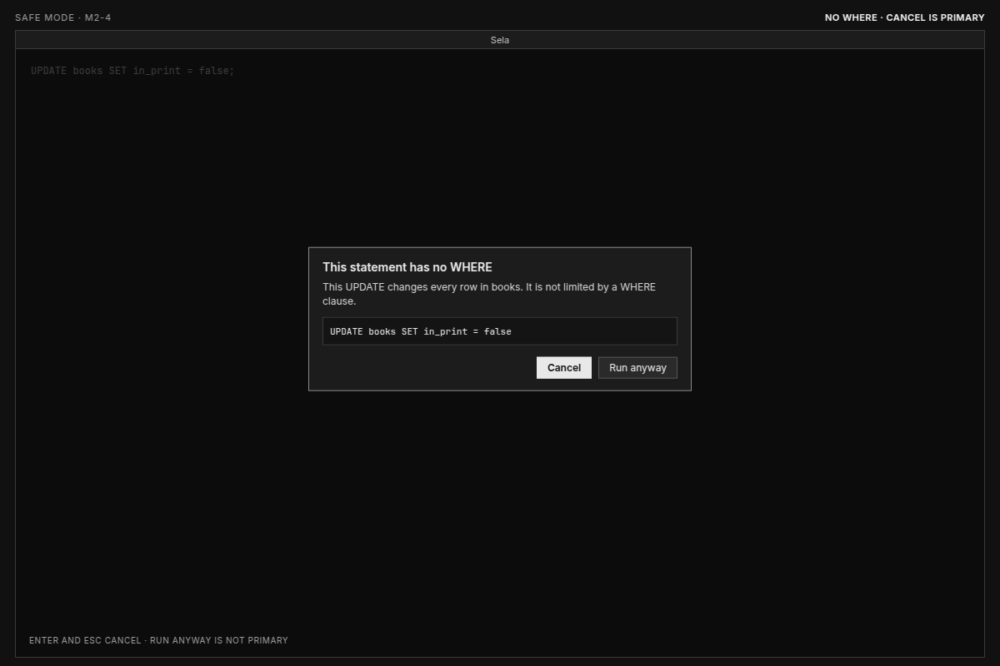

# Safe mode

M2-4, US-07. Three levels, per connection, plus a warning for `UPDATE` and `DELETE` with no `WHERE`. The levels are the roadmap and user-story names: **Off**, **Confirm writes**, **Read-only**.

Connection color, which flags production on the toolbar, is in [05-connection-dialog.md](./05-connection-dialog.md) and [01-main-window.md](./01-main-window.md#connection-color-and-groups). Grid commit goes through this file from [08-preview-commit.md](./08-preview-commit.md). Editor run goes through it from [03-sql-editor.md](./03-sql-editor.md).

## Levels

| Level | Grid | SQL editor | No-WHERE `UPDATE` / `DELETE` |
| --- | --- | --- | --- |
| Off | Commit sends immediately. | A write runs immediately. | Always asks. Cancel is the default. |
| Confirm writes | Commit asks first. | A write asks first. | The no-WHERE dialog is the only dialog. |
| Read-only | The Data pane is read-only ([07-grid-editing.md](./07-grid-editing.md)). Commit is disabled. | A write is refused. It does not run. A read runs. | Refused. There is no `Run anyway`. |

A read is a statement Sela can classify as not writing: `SELECT`, `VALUES`, `SHOW`, `EXPLAIN` without `ANALYZE`, and `WITH` when no part of it writes. Everything else is a write, including a data-modifying CTE. This is the same caution as load-more, tightened with `sqlparser` because load-more's text classifier still treats `SELECT my_func()` as safe. A function call in a `SELECT` stays a read here too. Do not promise otherwise.

If `sqlparser` cannot parse the statement, treat it as a write. Off and Confirm writes show the confirm. Read-only refuses it. The dialog says the parse failed.

`WHERE 1=1` and other tautologies count as a `WHERE`. This milestone does not prove that a predicate matches every row. The figure is the no-WHERE dialog, which is the case that does warn.

## Where it is set

On the connection, in the dialog, field `Safe mode`. Stored as `safe_mode` on the saved connection: `off`, `confirm`, `read-only`. Missing field loads as `off`. No `schema_version` bump. See [05-connection-dialog.md](./05-connection-dialog.md#color-label-and-group).

A new connection starts at Off. Choosing the Red swatch before the user touches Safe mode sets Confirm writes. Moving off Red before they touch the select sets Off again. Once they change the select, the color never overwrites it. Editing an existing connection does not change `safe_mode` when the color changes.

The Red swatch is the production tag from SPECS ("production-tagged connections default to Confirm writes"). There is no separate production checkbox.

## Where it shows

| Place | What |
| --- | --- |
| Toolbar engine line | The last segment, always: `Safe: Off`, `Safe: Confirm`, or `Safe: Read-only`. The endpoint ellipsizes before this segment does. |
| Status bar | Nothing. The toolbar line is the indicator. |
| Connection dialog | The select, with the helper in [05-connection-dialog.md](./05-connection-dialog.md#color-label-and-group). |
| Read-only grid | The strip in [07-grid-editing.md](./07-grid-editing.md#read-only) when the level is Read-only. |

The color strip on the toolbar is the environment flag (production red and the other swatches). It is not a second encoding of the safe-mode level. A red connection can still be set to Off if the user chose that.

## Confirm dialogs

Every confirm uses the quit dialog's button rules ([01-main-window.md](./01-main-window.md#quit-and-window-lifecycle)). Cancel is primary. `Enter` and `Escape` cancel. The button that writes is not primary and is not danger-styled. One dialog, never two stacked ones.

### Confirm writes

Grid Commit, or an editor run of a write that does have a `WHERE` (or is not an `UPDATE` / `DELETE`).

| Piece | Grid | Editor |
| --- | --- | --- |
| Title | `Commit {N} changes?` | `Run this write?` |
| Body | `{N} statements on {schema.table}.` Then the first statement, one line, monospace, ellipsized. | The statement, monospace, scrolling after about 8 lines. |
| Cancel | Primary. `Enter` and `Escape`. Nothing is sent. | Same. |
| Other button | `Commit` | `Run` |

A run-all batch that contains any write confirms once for the batch. Cancel runs nothing in the batch, including earlier reads. The body lists each writing statement, one line each, and says `Reads in this batch will run only if you continue.`

### No WHERE

`UPDATE` or `DELETE` with no `WHERE` clause, in the statement or inside a CTE. This asks even when the level is Off. When the level is Confirm writes, this dialog replaces the confirm-writes dialog. When the level is Read-only, do not open it; use the refusal below.

| Piece | Value |
| --- | --- |
| Title | `This statement has no WHERE` |
| Body | `This {UPDATE or DELETE} changes every row in {table}. It is not limited by a WHERE clause.` When the table name is not known, use `every row it targets`. |
| Cancel | Primary. `Enter` and `Escape`. |
| Run anyway | Not primary. |

Run-all with one no-WHERE statement uses this dialog for the batch. The body names that statement. Cancel runs nothing.

### Parse failed

| Piece | Value |
| --- | --- |
| Title | `Sela could not parse this statement` |
| Body | `It was not run. You can run it anyway, or cancel and edit it.` The statement follows, monospace. |
| Cancel | Primary. |
| Run anyway | Not primary. Hidden when the level is Read-only. |

### Read-only refusal

No dialog. The editor error banner shows `Read-only connection. The statement was not run.` Status: `Read-only · statement not run`. The grid strip covers the grid side. History Rerun of a write on a read-only connection uses this refusal instead of its own confirm.

## Editor and grid

Classify the statement at the caret, the selection, or each statement of a run-all, before anything is sent. The chords in [03-sql-editor.md](./03-sql-editor.md) do not change. A refused or cancelled run does not open a result and does not record history.

Grid Commit is classified as a write that has a `WHERE`. It never takes the no-WHERE dialog. Filter, sort, paging, Count, and Structure are reads. They do not ask.

Switching the level in the dialog does not discard pending edits already on a tab. The next Commit sees the new level. If the new level is Read-only, the strip appears and Commit disables; Discard still works.

## Keyboard

The dialogs take `Enter` and `Escape` as Cancel. There is no shortcut that confirms a write. `secondary-enter` does not mean Run anyway. The user reaches `Run`, `Run anyway`, or `Commit` with the pointer or with `Tab` then `Enter`, which is how Quit works.

## Implementation notes for engineering

- One classifier for the editor, grid commit, and history Rerun. Do not add a third copy beside `is_safe_to_rerun_for_load_more`. History Rerun of a read keeps its current path. History Rerun of a write follows this file.
- `sqlparser` dialect matches the connection engine. A parse error fails closed, as the table above.
- No-WHERE looks for the absence of a `WHERE` on `UPDATE` and `DELETE`, including inside CTEs. Do not treat `WHERE 1=1` as absent.
- The confirm is the existing alert dialog, with Cancel as the primary footer button, matching `show_quit_confirm`.

## Decisions

1. The three levels are Off, Confirm writes, and Read-only. Off still warns on `UPDATE` / `DELETE` without `WHERE`.
2. The level is stored per connection and shown on the toolbar engine line. The status bar does not repeat it.
3. Red sets the default to Confirm writes only until the user touches the Safe mode select.
4. Unparseable SQL fails closed.
5. A tautological `WHERE` is out of scope. Presence of the clause is the check.

## Open questions

1. Confirm that the Red swatch is the only production tag, and that it stops driving Safe mode once the user has touched the select.
2. Confirm that `WHERE 1=1` does not warn. The alternative is a later predicate check, which this milestone does not include.
