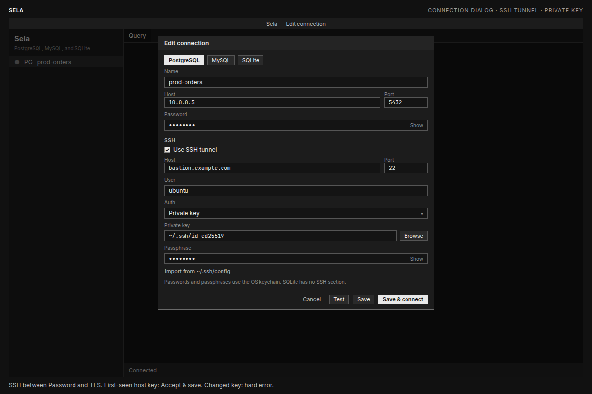

# SSH tunnel

M3-1, US-02. Extends the connection dialog in [05-connection-dialog.md](./05-connection-dialog.md). The tunnel opens first; the driver connects to `127.0.0.1:<ephemeral>` ([SPECS.md](../SPECS.md)). Closing or Disconnect closes the tunnel. No ProxyJump in v0.3.

Maps to QA [v0.3-test-plan.md](../../qa/v0.3-test-plan.md) **SSH-01…SSH-18**, **M-SSH-01**, **M-SSH-02**.



## Placement

**PostgreSQL and MySQL only.** For SQLite the SSH section is absent (not a disabled checkbox). Confirms QA assumption (**SSH-14**, **M-SSH-02**).

Insert **after Password**, **before TLS**, with a 1px top border and an 11px `SSH` label (same chrome as TLS). Width stays **560px**; the body scrolls.

## Fields

| Control | Default | Notes |
| --- | --- | --- |
| Use SSH tunnel | Off | Toggle. When Off, all SSH fields below are hidden. |
| Host | empty | Bastion hostname. Placeholder `bastion.example.com`. Required when on. |
| Port | `22` | Integer 1–65535. |
| User | empty | Required when on. Placeholder `ubuntu`. |
| Auth | `Private key` | Select: `Password`, `Private key`, `SSH agent`. |
| Password | empty | Auth = Password only. Masked + reveal. Never in JSON. |
| Private key | empty | Auth = Private key only. Path + Browse (`Choose private key`). `~` allowed. |
| Passphrase | empty | Auth = Private key only. Optional. Masked. Never in JSON. |
| Import from `~/.ssh/config` | ghost button | Host-alias picker; fills Host / Port / User / IdentityFile. |

Remote DB Host/Port stay the address as seen **from the bastion**. The local ephemeral listen address is never shown.

### Storage

```json
"ssh": {
  "enabled": true,
  "host": "bastion.example.com",
  "port": 22,
  "user": "ubuntu",
  "auth": "private-key",
  "private_key_path": "~/.ssh/id_ed25519"
}
```

`auth`: `password` | `private-key` | `agent`. Omit `ssh` when disabled. Missing → Off. No `schema_version` bump.

SSH password and key passphrase use the OS keychain (ids distinct from the DB password, e.g. `{id}:ssh-password`, `{id}:ssh-passphrase`), same memory-fallback warning as the DB password (**SSH-13**). Delete connection deletes those secrets.

Duplicate copies SSH host settings and does **not** copy SSH secrets (same as DB password).

### Import URL

Import URL fills **only** DB fields (engine, host, port, user, database, password, TLS hints). It **never** touches SSH fields. A URL with SSH parameters is **not supported** in v0.3; such query keys are ignored like any other unknown parameter ([05](./05-connection-dialog.md#import-url)).

### Import from `~/.ssh/config`

Button opens a host-alias picker (list of `Host` aliases from `~/.ssh/config`, filterable). Choosing an alias fills:

| Config | Field |
| --- | --- |
| `HostName` (or the alias if no HostName) | Host |
| `Port` (default 22) | Port |
| `User` | User |
| `IdentityFile` | Auth → Private key; Private key path |

Does not read passwords from the config. Clears on-screen SSH password/passphrase when the host changes so a prior secret is not left for a different bastion. Result line: `Filled SSH from Host {alias}.` Saved connection stores the **resolved** values, not the alias string (unless the user leaves Host as the alias and there was no HostName).

Failures: `Could not read ~/.ssh/config.` / `No Host '{alias}' in ~/.ssh/config.`

`Include` under the user’s home: follow one level. No ProxyJump / `ProxyCommand` in v0.3.

## known_hosts

### First-seen host key (**SSH-18**)

Quit-style confirm. Cancel is primary. `Enter` / `Escape` cancel.

| Piece | Value |
| --- | --- |
| Title | `Unknown SSH host key` |
| Body | `The host key for {host} is not in known_hosts.\n\nSHA256 fingerprint:\n{fingerprint}\n\nAccept and save this key to known_hosts?` |
| Cancel | Primary |
| Accept & save | Not primary |

Accept appends to `~/.ssh/known_hosts` and continues the same Test/connect. Cancel aborts; known_hosts unchanged. Fingerprint format: OpenSSH SHA256 (`SHA256:…`).

### Changed host key (**SSH-07**)

**Hard error. No override button.** Connect/Test stops before any DB handshake.

| Piece | Value |
| --- | --- |
| Title | `SSH host key changed` |
| Body | `The host key for {host} does not match known_hosts. This can mean the server was rebuilt — or that someone is intercepting the connection.\n\nExpected:\n{old_fingerprint}\n\nPresented:\n{new_fingerprint}\n\nSela will not connect. Remove or update the entry for this host in ~/.ssh/known_hosts, then try again.` |
| OK | Primary (dismiss only) |

No “Replace” / “Continue anyway”.

## Connect and Test

When the toggle is on (**SSH-16**): validate → open tunnel (auth + known_hosts) → dial DB via `127.0.0.1:<ephemeral>` (**SSH-09**). Test success: `Connected in {ms} ms (via SSH).` Closing the dialog cancels an in-flight test. TLS still applies inside the tunnel.

## Validation (when toggle on)

| Check | Message |
| --- | --- |
| Empty Host | `SSH host is required.` |
| Port not 1–65535 | `SSH port must be a number from 1 to 65535.` |
| Empty User | `SSH user is required.` |
| Private key path empty | `Private key path is required.` |
| Key path missing / directory | `Private key was not found.` |

## Error states (**SSH-08**, **SSH-11**, **SSH-15**)

Prefer `DbError::Ssh` (or equally distinct). Never log SSH secrets.

| Situation | Message |
| --- | --- |
| Unreachable / timeout | `SSH: could not reach {host}:{port}.` |
| Auth failed | `SSH: authentication failed.` |
| Key parse | `SSH: could not read the private key.` |
| Bad passphrase | `SSH: could not unlock the private key.` |
| Agent missing | `SSH: SSH agent is not available.` |
| Agent empty | `SSH: SSH agent has no identities.` |
| Changed host key | Dialog above (not a soft banner). |
| Tunnel drop mid-session | Banner `SSH tunnel closed. The connection was dropped.` Status `SSH tunnel closed.` Drop the DB session; tabs and pending edits stay; reconnect required (**SSH-11**). |
| DB error after tunnel up | Ordinary DB `DbError`, no `SSH:` prefix. |

Local ephemeral port collision: retry another port or fail with a clear SSH error; never talk to a foreign process (**SSH-12**). Failed attempt leaves no listener (**SSH-15**). Close/delete releases the tunnel (**SSH-10**).

## Acceptance criteria (→ QA IDs)

1. **SSH-01…04, SSH-17** — Password / key / key+passphrase / agent auth reach Postgres (and MySQL once) through the tunnel; `SELECT 1` works; wrong SSH auth is SSH, not DB.
2. **SSH-05** — Import from `~/.ssh/config` fills Host/Port/User/IdentityFile from a Host alias; unit covers parse.
3. **SSH-06** — Matching known_hosts allows connect.
4. **SSH-07** — Mismatched key: hard error dialog, no override, no DB handshake.
5. **SSH-08** — SSH failures ≠ DB auth/connection messages; good tunnel + bad DB password is DB auth.
6. **SSH-09…12, SSH-15** — Ephemeral local forward; close releases; drop mid-query surfaces error; port collision safe; failed attempt leaks no listener.
7. **SSH-13** — SSH secrets absent from `connections.json` / history / status; delete clears keychain.
8. **SSH-14** — Dialog shows SSH for PG/MySQL, hides for SQLite; save/reload round-trips fields; passphrase masked.
9. **SSH-16** — Test through the tunnel reports in-dialog without saving.
10. **SSH-18** — Unknown key shows SHA256 fingerprint; Accept & save writes known_hosts; Cancel does not.

## Decisions

1. Toggle label **Use SSH tunnel**. SSH hidden for SQLite.
2. Auth: Password | Private key | SSH agent. Default Private key.
3. Secrets in OS keychain like the DB password.
4. Import from `~/.ssh/config` is an explicit host picker (not always-on auto-read).
5. First-seen key: fingerprint + **Accept & save** / Cancel (TOFU write).
6. Changed key: **hard error**, fix `known_hosts` manually; no override.
7. No ProxyJump in v0.3.
8. Import URL never fills SSH; no SSH URL scheme in v0.3.

## Answers to QA (#110)

| QA question | Answer |
| --- | --- |
| 1. SSH UI and host-key policy | Fields and auth as above. Config via explicit Import picker. First-seen: Accept & save (SSH-18). Changed: reject, no override (SSH-07). |
| 2. SSH on SQLite | Hidden. Confirmed. |
| 3. Import URL + SSH | SSH fields only in the dialog. URL does not set SSH. |

## Open questions

None for product. SE crate layout (`sela-ssh` vs module) stays an SE item in #110.
