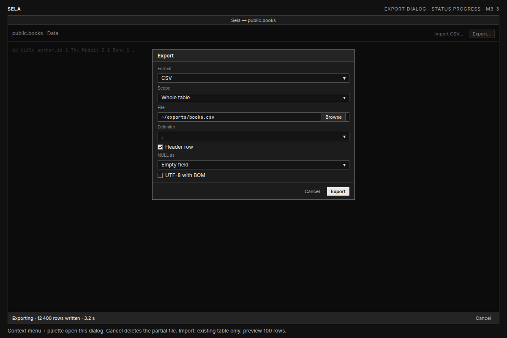

# Export and CSV import

M3-3, US-12. Export a result or a whole table as CSV, JSON, or SQL INSERT with background progress and cancel. Import CSV into an **existing** table only (create-table import is backlog). Copy of a selection remains US-14 ([copying.md](../../user/copying.md)).

Maps to QA [v0.3-test-plan.md](../../qa/v0.3-test-plan.md) **EX-01…EX-11**, **IM-01…IM-08**, **M-EX-01**. Safe mode: [09-safe-mode.md](./09-safe-mode.md).

## Entry points

| Entry | Control |
| --- | --- |
| Grid / table context menu | `Export…`, and on table Data also `Import CSV…` |
| Command palette | `Export…`, `Import CSV…` ([12-command-palette.md](./12-command-palette.md)) |

No dedicated global shortcut. **Browse** uses the platform save dialog on export and the platform open dialog on import (**M-EX-01** scores the live Fedora Wayland picker at RC; X11 optional add-on). Headless tests inject typed paths.

## Export dialog

One dialog (560px). Fields:

| Field | Values |
| --- | --- |
| Format | `CSV` / `JSON` / `SQL INSERT` |
| Scope | `Current result` — rows of the active result (table page stream or SQL result, see below). `Whole table` — only on a table Data tab; streams every row of `{schema.table}` (honours active filter/sort). Disabled on SQL-only tabs with reason `Open a table to export the whole table.` |
| File | Path field + Browse (save dialog). Injected in tests. |
| CSV options (format = CSV) | Delimiter: `,` (default) / `;` / `Tab`. Header row: on by default. NULL as: `Empty field` (default) or `Literal \N`. Encoding: UTF-8; checkbox `UTF-8 with BOM` off by default. |

Buttons: Cancel (ghost), Export (primary).

### Scope detail (**EX-01**, **EX-04**)

| Scope | Behavior |
| --- | --- |
| Current result on table Data | Not limited to the current page: stream the filtered/sorted set (same predicates as the grid). |
| Current result on SQL tab | Rows already loaded for that result. If capped, status note `Exporting the loaded result (capped at {N} rows).` Do not re-run the SQL. |
| Whole table | Stream from the server; memory bounded; not a giant `ResultWindow` (**EX-10**). |

Formats follow copy contracts where applicable (**EX-02**, **EX-03**, **EX-07**, **EX-08**, **EX-11**): JSON NULL → `null`; INSERT uses dialect quoting; decode-error / non-finite MySQL·SQLite numbers refuse INSERT with a column name in the status; CSV/JSON do not invent NULL for decode errors (use the display / copy behavior). On a **SQL result** tab, SQL INSERT uses the copy placeholder target `table` plus a trailing comment `-- replace table name` (no invented `{schema.table}`), matching clipboard copy. SQL INSERT files batch at **100 rows or ~1 MiB of statement text per statement, whichever comes first** (Decision 6).

### Progress and cancel (**EX-05**, **EX-06**)

Background job. UI stays interactive.

| Piece | Behavior |
| --- | --- |
| Status bar | `Exporting · {done} rows written · {elapsed} s` (add `/ {total}` when known). |
| Cancel | Status-bar Cancel on the progress item, or `secondary-.` / Stop when export is the active background job and no query is running. |
| On cancel | Delete only the same-directory temp file. An existing destination is left untouched. Status `Export cancelled.` |
| Success | `Exported {N} rows · {path} · {ms} ms` (temp renamed onto the destination). |
| Failure | Banner + `Export failed.` Same temp-only discard as cancel — never delete the user’s existing destination. |
| Concurrent | One export per window. Second start → `An export is already running.` |

## CSV import (existing table only)

Opens only from a table Data tab (target = that tab’s table). Create-new-table is backlog.

### Flow (**IM-01**, **IM-03**)

1. Pick file (`.csv` / All files). UTF-8 only (**IM-08**); invalid UTF-8 fails with a clear error, no fallback encoding.
2. Sheet or 560px dialog: preview **first 100 data rows**, header mapping.
3. Options: `First row is header` (default on). `Empty field = NULL` (default on). When off, empty field is `''`.
4. Mapping: CSV column → table column select, including `Skip`. Auto-match by **case-insensitive** name. Unmatched CSV columns → **Skip**. Required table columns left unmapped (NOT NULL, no default, not generated): block Import with `Map every required column or cancel.` When **First row is header** is off, the same mapping still applies (not position-only).
5. Before enabling Import (and before the Confirm-writes dialog), **pre-scan** the file once (background, cancellable when the dialog closes) to count every data row that would be imported: all rows after the header when `First row is header` is on, otherwise every row. That count is `{N}` / `{total}`. Preview and count stream via the CSV reader (no whole-file byte buffer on the UI thread). If the pre-scan fails (I/O or encoding), refuse with the parse/encoding error and do not open Confirm.
6. Import (primary) builds an in-memory `ChangePlan` then runs inserts in **one transaction**. A streaming insert sink without a full plan is backlog (**IM-07** partial).

Confirm title `Import {N} rows into {schema.table}?` uses that pre-scan `{N}` (not the 100-row preview length). Progress: `Importing · {done} / {total} rows · {elapsed} s` with the same `{total}`. Cancel → roll back; status `Import cancelled.`; table unchanged (**IM-04**, **IM-07**).

### Errors (**IM-06**)

On any row error: stop, roll back, banner `Import failed at row {n}: {message}. No rows were written.` Table unchanged. Malformed CSV before start: `Could not parse CSV: {detail}.`

### Safe mode (**IM-05**)

| Level | Behavior |
| --- | --- |
| Read-only | Import disabled. Copy: `Import is disabled in Read-only mode.` Palette row dimmed with that reason. |
| Confirm writes | Confirm before send. Title `Import {N} rows into {schema.table}?` Body names the file. Cancel primary (`Enter`/`Escape`). `Import` not primary. Quit-dialog pattern. |
| Off | Runs directly after Import. |

Pending grid edits: confirm first — `Import and discard pending edits?` / `{N} pending changes on {schema.table} will be discarded. The database is not changed until import runs.` Cancel primary. Then safe-mode gate.

### Round-trip (**IM-02**)

Export CSV (default NULL = empty field) + import (empty field = NULL) restores NULL vs `''`, quotes, and UTF-8 non-ASCII when options match.

## Acceptance criteria (→ QA IDs)

1. **EX-01…04** — CSV/JSON/INSERT export for current result and whole table; not page-limited; INSERT contracts as copy.
2. **EX-05…06** — Background progress; cancel deletes the temp file only; UI not hung.
3. **EX-07…09** — Quoting goldens; NULL ≠ `''`; UTF-8 ± optional BOM; no other encodings.
4. **EX-10…11** — Streaming bounded; INSERT refuses decode/non-finite with status.
5. **IM-01…02** — Import into existing table; CSV round-trip.
6. **IM-03** — Header auto-map case-insensitive; unmatched → Skip; required unmapped blocks start.
7. **IM-04…07** — Single transaction; cancel/error roll back; progress; safe-mode copy as above.
8. **IM-08** — UTF-8 ok; invalid UTF-8 fails clearly.

## Decisions

1. Entry: context menu + palette (no dedicated shortcut).
2. Export dialog: format, scope, path; CSV delimiter / header / NULL encoding / optional BOM.
3. Cancel/failure export deletes only the temp sibling; never the existing destination.
4. Import: existing table only; preview 100 rows; empty field = NULL option; single transaction; abort+rollback on first row error.
5. Read-only copy: `Import is disabled in Read-only mode.` Confirm: `Import {N} rows into {schema.table}?` where `{N}` is the pre-scanned data-row count for the whole file.
6. **SQL INSERT export batching:** emit at most **100 rows** or about **1 MiB** of statement text per `INSERT`, whichever comes first, so multi-value statements stay under MySQL’s default `max_allowed_packet`. Start a new statement when either limit would be exceeded.

## Answers to QA (#110)

| QA question | Answer |
| --- | --- |
| 4. Export/import UI | Context menu + palette; dialog as above. CSV NULL default empty field, optional `\N`. UTF-8 only, optional BOM. Header map case-insensitive; unmatched Skip. Import fills existing table only. Safe-mode copy as IM-05. |

## Open questions

None.
