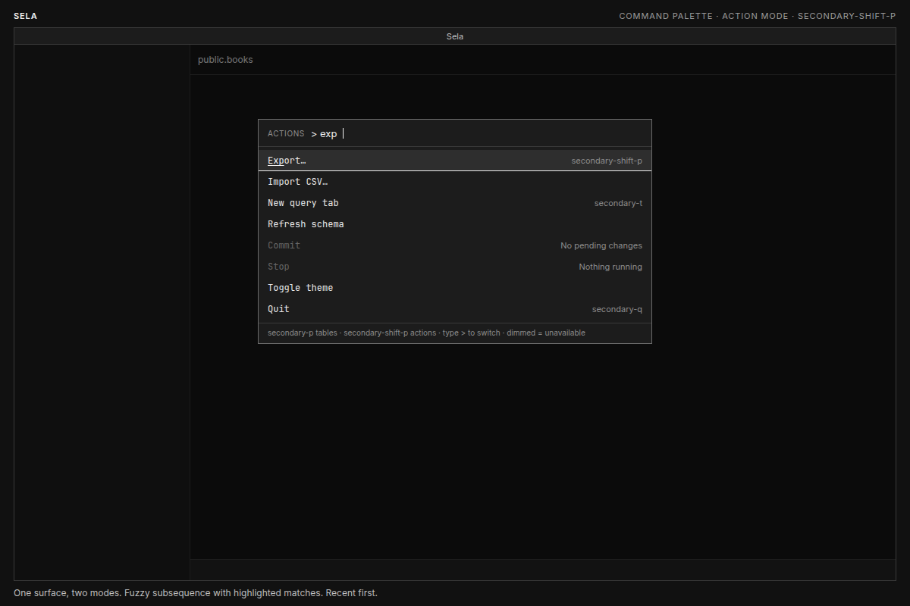

# Command palette and quick open

M3-4. One surface, two modes. Fuzzy open for tables and for actions. Maps to QA [v0.3-test-plan.md](../../qa/v0.3-test-plan.md) **PAL-01…PAL-10**, **M-PAL-01**.

## Shortcuts

| Chord | Opens |
| --- | --- |
| `secondary-p` | Table mode (quick open) |
| `secondary-shift-p` | Action mode |

**Conflict:** `secondary-shift-p` was Preview SQL in M2 ([08-preview-commit.md](./08-preview-commit.md)). Preview moves to **`secondary-shift-v`** (preView). The Preview **button** on the pending bar is unchanged. Documented in [README.md](./README.md).

`secondary-q` still quits (**PAL-08**). On macOS, `secondary-space` (Command+Space) stays Spotlight-free. On Linux and Windows, `secondary-space` is the same chord as `ctrl-space`, and that chord is bound only to `ShowSqlCompletions` in the `SqlEditor` context ([03-sql-editor.md](./03-sql-editor.md)); the palette does not bind it.

## One surface

Centered overlay (~520px wide, max ~420px tall), dense list, no cards. Search field focused on open. Escape or click outside closes; focus returns to the previous target (**PAL-07**).

| Mode | How | Empty query shows |
| --- | --- | --- |
| Tables | `secondary-p`, or clear a leading `>` | Recent tables first, then catalog |
| Actions | `secondary-shift-p`, or type `>` as the first character in table mode | Recent actions first, then the full action list |

Typing `>` at the start switches table → action mode (strip the `>` from the filter). Backspace through an empty action query while mode was entered via `>` returns to table mode. A second `secondary-p` while open in table mode **toggles closed**; a second `secondary-shift-p` while in action mode toggles closed. Either chord while the other mode is open switches mode and keeps the surface open.

## Fuzzy match (**PAL-04**)

Subsequence match on the display label (and on `schema.table` for tables). Matched characters are highlighted. Ranking:

1. Recent items for this mode (session list, cap 10).
2. Case-insensitive prefix.
3. Subsequence / fuzzy; exact name wins over a neighbour.
4. Others.

Empty query does not panic; shows the default list above.

## Table mode (**PAL-02**, **PAL-09**, **PAL-10**)

Rows: `schema.table` (or engine equivalent), muted engine/schema label on the right when needed to disambiguate (`public.books` vs `other.books`). Enter opens or focuses the Data tab (no duplicate tab), same as the sidebar. Disconnected / empty schema: one muted row `No tables — connect and refresh schema.` Not runnable (**PAL-09**).

## Action mode (**PAL-03**, **PAL-06**)

Primary actions (invoke the same code path as the menu/shortcut):

| Action | Enabled when | Dimmed reason (examples) |
| --- | --- | --- |
| New connection | Always | — |
| Connect | A saved connection is **highlighted in the sidebar tree** and that id is not the live session | `Already connected` (sidebar selection is the live session) / `Select a connection` (no sidebar highlight) |
| Disconnect | A live session exists | `Not connected` |
| New query tab | Connected | `Not connected` |
| Run query | Editor has a runnable statement and not busy | `Editor empty` / `Query running` |
| Refresh schema | Connected | `Not connected` |
| Export… | There is an exportable result or table tab | `Nothing to export` |
| Import CSV… | Table Data tab; not Read-only | `Open a table` / `Import is disabled in Read-only mode.` |
| Toggle theme | Always | — |
| Font bigger / Font smaller | Always (clamped at ends) | `Already at maximum` / `Already at minimum` when clamped |
| Toggle safe mode | Connected (live session). Cycles Off → Confirm writes → Read-only → Off | `Not connected` |
| Quit | Always | — |

### Toggle safe mode (palette)

Same rules as changing the level in the connection dialog and saving ([09-safe-mode.md](./09-safe-mode.md#editor-and-grid)):

1. Persist `safe_mode` on that connection in `connections.json` immediately.
2. Do **not** discard pending grid edits.
3. Reconnect the live session so the server-side Read-only guard (and leaving it) takes effect.
4. Toolbar `Safe: …` updates to the new level as soon as the in-memory connection value changes (before reconnect finishes). While reconnecting, use the existing reconnect status line; after reconnect, the strip / Commit enablement match the new level.

Also include, dimmed when N/A: Preview SQL (`secondary-shift-v`), Commit, Discard, Stop, Toggle filter, Toggle history — so every prior primary stays reachable (**PAL-03** minimum set).

Unavailable actions stay **visible**, **dimmed**, with the reason on the right. Enter on a dimmed row does nothing (no crash). They are not hidden.

**Connect** uses the sidebar tree highlight. **Disconnect** always targets the live session.

## Keyboard (**PAL-05**)

| Key | Behavior |
| --- | --- |
| Type | Filter |
| Up / Down | Move selection |
| Enter | Run / open selected if enabled |
| Escape | Close |
| Click outside | Close |

Focus trapped while open.

## Acceptance criteria (→ QA IDs)

1. **PAL-01** — `secondary-p` opens the surface; Escape closes.
2. **PAL-02** — Table fuzzy match; Enter opens/focuses Data tab.
3. **PAL-03** — Action list includes the table above; each invokes the real action.
4. **PAL-04** — Fuzzy subsequence + highlight; recent first; empty query safe.
5. **PAL-05** — Keyboard-only open → type → move → Enter → Escape.
6. **PAL-06** — Dimmed + reason; Enter on dimmed is a no-op.
7. **PAL-07** — Click outside closes; second `secondary-p` toggles; focus restored.
8. **PAL-08** — Does not steal `secondary-q`; does not bind `secondary-space` / `ctrl-space` (those stay `ShowSqlCompletions` in `SqlEditor` only).
9. **PAL-09** — Disconnected empty state, no hang.
10. **PAL-10** — Schema-qualified duplicates disambiguated.

## Decisions

1. One surface, two modes: `secondary-p` tables, `secondary-shift-p` actions; `>` switches to actions.
2. Preview SQL chord moves to `secondary-shift-v` so the palette can own `secondary-shift-p`.
3. Fuzzy subsequence with highlighted matches; recent first.
4. Unavailable actions dimmed with reason, not hidden, not executable.
5. Second `secondary-p` / `secondary-shift-p` toggles that mode closed.
6. Toggle safe mode cycles Off → Confirm writes → Read-only → Off; persists, reconnects, keeps pending edits, updates the toolbar immediately (same as dialog save).
7. Connect = sidebar selection; Disconnect = live session.

## Answers to QA (#110)

| QA question | Answer |
| --- | --- |
| 5. Palette vs quick open | One surface, two chords as above. Action list in the table. Dimmed+reason. Second chord toggles closed. |

## Open questions

None.
