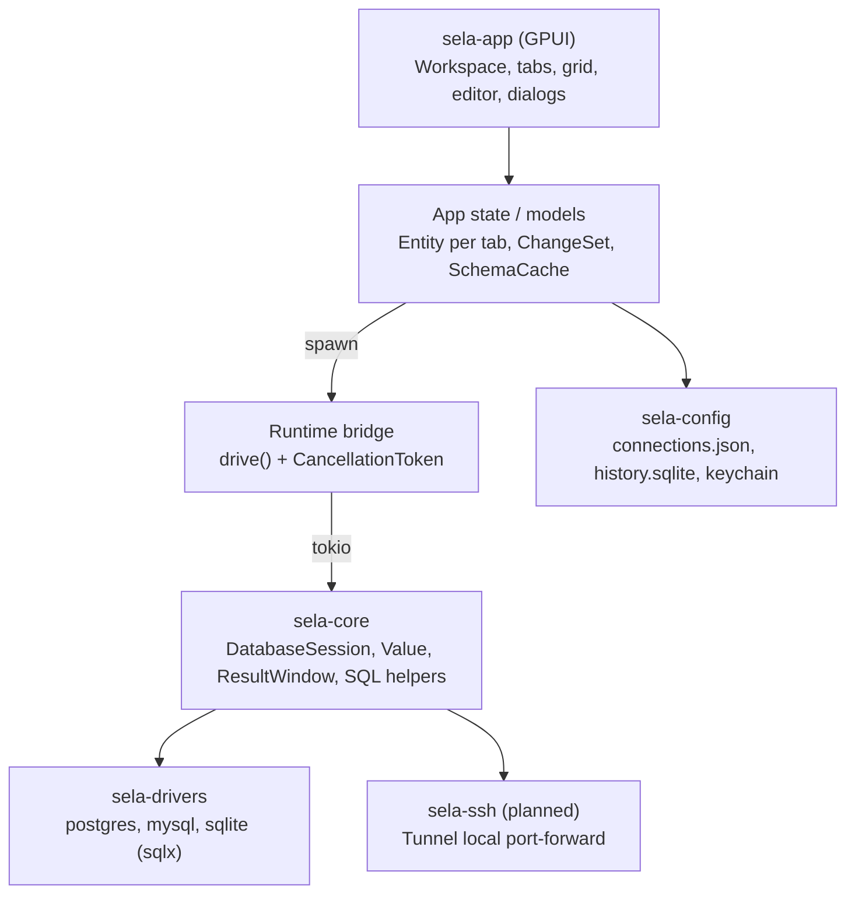

# Architecture

Condensed from [SPECS.md](../design/SPECS.md). Product intent: [PRD.md](../design/PRD.md). Roadmap: [roadmap.md](../design/roadmap.md).

**License:** GPL-3.0-or-later. **Stack:** Rust 1.85+, gpui-kit 0.10.0 (gpui-pre 0.3.12 + gpui-component), sqlx 0.9.1, tokio, keyring 3.

## Crate diagram



The UI never talks to sqlx directly. Library crates stay free of GPUI so CI can test them without a GPU.

## Layout

```text
crates/
  sela-core/     # DatabaseSession, Value, ResultWindow, SQL builder, structure, tabs
  sela-drivers/  # postgres, mysql, sqlite, stream, decode, runtime
  sela-config/   # connections.json, tabs.json, SecretStore / keyring
  sela-app/      # GPUI binary `sela`
```

## Key boundaries

| Concern | Behavior |
| --- | --- |
| Session API | `DatabaseSession` in `sela-core`; drivers implement it |
| Async bridge | Tokio via `drive()`; UI uses `cx.spawn` + request ids per tab |
| Results | Bounded `ResultWindow` (16×100); lazy Json; see [ADR 0002](../adr/0002-bounded-result-window.md) |
| Cancel | Second-connection server cancel for PG/MySQL; [ADR 0003](../adr/0003-cancel-second-connection.md) |
| Load-more | Safe re-run classifier; [ADR 0004](../adr/0004-safe-load-more.md) |
| Secrets | OS keychain; never passwords in JSON |
| Grid | Keep DataTable; [ADR 0001](../adr/0001-keep-datatable.md) |

Full API shapes, `Value`, `DbError`, config schema plans, and testing matrix: [SPECS.md](../design/SPECS.md).
